# MODELADO CONCEPTUAL (E-R EXTENDIDO) Y TRANSFORMACIÓN AL ESQUEMA RELACIONAL
## PROYECTO INTEGRADOR V — TECNM / INSTITUTO TECNOLÓGICO SUPERIOR DE MONCLOVA
### ASIGNATURA: FUNDAMENTOS DE BASE DE DATOS (FBD — AEF-1031) — CRITERIO 2.1 (20%)
**Sistema:** DERMA-ECOM (E-Commerce de Salud, Belleza y Maquillaje con Trazabilidad FEFO y Cadena de Frío)  
**Magnitud verificada:** 150 Entidades / Tablas · 14 Esquemas Lógicos · 183 Llaves Foráneas · 0 Tablas Huérfanas · 1 Componente Conexo

---

## 1. MODELO CONCEPTUAL: DIAGRAMA ENTIDAD-RELACIÓN EXTENDIDO (E-R EXTENDIDO)

El diseño conceptual de **DERMA-ECOM** se formuló aplicando la notación **Entidad-Relación Extendida (EER)** de Elmasri & Navathe, incorporando jerarquías de especialización/generalización, entidades fuertes y débiles, atributos compuestos, multivaluados y derivados, así como cardinalidades mínimas y máximas `(min, max)`.

### 1.1 Jerarquías de Especialización / Generalización (EER)

Para evitar columnas nulas masivas, redundancias y anomalías de actualización, el modelo conceptual define **cuatro jerarquías formales de especialización/generalización**:

```mermaid
flowchart TD
    subgraph J1["Jerarquía 1: Actores del Sistema (Solapada, Parcial: {o, parcial})"]
        U["USUARIO\n(id_usuario, email, password_hash, mfa)"]
        O1(("o"))
        U --- O1
        O1 --> CLI["CLIENTE\n(perfil cutáneo, RFC, CURP, direcciones)"]
        O1 --> AFI["AFILIADO_INFLUENCER\n(codigo_referido, porcentaje_comision, clabe)"]
        O1 --> OPE["OPERADOR_INTERNO (vía RBAC)\n(Admin, Dermoconsultor, WMS, Facturación, Auditor)"]
    end

    subgraph J2["Jerarquía 2: Comprobantes Fiscales SAT CFDI 4.0 (Disjunta, Total: {d, total})"]
        CFDI["COMPROBANTE_FISCAL_SAT\n(uuid_sat, fecha_timbrado, monto, estado)"]
        D2(("d"))
        CFDI === D2
        D2 --> FAC["FACTURA_CFDI (Ingreso)\n(serie_factura, folio_factura, sellos)"]
        D2 --> REP["COMPLEMENTO_PAGO (REP)\n(numero_parcialidad, saldo_insoluto)"]
        D2 --> NCR["NOTA_CREDITO (Egreso)\n(motivo_devolucion_sat, total_acreditado)"]
    end

    subgraph J3["Jerarquía 3: Instrumentos de Pago (Disjunta, Parcial: {d, parcial})"]
        PAG["INSTRUMENTO_PAGO\n(cliente, activo, auditoría)"]
        D3(("d"))
        PAG --- D3
        D3 --> TOK["METODO_PAGO_TOKENIZADO\n(token_pci_dss, ultimos_4_digitos)"]
        D3 --> BIL["BILLETERA_ELECTRONICA\n(saldo_disponible, saldo_bloqueado)"]
        D3 --> GFT["TARJETA_REGALO_GIFTCARD\n(codigo_cifrado, saldo_actual)"]
    end

    subgraph J4["Jerarquía 4: Registros de Auditoría Forense (Disjunta, Total: {d, total})"]
        AUD["EVENTO_FORENSE\n(creado_por, fecha_creacion, activo)"]
        D4(("d"))
        AUD === D4
        D4 --> BSG["BITACORA_SEGURIDAD_GLOBAL\n(firma_integridad_hash, ip, modulo)"]
        D4 --> BCD["BITACORA_CAMBIOS_DATOS\n(tipo_operacion, valores_json)"]
        D4 --> ILG["INTENTOS_LOGIN\n(resultado, ip, user_agent)"]
        D4 --> KDX["KARDEX_MOVIMIENTOS\n(saldo_anterior, saldo_resultante)"]
    end
```

### 1.2 Clasificación Formal de Atributos Especiales y Entidades Débiles

| Constructo EER | Elementos del Dominio DERMA-ECOM | Regla de Mapeo al Modelo Relacional |
| :--- | :--- | :--- |
| **Atributos Compuestos** | • `NombrePersona(nombres, primer_apellido, segundo_apellido)` • `Domicilio(calle, num_ext, num_int, colonia, cp, ciudad, estado)` • `DimensionesPaquete(alto_cm, ancho_cm, largo_cm)` • `AuditoriaSoftDelete(activo, fecha_creacion, creado_por, fecha_modificacion, modificado_por, fecha_baja, eliminado_por)` | Se descomponen en columnas atómicas independientes (cumplimiento estricto de 1FN) dentro de `clientes.clientes`, `clientes.direcciones`, `envios.paquetes_bultos` y las 150 tablas. |
| **Atributos Multivaluados** | • Roles asignados a un usuario • Condiciones dermatológicas de un cliente • Ingredientes INCI y alérgenos de un producto • Imágenes/swatches de una variante SKU • Direcciones de entrega de un cliente | Se extraen a relaciones separadas con FK a la entidad propietaria: `seguridad.usuarios_roles`, `clientes.cliente_condiciones`, `catalogo.formula_ingredientes`, `catalogo.multimedia_variantes`, `clientes.direcciones`. |
| **Atributos Derivados** | • `peso_volumetrico_kg = (alto_cm * ancho_cm * largo_cm) / 5000.0` • `tiempo_transito_horas = fecha_entrega_real - fecha_recoleccion_paqueteria` • `tasa_rechazo_qa = rechazos / inspecciones * 100` | `peso_volumetrico_kg` se materializa como columna calculada (`PERSISTED` en SQL Server / `GENERATED ALWAYS AS ... STORED` en PostgreSQL); los indicadores analíticos se calculan dinámicamente en consultas SQL. |
| **Entidades Débiles** *(dependencia de existencia)* | `ordenes_detalles`, `ordenes_impuestos`, `ordenes_descuentos`, `ordenes_splits_almacen`, `ordenes_notas_instrucciones`, `items_carrito`, `respuestas_evaluacion`, `rutinas_pasos`, `facturas_partidas`, `requisiciones_detalles`, `ordenes_compra_detalles`, `recepciones_detalles`, `transferencias_detalles`, `conteos_ciclicos_detalles`, `paquetes_bultos`, `rma_detalles`, `tickets_mensajes` (17 entidades débiles) | Cada entidad débil incorpora la FK obligatoria (`NOT NULL`) de su entidad propietaria fuerte junto con un discriminador secuencial (`numero_partida`, `numero_paso`, `codigo_bulto`) y llave subrogada `BIGINT IDENTITY` para uniformidad de integridad y auditoría. |

---

### 1.3 Diagrama E-R del Submódulo 1: Identidad, Perfil Clínico-Cutáneo, Catálogo y COFEPRIS (Tablas 001–050)

```mermaid
erDiagram
    USUARIOS ||--o{ USUARIOS_ROLES : "posee (1,N)"
    ROLES ||--o{ USUARIOS_ROLES : "asigna (0,N)"
    ROLES ||--o{ ROLES_PERMISOS : "autoriza (0,N)"
    PERMISOS ||--o{ ROLES_PERMISOS : "concede (0,N)"
    USUARIOS ||--o{ SESIONES_ACTIVAS : "mantiene (0,N)"
    USUARIOS ||--o{ HISTORIAL_PASSWORDS : "registra (0,N)"
    USUARIOS ||--o{ INTENTOS_LOGIN : "genera (0,N)"
    USUARIOS ||--o{ TOKENS_RECUPERACION : "solicita (0,N)"
    USUARIOS ||--o{ DISPOSITIVOS_CONFIANZA : "autoriza (0,N)"
    USUARIOS ||--o| CLIENTES : "especializa (0,1)"

    CLIENTES ||--o{ DIRECCIONES : "registra (1,N)"
    CLIENTES ||--o| PERFIL_CUTANEO : "define (0,1)"
    TIPOS_PIEL ||--o{ PERFIL_CUTANEO : "clasifica (0,N)"
    CLIENTES ||--o{ CLIENTE_CONDICIONES : "padece (0,N)"
    CONDICIONES_DERMATOLOGICAS ||--o{ CLIENTE_CONDICIONES : "diagnostica (0,N)"
    CLIENTES ||--o{ EVALUACIONES_DIAGNOSTICO : "responde (0,N)"
    CUESTIONARIOS_DIAGNOSTICO ||--|{ PREGUNTAS_DIAGNOSTICO : "contiene (1,N)"
    PREGUNTAS_DIAGNOSTICO ||--|{ OPCIONES_PREGUNTA : "ofrece (1,N)"
    EVALUACIONES_DIAGNOSTICO ||--|{ RESPUESTAS_EVALUACION : "detalla (1,N)"
    CLIENTES ||--o{ CONSENTIMIENTOS_PRIVACIDAD : "otorga (1,N)"
    CLIENTES ||--o{ SOLICITUDES_ARCO : "tramita (0,N)"
    CLIENTES ||--o{ METODOS_PAGO_TOKENIZADOS : "guarda (0,N)"

    MARCAS ||--o{ PRODUCTOS_MAESTROS : "fabrica (1,N)"
    LABORATORIOS_FABRICANTES ||--o{ PRODUCTOS_MAESTROS : "formula (1,N)"
    CATEGORIAS ||--|{ SUBCATEGORIAS : "agrupa (1,N)"
    SUBCATEGORIAS ||--o{ PRODUCTOS_MAESTROS : "clasifica (1,N)"
    TIPOS_APLICACION ||--o{ PRODUCTOS_MAESTROS : "define_zona (0,N)"
    CERTIFICACIONES_SANITARIAS ||--o{ PRODUCTOS_MAESTROS : "certifica (0,N)"
    PRODUCTOS_MAESTROS ||--|{ VARIANTES_SKU : "presenta (1,N)"
    PRODUCTOS_MAESTROS ||--|{ FORMULA_INGREDIENTES : "compone (1,N)"
    INGREDIENTES_INCI ||--o{ FORMULA_INGREDIENTES : "integra (0,N)"
    INGREDIENTES_INCI ||--o{ ALERGENOS_INGREDIENTE : "alerta (0,N)"
    PRODUCTOS_MAESTROS ||--o{ REGISTROS_SANITARIOS_COFEPRIS : "avala (1,N)"
    PRODUCTOS_MAESTROS ||--o{ ADVERTENCIAS_CONTRAINDICACIONES : "advierte (0,N)"
    VARIANTES_SKU ||--o{ TONOS_VARIANTE : "matiza (0,N)"
    VARIANTES_SKU ||--o{ MULTIMEDIA_VARIANTES : "ilustra (0,N)"
    VARIANTES_SKU ||--o{ HISTORIAL_PRECIOS_BASE : "registra (1,N)"
    KITS_SETS ||--|{ KITS_ITEMS : "incluye (1,N)"
    VARIANTES_SKU ||--o{ KITS_ITEMS : "pertenece (0,N)"
    CLIENTES ||--o{ RUTINAS_BELLEZA : "crea (0,N)"
    RUTINAS_BELLEZA ||--|{ RUTINAS_PASOS : "ordena (1,N)"
    RUTINAS_PASOS ||--o{ RUTINAS_PRODUCTOS : "recomienda (0,N)"
```

---

### 1.4 Diagrama E-R del Submódulo 2: Motor Comercial, Suscripciones, Pagos, CFDI 4.0 y Promociones (Tablas 051–100)

```mermaid
erDiagram
    CLIENTES ||--o{ CARRITOS : "abre (0,N)"
    CARRITOS ||--|{ ITEMS_CARRITO : "contiene (1,N)"
    CARRITOS ||--o| CARRITOS_ABANDONADOS_SEGUIMIENTO : "monitorea (0,1)"

    PLANES_SUSCRIPCION ||--o{ SUSCRIPCIONES_CLIENTE : "contrata (0,N)"
    FRECUENCIAS_SUSCRIPCION ||--o{ SUSCRIPCIONES_CLIENTE : "define_ciclo (0,N)"
    CLIENTES ||--o{ SUSCRIPCIONES_CLIENTE : "suscribe (0,N)"
    SUSCRIPCIONES_CLIENTE ||--|{ SUSCRIPCIONES_ITEMS : "incluye (1,N)"
    SUSCRIPCIONES_CLIENTE ||--o{ SUSCRIPCIONES_CALENDARIO_ENTREGAS : "programa (1,N)"
    SUSCRIPCIONES_CLIENTE ||--o{ SUSCRIPCIONES_BITACORA_ESTADOS : "registra (1,N)"

    CLIENTES ||--o{ ORDENES : "realiza (0,N)"
    ESTADOS_ORDEN ||--o{ ORDENES : "clasifica (0,N)"
    MOTIVOS_CANCELACION_ORDEN ||--o{ ORDENES : "justifica_baja (0,N)"
    ORDENES ||--|{ ORDENES_DETALLES : "desglosa (1,N)"
    ORDENES ||--o{ ORDENES_HISTORIAL_ESTADOS : "audita (1,N)"
    ORDENES ||--|{ ORDENES_SPLITS_ALMACEN : "divide (1,N)"
    ORDENES ||--o{ ORDENES_IMPUESTOS : "grava (1,N)"
    ORDENES ||--o{ ORDENES_DESCUENTOS : "aplica (0,N)"
    ORDENES ||--o{ ORDENES_NOTAS_INSTRUCCIONES : "anota (0,N)"
    AFILIADOS_INFLUENCERS ||--o{ COMISIONES_AFILIADOS : "devenga (0,N)"
    ORDENES ||--o{ COMISIONES_AFILIADOS : "origina (0,N)"

    ORDENES ||--o{ TRANSACCIONES : "cobra (1,N)"
    PROVEEDORES_PASARELA ||--o{ TRANSACCIONES : "procesa (0,N)"
    METODOS_PAGO ||--o{ TRANSACCIONES : "usa (0,N)"
    TRANSACCIONES ||--o{ INTENTOS_COBRO : "registra (1,N)"
    TRANSACCIONES ||--o{ SPLIT_MULTIPAGOS : "divide (0,N)"
    TRANSACCIONES ||--o{ REEMBOLSOS_TRANSACCION : "reembolsa (0,N)"
    TRANSACCIONES ||--o{ CONTRACARGOS_CHARGEBACKS : "disputa (0,N)"
    ORDENES ||--o| EVALUACIONES_ANTIFRAUDE : "evalua (0,1)"
    REGLAS_ANTIFRAUDE ||--o{ EVALUACIONES_ANTIFRAUDE : "detona (0,N)"
    CLIENTES ||--o| BILLETERA_ELECTRONICA : "posee (0,1)"
    BILLETERA_ELECTRONICA ||--o{ MOVIMIENTOS_BILLETERA : "registra (0,N)"
    TARJETAS_REGALO_GIFTCARDS ||--o{ REDENCIONES_GIFTCARDS : "canjea (0,N)"

    REGIMENES_SAT ||--o{ DATOS_FISCALES_CLIENTE : "tipifica (0,N)"
    USOS_CFDI ||--o{ DATOS_FISCALES_CLIENTE : "indica (0,N)"
    DATOS_FISCALES_CLIENTE ||--o{ FACTURAS_CFDI : "emite (0,N)"
    ORDENES ||--o{ FACTURAS_CFDI : "factura (0,N)"
    FACTURAS_CFDI ||--|{ FACTURAS_PARTIDAS : "conceptua (1,N)"
    FACTURAS_CFDI ||--o{ COMPLEMENTOS_PAGO : "complementa (0,N)"
    FACTURAS_CFDI ||--o{ NOTAS_CREDITO : "acredita (0,N)"
    FACTURAS_CFDI ||--o| CANCELACIONES_CFDI : "anula (0,1)"

    CAMPANIAS ||--o{ CUPONES : "lanza (0,N)"
    TIPOS_DESCUENTO ||--o{ CUPONES : "define (0,N)"
    CUPONES ||--o{ REGLAS_ELEGIBILIDAD_CUPON : "restringe (0,N)"
    CUPONES ||--o{ CUPONES_CATEGORIAS_EXCLUIDAS : "excluye (0,N)"
    CUPONES ||--o{ REDENCIONES_CUPONES : "redime (0,N)"
```

---

### 1.5 Diagrama E-R del Submódulo 3: Compras, WMS FEFO, Envíos, Postventa RMA y Auditoría Forense (Tablas 101–150)

```mermaid
erDiagram
    PROVEEDORES ||--o{ CONTACTOS_PROVEEDOR : "asigna (1,N)"
    PROVEEDORES ||--o{ PROVEEDOR_SLAS : "pacta (1,N)"
    PROVEEDORES ||--o{ PROVEEDOR_PRODUCTOS : "suministra (1,N)"
    PROVEEDORES ||--o{ ORDENES_COMPRA : "recibe (0,N)"
    ESTADOS_ORDEN_COMPRA ||--o{ ORDENES_COMPRA : "controla (0,N)"
    REQUISICIONES ||--|{ REQUISICIONES_DETALLES : "solicita (1,N)"
    ORDENES_COMPRA ||--|{ ORDENES_COMPRA_DETALLES : "detalla (1,N)"
    ORDENES_COMPRA ||--o{ RECEPCIONES_MERCANCIA : "ingresa (0,N)"
    RECEPCIONES_MERCANCIA ||--|{ RECEPCIONES_DETALLES : "registra (1,N)"
    RECEPCIONES_DETALLES ||--o| INSPECCIONES_SANITARIAS_QA : "dictamina (0,1)"

    ALMACENES_CEDIS ||--|{ ZONAS_ALMACEN : "sectorializa (1,N)"
    ZONAS_ALMACEN ||--|{ PASILLOS_UBICACIONES : "contiene (1,N)"
    ZONAS_ALMACEN ||--o{ MONITOREO_TEMPERATURA_HUMEDAD : "telemetria (0,N)"
    VARIANTES_SKU ||--o{ LOTES_FABRICACION_SANITARIA : "produce (1,N)"
    LOTES_FABRICACION_SANITARIA ||--o{ INVENTARIO_LOTES_UBICACION : "ubica (1,N)"
    PASILLOS_UBICACIONES ||--o{ INVENTARIO_LOTES_UBICACION : "aloja (0,N)"
    TIPOS_MOVIMIENTO_INVENTARIO ||--o{ KARDEX_MOVIMIENTOS : "clasifica (0,N)"
    LOTES_FABRICACION_SANITARIA ||--o{ KARDEX_MOVIMIENTOS : "traza (1,N)"
    LOTES_FABRICACION_SANITARIA ||--o{ ALERTAS_CADUCIDAD_PROXIMA : "alerta_fefo (0,N)"
    LOTES_FABRICACION_SANITARIA ||--o{ MERMAS_DESTRUCCION_SANITARIA : "baja_sanitaria (0,N)"
    ALMACENES_CEDIS ||--o{ TRANSFERENCIAS_ALMACENES : "origina_recibe (0,N)"
    TRANSFERENCIAS_ALMACENES ||--|{ TRANSFERENCIAS_DETALLES : "detalla (1,N)"
    ALMACENES_CEDIS ||--o{ CONTEOS_CICLICOS_AUDITORIA : "audita (0,N)"
    CONTEOS_CICLICOS_AUDITORIA ||--|{ CONTEOS_CICLICOS_DETALLES : "verifica (1,N)"

    ORDENES_SPLITS_ALMACEN ||--o{ DESPACHOS_ORDEN : "despacha (1,N)"
    TRANSPORTISTAS_PAQUETERIAS ||--o{ DESPACHOS_ORDEN : "transporta (0,N)"
    TIPOS_SERVICIO_ENVIO ||--o{ DESPACHOS_ORDEN : "modalidad (0,N)"
    TRANSPORTISTAS_PAQUETERIAS ||--o{ PUNTOS_RECOLECCION_PICKUP : "opera_locker (0,N)"
    ALMACENES_CEDIS ||--o{ PUNTOS_RECOLECCION_PICKUP : "abastece (0,N)"
    DESPACHOS_ORDEN ||--|{ PAQUETES_BULTOS : "embala (1,N)"
    PAQUETES_BULTOS ||--|{ PAQUETES_CONTENIDO_LOTES : "traza_lote (1,N)"
    PAQUETES_BULTOS ||--o| GUIAS_RASTREO : "etiqueta (0,1)"
    GUIAS_RASTREO ||--o{ EVENTOS_TRACKING_BITACORA : "reporta (0,N)"
    DESPACHOS_ORDEN ||--o{ INTENTOS_ENTREGA_FALLIDOS : "registra (0,N)"
    DESPACHOS_ORDEN ||--o{ INCIDENCIAS_LOGISTICAS : "incide (0,N)"
    DESPACHOS_ORDEN ||--o| SEGUROS_MERCANCIA : "asegura (0,1)"

    ORDENES ||--o{ SOLICITUDES_RMA : "devuelve (0,N)"
    MOTIVOS_DEVOLUCION_RMA ||--o{ SOLICITUDES_RMA : "motiva (0,N)"
    SOLICITUDES_RMA ||--|{ RMA_DETALLES : "reclama (1,N)"
    RMA_DETALLES ||--o| INSPECCION_SANITARIA_RETORNO : "dictamina_higiene (0,1)"
    CLIENTES ||--o{ TICKETS_SOPORTE : "abre (0,N)"
    TICKETS_SOPORTE ||--|{ TICKETS_MENSAJES : "conversa (1,N)"
    CLIENTES ||--o{ REPORTES_FARMACOVIGILANCIA : "notifica_ram (0,N)"

    TIPOS_EVENTO_SISTEMA ||--o{ BITACORA_SEGURIDAD_GLOBAL : "categoriza (0,N)"
    USUARIOS ||--o{ BITACORA_SEGURIDAD_GLOBAL : "ejecuta (0,N)"
    USUARIOS ||--o{ BITACORA_CAMBIOS_DATOS : "modifica (0,N)"
    USUARIOS ||--o{ PARAMETROS_CONFIGURACION : "administra (0,N)"
    USUARIOS ||--o{ NOTIFICACIONES_PUSH_EMAIL : "recibe (0,N)"
```

---

## 2. TRANSFORMACIÓN FORMAL DEL MODELO E-R EXTENDIDO AL ESQUEMA RELACIONAL

Se aplicó sistemáticamente el **Algoritmo de Transformación EER-a-Relacional de 8 Pasos** (Elmasri & Navathe, 7ª ed.):

| Paso | Regla de Transformación Aplicada | Aplicación en DERMA-ECOM | Evidencia Física en DDL |
| :---: | :--- | :--- | :--- |
| **Paso 1** | **Entidades Fuertes:** Cada entidad regular se transforma en una relación con clave primaria subrogada `BIGINT IDENTITY` + llave natural `UNIQUE`. | 115 entidades fuertes (ej. `seguridad.usuarios`, `catalogo.productos_maestros`, `ventas.ordenes`, `wms.almacenes_cedis`). | 150 `PRIMARY KEY` + llaves candidatas `UNIQUE` (`email`, `sku_codigo`, `folio_orden`, `uuid_sat_fiscal`). |
| **Paso 2** | **Entidades Débiles:** Se incluye como FK `NOT NULL` la PK de la entidad propietaria fuerte más el discriminador propio. | 17 entidades débiles (ej. `ventas.ordenes_detalles(orden, numero_partida)`, `fiscal.facturas_partidas`, `postventa.rma_detalles`). | Integridad referencial estricta (`ON DELETE NO ACTION` por política *Soft Delete*). |
| **Paso 3** | **Relaciones binarias 1:1:** Se propaga la FK en la entidad con participación total y se restringe con `UNIQUE`. | `clientes.clientes(usuario UNIQUE)`, `clientes.perfil_cutaneo(cliente UNIQUE)`, `pagos.evaluaciones_antifraude(orden UNIQUE)`, `pagos.billetera_electronica(cliente UNIQUE)`. | Restricciones `UQ_*` sobre la FK para garantizar multiplicidad máxima `1:1`. |
| **Paso 4** | **Relaciones binarias 1:N:** Se propaga la PK del lado `1` como FK en el lado `N`. | 145+ relaciones `1:N` (ej. `productos_maestros.certificacion_sanitaria → certificaciones_sanitarias`, `ordenes.motivo_cancelacion → motivos_cancelacion_orden`, `evaluaciones_antifraude.regla_antifraude → reglas_antifraude`). | 183 llaves foráneas activas en ambos motores, ordenadas sin dependencias hacia adelante. |
| **Paso 5** | **Relaciones N:M:** Se crea una relación puente con ambas FKs y restricción `UNIQUE(fk_1, fk_2)`. | 14 tablas intermedias $N:M$: `roles_permisos`, `usuarios_roles`, `cliente_condiciones`, `formula_ingredientes`, `kits_items`, `productos_relacionados`, `rutinas_productos`, `suscripciones_items`, `cupones_categorias_excluidas`, `proveedor_productos`, `paquetes_contenido_lotes`, etc. | Restricciones `UNIQUE` compuestas para impedir duplicados en relaciones asociativas. |
| **Paso 6** | **Atributos Multivaluados:** Se separan en tablas dependientes con FK hacia la entidad origen. | `catalogo.alergenos_ingrediente`, `catalogo.multimedia_variantes`, `clientes.direcciones`, `seguridad.historial_passwords`. | Eliminación total de listas delimitadas por comas (cumplimiento 1FN). |
| **Paso 7** | **Relaciones N-arias:** Se modelan mediante entidades asociativas con 3 o más FKs. | `wms.inventario_lotes_ubicacion` (Lote + Ubicación), `wms.kardex_movimientos` (Lote + Ubicación + TipoMovimiento), `promos.redenciones_cupones` (Cupón + Cliente + Orden), `postventa.reportes_farmacovigilancia` (Cliente + Producto + Lote). | Integridad multi-entidad garantizada por llaves foráneas compuestas. |
| **Paso 8** | **Especialización / Generalización (Estrategia 8A — Superclase + Subclases):** La superclase almacena atributos comunes y cada subclase hereda la identidad mediante FK `UNIQUE`. | `seguridad.usuarios` → `clientes.clientes` / `ventas.afiliados_influencers`; comprobantes SAT (`facturas_cfdi`, `complementos_pago`, `notas_credito`); bitácoras forenses vinculadas a `seguridad.usuarios`. | Cero columnas espurias nulas y cumplimiento simultáneo de BCNF. |

---

### 2.1 Reglas de Integridad Garantizadas en el Esquema Relacional

1. **Integridad de Entidad:** El 100% de las 150 tablas declara una llave primaria `NOT NULL` autoincrementable (`BIGINT IDENTITY(1,1)` en SQL Server / `BIGINT GENERATED ALWAYS AS IDENTITY` en PostgreSQL).
2. **Integridad Referencial Activa (0 Tablas Huérfanas):** Se verificaron **183 restricciones `FOREIGN KEY`** formando **1 único componente conexo** que abarca la totalidad de las 150 tablas (verificado en vivo en `sys.foreign_keys` de SQL Server 2022 y mediante análisis de grafo en el DDL de PostgreSQL).
3. **Integridad de Dominio:** **87 restricciones `CHECK`** validan rangos numéricos (`nivel_jerarquico BETWEEN 1 AND 10`, `total_neto > 0`, `factor_proteccion_solar_fps BETWEEN 0 AND 100`), catálogos enumerados (`estado_cfdi`, `tipo_operacion`, `dictamen_qa`, `nivel_riesgo`) y reglas fiscales/sanitarias.
4. **Integridad de Unicidad (Llaves Candidatas):** Restricciones `UNIQUE` sobre identificadores de negocio (`email`, `uuid_usuario`, `sku_codigo`, `codigo_barras_ean13`, `folio_orden`, `uuid_sat_fiscal`, `codigo_cupon`, `codigo_locker`).
5. **Integridad de Auditoría Forense (*Soft Delete*):** Las 150 tablas incluyen el bloque inmutable de 7 columnas (`activo`, `fecha_creacion`, `creado_por`, `fecha_modificacion`, `modificado_por`, `fecha_baja`, `eliminado_por`) con `ON DELETE NO ACTION` para impedir la destrucción física de evidencia fiscal (CFF) y sanitaria (COFEPRIS).
