# MODELADO CONCEPTUAL (E-R EXTENDIDO) Y TRANSFORMACIÓN AL ESQUEMA RELACIONAL
## PROYECTO INTEGRADOR V — TECNM / INSTITUTO TECNOLÓGICO SUPERIOR DE MONCLOVA
### ASIGNATURA: FUNDAMENTOS DE BASE DE DATOS (FBD — AEF-1031) — CRITERIO 2.1 (20%)
**Sistema:** DERMA-ECOM (E-Commerce de Salud, Belleza y Maquillaje con Trazabilidad FEFO y Cadena de Frío)  
**Magnitud verificada:** 150 Entidades / Tablas · 14 Esquemas Lógicos · 183 Llaves Foráneas · 0 Tablas Huérfanas · 1 Componente Conexo

---

## 1. MODELO CONCEPTUAL: DIAGRAMA ENTIDAD-RELACIÓN EXTENDIDO (E-R EXTENDIDO)

El diseño conceptual de **DERMA-ECOM** se formuló aplicando la notación **Entidad-Relación Extendida (EER)** de Elmasri & Navathe, incorporando jerarquías de especialización/generalización, entidades fuertes y débiles, atributos compuestos, multivaluados y derivados, así como cardinalidades mínimas y máximas `(min, max)`.

> [!IMPORTANT]
> **Acceso a los Diagramas Visuales Globales (Separación rigurosa Conceptual Chen vs. Relacional Crow's Foot):**
> 1. **Modelo Conceptual — Diagrama E-R Extendido (Notación clásica Chen / Elmasri & Navathe):**
>    - Editable `.drawio`: `05_diagrama_EER_conceptual_CHEN_elmasri.drawio`
>    - Visor Interactivo HTML/SVG (con leyenda y exportación SVG): `06_visor_interactivo_EER_CHEN_elmasri.html`  
>    *(Rectángulos = Entidades fuertes · Rectángulos dobles = Entidades débiles · Rombos / Rombos dobles = Relaciones y Relaciones identificadoras · Óvalos subrayados/compuestos/dobles/punteados = Claves, Compuestos, Multivaluados y Derivados · Círculos `d`/`o` y líneas simples/dobles = Jerarquías EER).*
> 2. **Modelo Lógico — Esquema Relacional Global (Notación Crow's Foot — 150 Tablas y 183 FKs):**
>    - Editable `.drawio`: `03_diagrama_ER_relacional_GLOBAL_150_tablas.drawio`
>    - Visor Interactivo HTML/SVG (buscador, filtros por submódulo/esquema, inspector de columnas y exportación SVG): `04_visor_interactivo_ER_GLOBAL_150_tablas.html`

### 1.0 Vista Global de Interconexión entre los 14 Esquemas y 3 Submódulos (150 Tablas · 183 FKs · 1 Componente Conexo)

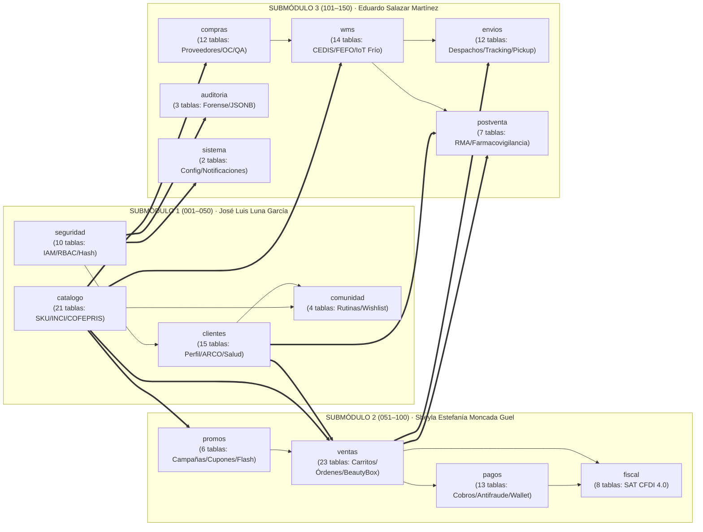

### 1.1 Jerarquías de Especialización / Generalización (EER)

Para evitar columnas nulas masivas, redundancias y anomalías de actualización, el modelo conceptual define **cuatro jerarquías formales de especialización/generalización**:

```mermaid
flowchart TD
    subgraph J1["Jerarquía 1: Actores del Sistema (Solapada, Parcial: {o, parcial})"]
        U["USUARIO\n(ID, email, password_hash, mfa)"]
        O1(("o"))
        U --- O1
        O1 --> CLI["CLIENTE\n(perfil cutáneo, RFC, CURP, direcciones)"]
        O1 --> AFI["AFILIADO_INFLUENCER\n(codigo_referido, porcentaje_comision, clabe)"]
        O1 --> OPE["OPERADOR_INTERNO (vía RBAC)\n(Admin, Dermoconsultor, WMS, Facturación, Auditor)"]
    end

    subgraph J2["Jerarquía 2: Comprobantes Fiscales SAT CFDI 4.0 (Disjunta, Total: {d, total})"]
        CFDI["COMPROBANTE_FISCAL_SAT\n(uuid_sat, fecha_timbrado, monto, estado)"]
        D2(("d"))
        CFDI === D2
        D2 --> FAC["FACTURA_CFDI (Ingreso)\n(serie_factura, folio_factura, sellos)"]
        D2 --> REP["COMPLEMENTO_PAGO (REP)\n(numero_parcialidad, saldo_insoluto)"]
        D2 --> NCR["NOTA_CREDITO (Egreso)\n(motivo_devolucion_sat, total_acreditado)"]
    end

    subgraph J3["Jerarquía 3: Instrumentos de Pago (Disjunta, Parcial: {d, parcial})"]
        PAG["INSTRUMENTO_PAGO\n(cliente, activo, auditoría)"]
        D3(("d"))
        PAG --- D3
        D3 --> TOK["METODO_PAGO_TOKENIZADO\n(token_pci_dss, ultimos_4_digitos)"]
        D3 --> BIL["BILLETERA_ELECTRONICA\n(saldo_disponible, saldo_bloqueado)"]
        D3 --> GFT["TARJETA_REGALO_GIFTCARD\n(codigo_cifrado, saldo_actual)"]
    end

    subgraph J4["Jerarquía 4: Registros de Auditoría Forense (Disjunta, Total: {d, total})"]
        AUD["EVENTO_FORENSE\n(creado_por, fecha_creacion, activo)"]
        D4(("d"))
        AUD === D4
        D4 --> BSG["BITACORA_SEGURIDAD_GLOBAL\n(firma_integridad_hash, ip, modulo)"]
        D4 --> BCD["BITACORA_CAMBIOS_DATOS\n(tipo_operacion, valores_json)"]
        D4 --> ILG["INTENTOS_LOGIN\n(resultado, ip, user_agent)"]
        D4 --> KDX["KARDEX_MOVIMIENTOS\n(saldo_anterior, saldo_resultante)"]
    end
```

### 1.2 Clasificación Formal de Atributos Especiales y Entidades Débiles

| Constructo EER | Elementos del Dominio DERMA-ECOM | Regla de Mapeo al Modelo Relacional |
| :--- | :--- | :--- |
| **Atributos Compuestos** | • `NombrePersona(nombres, primer_apellido, segundo_apellido)` • `Domicilio(calle, num_ext, num_int, colonia, cp, ciudad, estado)` • `DimensionesPaquete(alto_cm, ancho_cm, largo_cm)` • `AuditoriaSoftDelete(activo, fecha_creacion, creado_por, fecha_modificacion, modificado_por, fecha_baja, eliminado_por)` | Se descomponen en columnas atómicas independientes (cumplimiento estricto de 1FN) dentro de `clientes.clientes`, `clientes.direcciones`, `envios.paquetes_bultos` y las 150 tablas. |
| **Atributos Multivaluados** | • Roles asignados a un usuario • Condiciones dermatológicas de un cliente • Ingredientes INCI y alérgenos de un producto • Imágenes/swatches de una variante SKU • Direcciones de entrega de un cliente | Se extraen a relaciones separadas con FK a la entidad propietaria: `seguridad.usuarios_roles`, `clientes.cliente_condiciones`, `catalogo.formula_ingredientes`, `catalogo.multimedia_variantes`, `clientes.direcciones`. |
| **Atributos Derivados** | • `peso_volumetrico_kg = (alto_cm * ancho_cm * largo_cm) / 5000.0` • `tiempo_transito_horas = fecha_entrega_real - fecha_recoleccion_paqueteria` • `tasa_rechazo_qa = rechazos / inspecciones * 100` | `peso_volumetrico_kg` se materializa como columna calculada (`PERSISTED` en SQL Server / `GENERATED ALWAYS AS ... STORED` en PostgreSQL); los indicadores analíticos se calculan dinámicamente en consultas SQL. |
| **Entidades Débiles** *(dependencia de existencia)* | `ordenes_detalles`, `ordenes_impuestos`, `ordenes_descuentos`, `ordenes_splits_almacen`, `ordenes_notas_instrucciones`, `items_carrito`, `respuestas_evaluacion`, `rutinas_pasos`, `facturas_partidas`, `requisiciones_detalles`, `ordenes_compra_detalles`, `recepciones_detalles`, `transferencias_detalles`, `conteos_ciclicos_detalles`, `paquetes_bultos`, `rma_detalles`, `tickets_mensajes` (17 entidades débiles) | Cada entidad débil incorpora la FK obligatoria (`NOT NULL`) de su entidad propietaria fuerte junto con un discriminador secuencial (`numero_partida`, `numero_paso`, `codigo_bulto`) y llave subrogada `BIGINT IDENTITY` para uniformidad de integridad y auditoría. |

---

### 1.3 Submódulo 1: Identidad, Perfil Clínico-Cutáneo, Catálogo y COFEPRIS (Tablas 001–050)

#### 1.3.1 Diagrama Entidad-Relación (E-R) — Submódulo 1 (Tablas 001–050)

```mermaid
erDiagram
    USUARIOS ||--o{ USUARIOS_ROLES : "posee (1,N)"
    ROLES ||--o{ USUARIOS_ROLES : "asigna (0,N)"
    ROLES ||--o{ ROLES_PERMISOS : "autoriza (0,N)"
    PERMISOS ||--o{ ROLES_PERMISOS : "concede (0,N)"
    USUARIOS ||--o{ SESIONES_ACTIVAS : "mantiene (0,N)"
    USUARIOS ||--o{ HISTORIAL_PASSWORDS : "registra (0,N)"
    USUARIOS ||--o{ INTENTOS_LOGIN : "genera (0,N)"
    USUARIOS ||--o{ TOKENS_RECUPERACION : "solicita (0,N)"
    USUARIOS ||--o{ DISPOSITIVOS_CONFIANZA : "autoriza (0,N)"
    USUARIOS ||--o| CLIENTES : "especializa (0,1)"

    CLIENTES ||--o{ DIRECCIONES : "registra (1,N)"
    CLIENTES ||--o| PERFIL_CUTANEO : "define (0,1)"
    TIPOS_PIEL ||--o{ PERFIL_CUTANEO : "clasifica (0,N)"
    CLIENTES ||--o{ CLIENTE_CONDICIONES : "padece (0,N)"
    CONDICIONES_DERMATOLOGICAS ||--o{ CLIENTE_CONDICIONES : "diagnostica (0,N)"
    CLIENTES ||--o{ EVALUACIONES_DIAGNOSTICO : "responde (0,N)"
    CUESTIONARIOS_DIAGNOSTICO ||--|{ PREGUNTAS_DIAGNOSTICO : "contiene (1,N)"
    PREGUNTAS_DIAGNOSTICO ||--|{ OPCIONES_PREGUNTA : "ofrece (1,N)"
    EVALUACIONES_DIAGNOSTICO ||--|{ RESPUESTAS_EVALUACION : "detalla (1,N)"
    CLIENTES ||--o{ CONSENTIMIENTOS_PRIVACIDAD : "otorga (1,N)"
    CLIENTES ||--o{ SOLICITUDES_ARCO : "tramita (0,N)"
    CLIENTES ||--o| PREFERENCIAS_COMUNICACION : "configura (0,1)"
    CLIENTES ||--o{ METODOS_PAGO_TOKENIZADOS : "guarda (0,N)"

    MARCAS ||--o{ PRODUCTOS_MAESTROS : "fabrica (1,N)"
    LABORATORIOS_FABRICANTES ||--o{ PRODUCTOS_MAESTROS : "formula (1,N)"
    CATEGORIAS ||--|{ SUBCATEGORIAS : "agrupa (1,N)"
    SUBCATEGORIAS ||--o{ PRODUCTOS_MAESTROS : "clasifica (1,N)"
    TIPOS_APLICACION ||--o{ PRODUCTOS_MAESTROS : "define_zona (0,N)"
    CERTIFICACIONES_SANITARIAS ||--o{ PRODUCTOS_MAESTROS : "certifica (0,N)"
    PRODUCTOS_MAESTROS ||--|{ VARIANTES_SKU : "presenta (1,N)"
    PRODUCTOS_MAESTROS ||--o{ PRODUCTOS_RELACIONADOS : "vincula_cross_sell (0,N)"
    PRODUCTOS_MAESTROS ||--|{ FORMULA_INGREDIENTES : "compone (1,N)"
    INGREDIENTES_INCI ||--o{ FORMULA_INGREDIENTES : "integra (0,N)"
    INGREDIENTES_INCI ||--o{ ALERGENOS_INGREDIENTE : "alerta (0,N)"
    PRODUCTOS_MAESTROS ||--o{ REGISTROS_SANITARIOS_COFEPRIS : "avala (1,N)"
    PRODUCTOS_MAESTROS ||--o{ ADVERTENCIAS_CONTRAINDICACIONES : "advierte (0,N)"
    VARIANTES_SKU ||--o{ TONOS_VARIANTE : "matiza (0,N)"
    SUBTONOS_MAQUILLAJE ||--o{ TONOS_VARIANTE : "define_subtono (0,N)"
    ACABADOS_MAQUILLAJE ||--o{ TONOS_VARIANTE : "define_acabado (0,N)"
    VARIANTES_SKU ||--o{ MULTIMEDIA_VARIANTES : "ilustra (0,N)"
    VARIANTES_SKU ||--o{ HISTORIAL_PRECIOS_BASE : "registra (1,N)"
    KITS_SETS ||--|{ KITS_ITEMS : "incluye (1,N)"
    VARIANTES_SKU ||--o{ KITS_ITEMS : "pertenece (0,N)"
    CLIENTES ||--o{ RUTINAS_BELLEZA : "crea (0,N)"
    RUTINAS_BELLEZA ||--|{ RUTINAS_PASOS : "ordena (1,N)"
    RUTINAS_PASOS ||--o{ RUTINAS_PRODUCTOS : "recomienda (0,N)"
    CLIENTES ||--o{ LISTAS_DESEOS : "guarda_favorito (0,N)"
    VARIANTES_SKU ||--o{ LISTAS_DESEOS : "deseado_en (0,N)"
```

#### 1.3.2 Modelo Relacional (Esquema Lógico con PK, FK, UK y Tipos de Datos) — Submódulo 1 (Tablas 001–050)

> [!TIP]
> **Modelo Relacional del Submódulo 1 (José Luis Luna García):** exactamente **50 tablas relacionales propias** (Tablas 001–050) y **53 llaves foráneas** reales sincronizadas al 100% con el DDL. Para garantizar nitidez visual y renderizado inmediato en visores Markdown, el diagrama relacional se presenta en **2 bloques por esquemas SQL** (~23–27 tablas por diagrama, mostrando `PK`, `FK`, `UK` y tipos de datos), seguido de la tabla completa del **Esquema Relacional Formal** con el 100% de sus columnas.

**Bloque 1A — Esquemas `seguridad` y `clientes` (Tablas 001–025)** (25 tablas propias · 26 FKs)

```mermaid
erDiagram
    seguridad__roles {
        BIGINT ID PK
        NVARCHAR_30 codigo_rol UK
        NVARCHAR_80 nombre_rol
    }
    seguridad__permisos {
        BIGINT ID PK
        NVARCHAR_60 clave_permiso UK
        NVARCHAR_50 modulo_sistema
    }
    seguridad__roles_permisos {
        BIGINT ID PK
        BIGINT ID_rol FK
        BIGINT ID_permiso FK
    }
    seguridad__usuarios {
        BIGINT ID PK
        UUID uuid_usuario UK
        NVARCHAR_150 email UK
    }
    seguridad__usuarios_roles {
        BIGINT ID PK
        BIGINT ID_usuario FK
        BIGINT ID_rol FK
    }
    seguridad__sesiones_activas {
        BIGINT ID PK
        BIGINT ID_usuario FK
        NVARCHAR_128 token_sesion_hash UK
    }
    seguridad__historial_passwords {
        BIGINT ID PK
        BIGINT ID_usuario FK
        NVARCHAR_255 password_hash
    }
    seguridad__intentos_login {
        BIGINT ID PK
        BIGINT ID_usuario FK
        NVARCHAR_150 email_ingresado
    }
    seguridad__tokens_recuperacion {
        BIGINT ID PK
        BIGINT ID_usuario FK
        NVARCHAR_128 token_hash UK
    }
    seguridad__dispositivos_confianza {
        BIGINT ID PK
        BIGINT ID_usuario FK
        NVARCHAR_128 fingerprint_dispositivo UK
    }
    clientes__tipos_piel {
        BIGINT ID PK
        NVARCHAR_20 codigo_piel UK
        NVARCHAR_50 nombre
    }
    clientes__condiciones_dermatologicas {
        BIGINT ID PK
        NVARCHAR_30 codigo_condicion UK
        NVARCHAR_80 nombre_condicion
    }
    clientes__clientes {
        BIGINT ID PK
        BIGINT ID_usuario FK
        NVARCHAR_80 nombres
    }
    clientes__direcciones {
        BIGINT ID PK
        BIGINT ID_cliente FK
        NVARCHAR_50 alias_direccion
    }
    clientes__perfil_cutaneo {
        BIGINT ID PK
        BIGINT ID_cliente FK
        BIGINT ID_tipo_piel FK
    }
    clientes__cliente_condiciones {
        BIGINT ID PK
        BIGINT ID_cliente FK
        BIGINT ID_condicion_dermatologica FK
    }
    clientes__cuestionarios_diagnostico {
        BIGINT ID PK
        NVARCHAR_30 codigo_cuestionario UK
        NVARCHAR_120 titulo
    }
    clientes__preguntas_diagnostico {
        BIGINT ID PK
        BIGINT ID_cuestionario FK
        INT numero_orden UK
    }
    clientes__opciones_pregunta {
        BIGINT ID PK
        BIGINT ID_pregunta FK
        NVARCHAR_20 clave_opcion UK
    }
    clientes__evaluaciones_diagnostico {
        BIGINT ID PK
        BIGINT ID_cliente FK
        BIGINT ID_cuestionario FK
    }
    clientes__respuestas_evaluacion {
        BIGINT ID PK
        BIGINT ID_evaluacion FK
        BIGINT ID_pregunta FK
        BIGINT ID_opcion_seleccionada FK
    }
    clientes__consentimientos_privacidad {
        BIGINT ID PK
        BIGINT ID_cliente FK
        NVARCHAR_20 version_aviso_privacidad
    }
    clientes__solicitudes_arco {
        BIGINT ID PK
        NVARCHAR_35 folio_solicitud UK
        BIGINT ID_cliente FK
    }
    clientes__preferencias_comunicacion {
        BIGINT ID PK
        BIGINT ID_cliente FK
        BIT canal_email
    }
    clientes__metodos_pago_tokenizados {
        BIGINT ID PK
        BIGINT ID_cliente FK
        NVARCHAR_120 token_tarjeta_pasarela UK
    }
    seguridad__permisos ||--o{ seguridad__roles_permisos : "FK: id_permiso"
    seguridad__roles ||--o{ seguridad__roles_permisos : "FK: id_rol"
    seguridad__roles ||--o{ seguridad__usuarios_roles : "FK: id_rol"
    seguridad__usuarios ||--o{ seguridad__usuarios_roles : "FK: id_usuario"
    seguridad__usuarios ||--o{ seguridad__sesiones_activas : "FK: id_usuario"
    seguridad__usuarios ||--o{ seguridad__historial_passwords : "FK: id_usuario"
    seguridad__usuarios |o--o{ seguridad__intentos_login : "FK: id_usuario"
    seguridad__usuarios ||--o{ seguridad__tokens_recuperacion : "FK: id_usuario"
    seguridad__usuarios ||--o{ seguridad__dispositivos_confianza : "FK: id_usuario"
    seguridad__usuarios ||--o| clientes__clientes : "FK,UQ: id_usuario"
    clientes__clientes ||--o{ clientes__direcciones : "FK: id_cliente"
    clientes__clientes ||--o| clientes__perfil_cutaneo : "FK,UQ: id_cliente"
    clientes__tipos_piel ||--o{ clientes__perfil_cutaneo : "FK: id_tipo_piel"
    clientes__clientes ||--o{ clientes__cliente_condiciones : "FK: id_cliente"
    clientes__condiciones_dermatologicas ||--o{ clientes__cliente_condiciones : "FK: id_condicion_dermatologica"
    clientes__cuestionarios_diagnostico ||--o{ clientes__preguntas_diagnostico : "FK: id_cuestionario"
    clientes__preguntas_diagnostico ||--o{ clientes__opciones_pregunta : "FK: id_pregunta"
    clientes__clientes ||--o{ clientes__evaluaciones_diagnostico : "FK: id_cliente"
    clientes__cuestionarios_diagnostico ||--o{ clientes__evaluaciones_diagnostico : "FK: id_cuestionario"
    clientes__evaluaciones_diagnostico ||--o{ clientes__respuestas_evaluacion : "FK: id_evaluacion"
    clientes__opciones_pregunta ||--o{ clientes__respuestas_evaluacion : "FK: id_opcion_seleccionada"
    clientes__preguntas_diagnostico ||--o{ clientes__respuestas_evaluacion : "FK: id_pregunta"
    clientes__clientes ||--o{ clientes__consentimientos_privacidad : "FK: id_cliente"
    clientes__clientes ||--o{ clientes__solicitudes_arco : "FK: id_cliente"
    clientes__clientes ||--o| clientes__preferencias_comunicacion : "FK,UQ: id_cliente"
    clientes__clientes ||--o{ clientes__metodos_pago_tokenizados : "FK: id_cliente"
```

**Bloque 1B — Esquemas `catalogo` y `comunidad` (Tablas 026–050)** (25 tablas propias · 27 FKs · 1 ref. externas)

```mermaid
erDiagram
    clientes__clientes_REF {
        BIGINT id PK
    }
    catalogo__marcas {
        BIGINT ID PK
        NVARCHAR_30 codigo_marca UK
        NVARCHAR_100 nombre_marca
    }
    catalogo__laboratorios_fabricantes {
        BIGINT ID PK
        NVARCHAR_30 clave_laboratorio UK
        NVARCHAR_150 razon_social
    }
    catalogo__categorias {
        BIGINT ID PK
        NVARCHAR_30 codigo_categoria UK
        BIGINT ID_categoria_padre FK
    }
    catalogo__subcategorias {
        BIGINT ID PK
        BIGINT ID_categoria FK
        NVARCHAR_30 codigo_subcategoria UK
    }
    catalogo__tipos_aplicacion {
        BIGINT ID PK
        NVARCHAR_20 codigo_aplicacion UK
        NVARCHAR_50 nombre
    }
    catalogo__certificaciones_sanitarias {
        BIGINT ID PK
        NVARCHAR_30 codigo_certificacion UK
        NVARCHAR_80 nombre_certificacion
    }
    catalogo__productos_maestros {
        BIGINT ID PK
        BIGINT ID_marca FK
        BIGINT ID_subcategoria FK
        BIGINT ID_laboratorio FK
        BIGINT ID_tipo_aplicacion FK
        BIGINT ID_certificacion_sanitaria FK
        NVARCHAR_40 codigo_producto UK
    }
    catalogo__subtonos_maquillaje {
        BIGINT ID PK
        NVARCHAR_20 codigo_subtono UK
        NVARCHAR_50 nombre_subtono
    }
    catalogo__acabados_maquillaje {
        BIGINT ID PK
        NVARCHAR_20 codigo_acabado UK
        NVARCHAR_50 nombre_acabado
    }
    catalogo__variantes_sku {
        BIGINT ID PK
        BIGINT ID_producto FK
        VARCHAR_50 sku_codigo UK
        VARCHAR_14 codigo_barras_ean13 UK
    }
    catalogo__tonos_variante {
        BIGINT ID PK
        BIGINT ID_variante_sku FK
        BIGINT ID_subtono FK
        BIGINT ID_acabado FK
    }
    catalogo__ingredientes_inci {
        BIGINT ID PK
        NVARCHAR_120 nombre_inci UK
        VARCHAR_30 codigo_cas
    }
    catalogo__alergenos_ingrediente {
        BIGINT ID PK
        BIGINT ID_ingrediente FK
        NVARCHAR_80 nombre_alergeno
    }
    catalogo__formula_ingredientes {
        BIGINT ID PK
        BIGINT ID_producto FK
        BIGINT ID_ingrediente FK
    }
    catalogo__registros_sanitarios_cofepris {
        BIGINT ID PK
        BIGINT ID_producto FK
        NVARCHAR_60 numero_registro_sanitario UK
    }
    catalogo__advertencias_contraindicaciones {
        BIGINT ID PK
        BIGINT ID_producto FK
        NVARCHAR_30 tipo_advertencia
    }
    catalogo__multimedia_variantes {
        BIGINT ID PK
        BIGINT ID_variante_sku FK
        INT numero_orden UK
    }
    catalogo__kits_sets {
        BIGINT ID PK
        NVARCHAR_40 codigo_kit UK
        NVARCHAR_120 nombre_kit
    }
    catalogo__kits_items {
        BIGINT ID PK
        BIGINT ID_kit FK
        BIGINT ID_variante_sku FK
    }
    catalogo__productos_relacionados {
        BIGINT ID PK
        BIGINT ID_producto_origen FK
        BIGINT ID_producto_destino FK
    }
    catalogo__historial_precios_base {
        BIGINT ID PK
        BIGINT ID_variante_sku FK
        DEC_12_2 precio_anterior
    }
    comunidad__rutinas_belleza {
        BIGINT ID PK
        BIGINT ID_cliente FK
        NVARCHAR_100 nombre_rutina
    }
    comunidad__rutinas_pasos {
        BIGINT ID PK
        BIGINT ID_rutina FK
        INT numero_paso UK
    }
    comunidad__rutinas_productos {
        BIGINT ID PK
        BIGINT ID_rutina_paso FK
        BIGINT ID_variante_sku FK
    }
    comunidad__listas_deseos {
        BIGINT ID PK
        BIGINT ID_cliente FK
        NVARCHAR_80 nombre_lista
    }
    catalogo__categorias |o--o{ catalogo__categorias : "FK: id_categoria_padre"
    catalogo__categorias ||--o{ catalogo__subcategorias : "FK: id_categoria"
    catalogo__certificaciones_sanitarias |o--o{ catalogo__productos_maestros : "FK: id_certificacion_sanitaria"
    catalogo__laboratorios_fabricantes ||--o{ catalogo__productos_maestros : "FK: id_laboratorio"
    catalogo__marcas ||--o{ catalogo__productos_maestros : "FK: id_marca"
    catalogo__subcategorias ||--o{ catalogo__productos_maestros : "FK: id_subcategoria"
    catalogo__tipos_aplicacion ||--o{ catalogo__productos_maestros : "FK: id_tipo_aplicacion"
    catalogo__productos_maestros ||--o{ catalogo__variantes_sku : "FK: id_producto"
    catalogo__acabados_maquillaje ||--o{ catalogo__tonos_variante : "FK: id_acabado"
    catalogo__subtonos_maquillaje ||--o{ catalogo__tonos_variante : "FK: id_subtono"
    catalogo__variantes_sku ||--o| catalogo__tonos_variante : "FK,UQ: id_variante_sku"
    catalogo__ingredientes_inci ||--o{ catalogo__alergenos_ingrediente : "FK: id_ingrediente"
    catalogo__ingredientes_inci ||--o{ catalogo__formula_ingredientes : "FK: id_ingrediente"
    catalogo__productos_maestros ||--o{ catalogo__formula_ingredientes : "FK: id_producto"
    catalogo__productos_maestros ||--o| catalogo__registros_sanitarios_cofepris : "FK,UQ: id_producto"
    catalogo__productos_maestros ||--o{ catalogo__advertencias_contraindicaciones : "FK: id_producto"
    catalogo__variantes_sku ||--o{ catalogo__multimedia_variantes : "FK: id_variante_sku"
    catalogo__kits_sets ||--o{ catalogo__kits_items : "FK: id_kit"
    catalogo__variantes_sku ||--o{ catalogo__kits_items : "FK: id_variante_sku"
    catalogo__productos_maestros ||--o{ catalogo__productos_relacionados : "FK: id_producto_destino / id_producto_origen"
    catalogo__variantes_sku ||--o{ catalogo__historial_precios_base : "FK: id_variante_sku"
    clientes__clientes_REF ||--o{ comunidad__rutinas_belleza : "FK: id_cliente"
    comunidad__rutinas_belleza ||--o{ comunidad__rutinas_pasos : "FK: id_rutina"
    comunidad__rutinas_pasos ||--o{ comunidad__rutinas_productos : "FK: id_rutina_paso"
    catalogo__variantes_sku ||--o{ comunidad__rutinas_productos : "FK: id_variante_sku"
    clientes__clientes_REF ||--o{ comunidad__listas_deseos : "FK: id_cliente"
```

**Esquema Relacional Formal — Submódulo 1 (50 Relaciones: Tablas 001–050):**

| # | Relación (`esquema.tabla`) | Esquema Relacional Formal (<u>PK</u>, *FK → ref*, `[UQ]` y atributos de dominio) |
| :---: | :--- | :--- |
| 001 | `seguridad.roles` | `seguridad.roles`(**<u>ID</u>** `PK`, codigo_rol `[UQ]`, nombre_rol, descripcion, nivel_jerarquico, *[+7 cols auditoría]*) |
| 002 | `seguridad.permisos` | `seguridad.permisos`(**<u>ID</u>** `PK`, clave_permiso `[UQ]`, modulo_sistema, accion, descripcion, *[+7 cols auditoría]*) |
| 003 | `seguridad.roles_permisos` | `seguridad.roles_permisos`(**<u>ID</u>** `PK`, *ID_rol* `[FK, UQ → seguridad.roles]`, *ID_permiso* `[FK, UQ → seguridad.permisos]`, permitir, *[+7 cols auditoría]*) |
| 004 | `seguridad.usuarios` | `seguridad.usuarios`(**<u>ID</u>** `PK`, uuid_usuario `[UQ]`, email `[UQ]`, password_hash, password_salt, telefono_movil, email_verificado, cuenta_bloqueada, fecha_bloqueo, intentos_fallidos_consecutivos, mfa_habilitado, mfa_secreto, ultimo_login_exitoso, ultimo_cambio_password, *[+7 cols auditoría]*) |
| 005 | `seguridad.usuarios_roles` | `seguridad.usuarios_roles`(**<u>ID</u>** `PK`, *ID_usuario* `[FK, UQ → seguridad.usuarios]`, *ID_rol* `[FK, UQ → seguridad.roles]`, fecha_asignacion, *[+7 cols auditoría]*) |
| 006 | `seguridad.sesiones_activas` | `seguridad.sesiones_activas`(**<u>ID</u>** `PK`, *ID_usuario* `[FK → seguridad.usuarios]`, token_sesion_hash `[UQ]`, direccion_ip, user_agent, fecha_inicio, fecha_expiracion, revocada, fecha_revocacion, motivo_revocacion, *[+7 cols auditoría]*) |
| 007 | `seguridad.historial_passwords` | `seguridad.historial_passwords`(**<u>ID</u>** `PK`, *ID_usuario* `[FK → seguridad.usuarios]`, password_hash, password_salt, algoritmo_hashing, *[+7 cols auditoría]*) |
| 008 | `seguridad.intentos_login` | `seguridad.intentos_login`(**<u>ID</u>** `PK`, email_ingresado, *ID_usuario* `[FK → seguridad.usuarios]`, direccion_ip, pais_origen_ip, user_agent, resultado, mensaje_detalle, *[+7 cols auditoría]*) |
| 009 | `seguridad.tokens_recuperacion` | `seguridad.tokens_recuperacion`(**<u>ID</u>** `PK`, *ID_usuario* `[FK → seguridad.usuarios]`, token_hash `[UQ]`, tipo_token, fecha_expiracion, utilizado, fecha_utilizacion, *[+7 cols auditoría]*) |
| 010 | `seguridad.dispositivos_confianza` | `seguridad.dispositivos_confianza`(**<u>ID</u>** `PK`, *ID_usuario* `[FK, UQ → seguridad.usuarios]`, fingerprint_dispositivo `[UQ]`, nombre_dispositivo, sistema_operativo, navegador, es_confiable, ultimo_acceso, *[+7 cols auditoría]*) |
| 011 | `clientes.tipos_piel` | `clientes.tipos_piel`(**<u>ID</u>** `PK`, codigo_piel `[UQ]`, nombre, descripcion_clinica, *[+7 cols auditoría]*) |
| 012 | `clientes.condiciones_dermatologicas` | `clientes.condiciones_dermatologicas`(**<u>ID</u>** `PK`, codigo_condicion `[UQ]`, nombre_condicion, descripcion_patologica, nivel_severidad_tipica, *[+7 cols auditoría]*) |
| 013 | `clientes.clientes` | `clientes.clientes`(**<u>ID</u>** `PK`, *ID_usuario* `[FK, UQ → seguridad.usuarios]`, nombres, primer_apellido, segundo_apellido, fecha_nacimiento, genero, curp, rfc, telefono_fijo, acepta_terminos, fecha_aceptacion_terminos, *[+7 cols auditoría]*) |
| 014 | `clientes.direcciones` | `clientes.direcciones`(**<u>ID</u>** `PK`, *ID_cliente* `[FK → clientes.clientes]`, alias_direccion, calle, numero_exterior, numero_interior, colonia, codigo_postal, municipio_alcaldia, estado, pais, referencias, es_predeterminada_envio, es_predeterminada_facturacion, *[+7 cols auditoría]*) |
| 015 | `clientes.perfil_cutaneo` | `clientes.perfil_cutaneo`(**<u>ID</u>** `PK`, *ID_cliente* `[FK, UQ → clientes.clientes]`, *ID_tipo_piel* `[FK → clientes.tipos_piel]`, sensibilidad_solar, nivel_oleosidad, poros_dilatados, propension_acne, manchas_hiperpigmentacion, lineas_expresion, consentimiento_datos_sensibles, fecha_declaracion, *[+7 cols auditoría]*) |
| 016 | `clientes.cliente_condiciones` | `clientes.cliente_condiciones`(**<u>ID</u>** `PK`, *ID_cliente* `[FK, UQ → clientes.clientes]`, *ID_condicion_dermatologica* `[FK, UQ → clientes.condiciones_dermatologicas]`, diagnosticada_por_medico, notas_paciente, *[+7 cols auditoría]*) |
| 017 | `clientes.cuestionarios_diagnostico` | `clientes.cuestionarios_diagnostico`(**<u>ID</u>** `PK`, codigo_cuestionario `[UQ]`, titulo, descripcion, version_clinica, vigente_desde, *[+7 cols auditoría]*) |
| 018 | `clientes.preguntas_diagnostico` | `clientes.preguntas_diagnostico`(**<u>ID</u>** `PK`, *ID_cuestionario* `[FK, UQ → clientes.cuestionarios_diagnostico]`, numero_orden `[UQ]`, enunciado_pregunta, tipo_respuesta, *[+7 cols auditoría]*) |
| 019 | `clientes.opciones_pregunta` | `clientes.opciones_pregunta`(**<u>ID</u>** `PK`, *ID_pregunta* `[FK, UQ → clientes.preguntas_diagnostico]`, clave_opcion `[UQ]`, texto_opcion, peso_clinico_puntos, *[+7 cols auditoría]*) |
| 020 | `clientes.evaluaciones_diagnostico` | `clientes.evaluaciones_diagnostico`(**<u>ID</u>** `PK`, *ID_cliente* `[FK → clientes.clientes]`, *ID_cuestionario* `[FK → clientes.cuestionarios_diagnostico]`, fecha_realizacion, puntaje_total, diagnostico_sugerido, observaciones_dermoconsultor, *[+7 cols auditoría]*) |
| 021 | `clientes.respuestas_evaluacion` | `clientes.respuestas_evaluacion`(**<u>ID</u>** `PK`, *ID_evaluacion* `[FK, UQ → clientes.evaluaciones_diagnostico]`, *ID_pregunta* `[FK, UQ → clientes.preguntas_diagnostico]`, *ID_opcion_seleccionada* `[FK, UQ → clientes.opciones_pregunta]`, valor_texto_adicional, *[+7 cols auditoría]*) |
| 022 | `clientes.consentimientos_privacidad` | `clientes.consentimientos_privacidad`(**<u>ID</u>** `PK`, *ID_cliente* `[FK → clientes.clientes]`, version_aviso_privacidad, acepta_finalidades_primarias, acepta_finalidades_secundarias_marketing, acepta_tratamiento_datos_salud_sensibles, direccion_ip_firma, medio_consentimiento, fecha_consentimiento, *[+7 cols auditoría]*) |
| 023 | `clientes.solicitudes_arco` | `clientes.solicitudes_arco`(**<u>ID</u>** `PK`, folio_solicitud `[UQ]`, *ID_cliente* `[FK → clientes.clientes]`, tipo_derecho, motivo_solicitud, estado_tramite, fecha_limite_respuesta, resolucion_juridica, fecha_resolucion, *[+7 cols auditoría]*) |
| 024 | `clientes.preferencias_comunicacion` | `clientes.preferencias_comunicacion`(**<u>ID</u>** `PK`, *ID_cliente* `[FK, UQ → clientes.clientes]`, canal_email, canal_sms, canal_whatsapp, notificaciones_ofertas, alertas_reabastecimiento_rutina, *[+7 cols auditoría]*) |
| 025 | `clientes.metodos_pago_tokenizados` | `clientes.metodos_pago_tokenizados`(**<u>ID</u>** `PK`, *ID_cliente* `[FK → clientes.clientes]`, pasarela_emisor, token_tarjeta_pasarela `[UQ]`, marca_tarjeta, ultimos_cuatro_digitos, mes_expiracion, anio_expiracion, titular_tarjeta_hash, es_predeterminada, *[+7 cols auditoría]*) |
| 026 | `catalogo.marcas` | `catalogo.marcas`(**<u>ID</u>** `PK`, codigo_marca `[UQ]`, nombre_marca, pais_origen, sitio_web, es_dermocosmetica, *[+7 cols auditoría]*) |
| 027 | `catalogo.laboratorios_fabricantes` | `catalogo.laboratorios_fabricantes`(**<u>ID</u>** `PK`, clave_laboratorio `[UQ]`, razon_social, licencia_sanitaria, pais, certificacion_gmp_vigente, *[+7 cols auditoría]*) |
| 028 | `catalogo.categorias` | `catalogo.categorias`(**<u>ID</u>** `PK`, codigo_categoria `[UQ]`, nombre_categoria, descripcion, *ID_categoria_padre* `[FK → catalogo.categorias]`, nivel_arbol, *[+7 cols auditoría]*) |
| 029 | `catalogo.subcategorias` | `catalogo.subcategorias`(**<u>ID</u>** `PK`, *ID_categoria* `[FK → catalogo.categorias]`, codigo_subcategoria `[UQ]`, nombre_subcategoria, descripcion, *[+7 cols auditoría]*) |
| 030 | `catalogo.tipos_aplicacion` | `catalogo.tipos_aplicacion`(**<u>ID</u>** `PK`, codigo_aplicacion `[UQ]`, nombre, descripcion, *[+7 cols auditoría]*) |
| 031 | `catalogo.certificaciones_sanitarias` | `catalogo.certificaciones_sanitarias`(**<u>ID</u>** `PK`, codigo_certificacion `[UQ]`, nombre_certificacion, organismo_certificador, *[+7 cols auditoría]*) |
| 032 | `catalogo.productos_maestros` | `catalogo.productos_maestros`(**<u>ID</u>** `PK`, *ID_marca* `[FK → catalogo.marcas]`, *ID_subcategoria* `[FK → catalogo.subcategorias]`, *ID_laboratorio* `[FK → catalogo.laboratorios_fabricantes]`, *ID_tipo_aplicacion* `[FK → catalogo.tipos_aplicacion]`, *ID_certificacion_sanitaria* `[FK → catalogo.certificaciones_sanitarias]`, codigo_producto `[UQ]`, nombre_comercial, descripcion_corta, descripcion_detallada, modo_empleo, requiere_prescripcion_medica, factor_proteccion_solar_fps, es_sensible_temperatura, *[+7 cols auditoría]*) |
| 033 | `catalogo.subtonos_maquillaje` | `catalogo.subtonos_maquillaje`(**<u>ID</u>** `PK`, codigo_subtono `[UQ]`, nombre_subtono, descripcion, *[+7 cols auditoría]*) |
| 034 | `catalogo.acabados_maquillaje` | `catalogo.acabados_maquillaje`(**<u>ID</u>** `PK`, codigo_acabado `[UQ]`, nombre_acabado, descripcion, *[+7 cols auditoría]*) |
| 035 | `catalogo.variantes_sku` | `catalogo.variantes_sku`(**<u>ID</u>** `PK`, *ID_producto* `[FK → catalogo.productos_maestros]`, sku_codigo `[UQ]`, codigo_barras_ean13 `[UQ]`, nombre_presentacion, contenido_neto_gramos_ml, unidad_medida, precio_base_menudeo, costo_estandar_compra, *[+7 cols auditoría]*) |
| 036 | `catalogo.tonos_variante` | `catalogo.tonos_variante`(**<u>ID</u>** `PK`, *ID_variante_sku* `[FK, UQ → catalogo.variantes_sku]`, *ID_subtono* `[FK → catalogo.subtonos_maquillaje]`, *ID_acabado* `[FK → catalogo.acabados_maquillaje]`, codigo_tono_color, nombre_tono, color_hexadecimal, *[+7 cols auditoría]*) |
| 037 | `catalogo.ingredientes_inci` | `catalogo.ingredientes_inci`(**<u>ID</u>** `PK`, codigo_cas, nombre_inci `[UQ]`, nombre_comun, funcion_principal, es_comedogenico, indice_comedogenico, es_alergeno_frecuente, *[+7 cols auditoría]*) |
| 038 | `catalogo.alergenos_ingrediente` | `catalogo.alergenos_ingrediente`(**<u>ID</u>** `PK`, *ID_ingrediente* `[FK → catalogo.ingredientes_inci]`, nombre_alergeno, clasificacion_riesgo, advertencia_etiqueta, *[+7 cols auditoría]*) |
| 039 | `catalogo.formula_ingredientes` | `catalogo.formula_ingredientes`(**<u>ID</u>** `PK`, *ID_producto* `[FK, UQ → catalogo.productos_maestros]`, *ID_ingrediente* `[FK, UQ → catalogo.ingredientes_inci]`, orden_en_etiqueta, porcentaje_concentracion, es_principio_activo, *[+7 cols auditoría]*) |
| 040 | `catalogo.registros_sanitarios_cofepris` | `catalogo.registros_sanitarios_cofepris`(**<u>ID</u>** `PK`, *ID_producto* `[FK, UQ → catalogo.productos_maestros]`, numero_registro_sanitario `[UQ]`, folio_ingreso_tramite, fecha_emision, fecha_vencimiento, estatus_regulatorio, documento_oficial_url, *[+7 cols auditoría]*) |
| 041 | `catalogo.advertencias_contraindicaciones` | `catalogo.advertencias_contraindicaciones`(**<u>ID</u>** `PK`, *ID_producto* `[FK → catalogo.productos_maestros]`, tipo_advertencia, texto_advertencia, medida_en_caso_ingestion, *[+7 cols auditoría]*) |
| 042 | `catalogo.multimedia_variantes` | `catalogo.multimedia_variantes`(**<u>ID</u>** `PK`, *ID_variante_sku* `[FK, UQ → catalogo.variantes_sku]`, tipo_archivo, url_recurso, texto_alternativo_accesibilidad, numero_orden `[UQ]`, es_imagen_principal, *[+7 cols auditoría]*) |
| 043 | `catalogo.kits_sets` | `catalogo.kits_sets`(**<u>ID</u>** `PK`, codigo_kit `[UQ]`, nombre_kit, descripcion, descuento_porcentual_kit, *[+7 cols auditoría]*) |
| 044 | `catalogo.kits_items` | `catalogo.kits_items`(**<u>ID</u>** `PK`, *ID_kit* `[FK, UQ → catalogo.kits_sets]`, *ID_variante_sku* `[FK, UQ → catalogo.variantes_sku]`, cantidad_unidades, *[+7 cols auditoría]*) |
| 045 | `catalogo.productos_relacionados` | `catalogo.productos_relacionados`(**<u>ID</u>** `PK`, *ID_producto_origen* `[FK, UQ → catalogo.productos_maestros]`, *ID_producto_destino* `[FK, UQ → catalogo.productos_maestros]`, tipo_relacion, *[+7 cols auditoría]*) |
| 046 | `catalogo.historial_precios_base` | `catalogo.historial_precios_base`(**<u>ID</u>** `PK`, *ID_variante_sku* `[FK → catalogo.variantes_sku]`, precio_anterior, precio_nuevo, motivo_cambio, *[+7 cols auditoría]*) |
| 047 | `comunidad.rutinas_belleza` | `comunidad.rutinas_belleza`(**<u>ID</u>** `PK`, *ID_cliente* `[FK → clientes.clientes]`, nombre_rutina, momento_dia, es_publica, *[+7 cols auditoría]*) |
| 048 | `comunidad.rutinas_pasos` | `comunidad.rutinas_pasos`(**<u>ID</u>** `PK`, *ID_rutina* `[FK, UQ → comunidad.rutinas_belleza]`, numero_paso `[UQ]`, nombre_fase, instrucciones_aplicacion, tiempo_espera_segundos, *[+7 cols auditoría]*) |
| 049 | `comunidad.rutinas_productos` | `comunidad.rutinas_productos`(**<u>ID</u>** `PK`, *ID_rutina_paso* `[FK, UQ → comunidad.rutinas_pasos]`, *ID_variante_sku* `[FK, UQ → catalogo.variantes_sku]`, es_producto_principal, *[+7 cols auditoría]*) |
| 050 | `comunidad.listas_deseos` | `comunidad.listas_deseos`(**<u>ID</u>** `PK`, *ID_cliente* `[FK → clientes.clientes]`, nombre_lista, es_publica, token_compartir, *[+7 cols auditoría]*) |

---

### 1.4 Submódulo 2: Motor Comercial, Suscripciones, Pagos, CFDI 4.0 y Promociones (Tablas 051–100)

#### 1.4.1 Diagrama Entidad-Relación (E-R) — Submódulo 2 (Tablas 051–100)

> [!NOTE]
> **Conteo exacto del Submódulo 2 (Autor: Sheyla Estefanía Moncada Guel):** contiene exactamente **50 entidades propias** (Tablas `051`–`100`). Adicionalmente se muestran **2 nodos puente externos** etiquetados con `_REF_SM1` (`CLIENTES_REF_SM1` y `VARIANTES_SKU_REF_SM1`, pertenecientes al Submódulo 1) únicamente para visualizar sus relaciones FK inter-módulo; en el diagrama global `.drawio`/`.html` cada tabla aparece una sola vez (`150` exactas).

```mermaid
erDiagram
    CLIENTES_REF_SM1 ||--o{ CARRITOS : "abre (0,N)"
    CARRITOS ||--|{ ITEMS_CARRITO : "contiene (1,N)"
    CARRITOS ||--o| CARRITOS_ABANDONADOS_SEGUIMIENTO : "monitorea (0,1)"
    CARRITOS ||--o{ RESERVAS_TEMPORALES_STOCK : "aparta_15min (0,N)"
    VARIANTES_SKU_REF_SM1 ||--o{ RESERVAS_TEMPORALES_STOCK : "bloquea_stock (0,N)"
    VARIANTES_SKU_REF_SM1 ||--o{ REGALOS_POR_COMPRA_GWP : "obsequia_muestra (0,N)"

    PLANES_SUSCRIPCION ||--o{ SUSCRIPCIONES_CLIENTE : "contrata (0,N)"
    FRECUENCIAS_SUSCRIPCION ||--o{ SUSCRIPCIONES_CLIENTE : "define_ciclo (0,N)"
    CLIENTES_REF_SM1 ||--o{ SUSCRIPCIONES_CLIENTE : "suscribe (0,N)"
    SUSCRIPCIONES_CLIENTE ||--|{ SUSCRIPCIONES_ITEMS : "incluye (1,N)"
    SUSCRIPCIONES_CLIENTE ||--o{ SUSCRIPCIONES_CALENDARIO_ENTREGAS : "programa (1,N)"
    SUSCRIPCIONES_CLIENTE ||--o{ SUSCRIPCIONES_BITACORA_ESTADOS : "registra (1,N)"

    CLIENTES_REF_SM1 ||--o{ ORDENES : "realiza (0,N)"
    ESTADOS_ORDEN ||--o{ ORDENES : "clasifica (0,N)"
    MOTIVOS_CANCELACION_ORDEN ||--o{ ORDENES : "justifica_baja (0,N)"
    ORDENES ||--|{ ORDENES_DETALLES : "desglosa (1,N)"
    ORDENES ||--o{ ORDENES_HISTORIAL_ESTADOS : "audita (1,N)"
    ORDENES ||--|{ ORDENES_SPLITS_ALMACEN : "divide (1,N)"
    ORDENES ||--o{ ORDENES_IMPUESTOS : "grava (1,N)"
    ORDENES ||--o{ ORDENES_DESCUENTOS : "aplica (0,N)"
    ORDENES ||--o{ ORDENES_NOTAS_INSTRUCCIONES : "anota (0,N)"
    AFILIADOS_INFLUENCERS ||--o{ COMISIONES_AFILIADOS : "devenga (0,N)"
    ORDENES ||--o{ COMISIONES_AFILIADOS : "origina (0,N)"

    ORDENES ||--o{ TRANSACCIONES : "cobra (1,N)"
    PROVEEDORES_PASARELA ||--o{ TRANSACCIONES : "procesa (0,N)"
    METODOS_PAGO ||--o{ TRANSACCIONES : "usa (0,N)"
    TRANSACCIONES ||--o{ INTENTOS_COBRO : "registra (1,N)"
    TRANSACCIONES ||--o{ SPLIT_MULTIPAGOS : "divide (0,N)"
    TRANSACCIONES ||--o{ REEMBOLSOS_TRANSACCION : "reembolsa (0,N)"
    TRANSACCIONES ||--o{ CONTRACARGOS_CHARGEBACKS : "disputa (0,N)"
    ORDENES ||--o| EVALUACIONES_ANTIFRAUDE : "evalua (0,1)"
    REGLAS_ANTIFRAUDE ||--o{ EVALUACIONES_ANTIFRAUDE : "detona (0,N)"
    CLIENTES_REF_SM1 ||--o| BILLETERA_ELECTRONICA : "posee (0,1)"
    BILLETERA_ELECTRONICA ||--o{ MOVIMIENTOS_BILLETERA : "registra (0,N)"
    TARJETAS_REGALO_GIFTCARDS ||--o{ REDENCIONES_GIFTCARDS : "canjea (0,N)"

    REGIMENES_SAT ||--o{ DATOS_FISCALES_CLIENTE : "tipifica (0,N)"
    USOS_CFDI ||--o{ DATOS_FISCALES_CLIENTE : "indica (0,N)"
    DATOS_FISCALES_CLIENTE ||--o{ FACTURAS_CFDI : "emite (0,N)"
    ORDENES ||--o{ FACTURAS_CFDI : "factura (0,N)"
    FACTURAS_CFDI ||--|{ FACTURAS_PARTIDAS : "conceptua (1,N)"
    FACTURAS_CFDI ||--o{ COMPLEMENTOS_PAGO : "complementa (0,N)"
    FACTURAS_CFDI ||--o{ NOTAS_CREDITO : "acredita (0,N)"
    FACTURAS_CFDI ||--o| CANCELACIONES_CFDI : "anula (0,1)"

    CAMPANIAS ||--o{ CUPONES : "lanza (0,N)"
    TIPOS_DESCUENTO ||--o{ CUPONES : "define (0,N)"
    CUPONES ||--o{ REGLAS_ELEGIBILIDAD_CUPON : "restringe (0,N)"
    CUPONES ||--o{ CUPONES_CATEGORIAS_EXCLUIDAS : "excluye (0,N)"
    CUPONES ||--o{ REDENCIONES_CUPONES : "redime (0,N)"
    CAMPANIAS ||--o{ VENTAS_FLASH_HORARIAS : "programa_flash (0,N)"
    VARIANTES_SKU_REF_SM1 ||--o{ VENTAS_FLASH_HORARIAS : "oferta_relampago (0,N)"
```

#### 1.4.2 Modelo Relacional (Esquema Lógico con PK, FK, UK y Tipos de Datos) — Submódulo 2 (Tablas 051–100)

> [!TIP]
> **Modelo Relacional del Submódulo 2 (Sheyla Estefanía Moncada Guel):** exactamente **50 tablas relacionales propias** (Tablas 051–100) y **67 llaves foráneas** reales sincronizadas al 100% con el DDL. Para garantizar nitidez visual y renderizado inmediato en visores Markdown, el diagrama relacional se presenta en **2 bloques por esquemas SQL** (~23–27 tablas por diagrama, mostrando `PK`, `FK`, `UK` y tipos de datos), seguido de la tabla completa del **Esquema Relacional Formal** con el 100% de sus columnas.

**Bloque 2A — Esquema `ventas` (Tablas 051–073)** (23 tablas propias · 33 FKs · 5 ref. externas)

```mermaid
erDiagram
    seguridad__usuarios_REF_SM1 {
        BIGINT id PK
    }
    clientes__clientes_REF_SM1 {
        BIGINT id PK
    }
    clientes__direcciones_REF_SM1 {
        BIGINT id PK
    }
    clientes__metodos_pago_tokenizados_REF_SM1 {
        BIGINT id PK
    }
    catalogo__variantes_sku_REF_SM1 {
        BIGINT id PK
    }
    ventas__tipos_descuento {
        BIGINT ID PK
        NVARCHAR_20 codigo_descuento UK
        NVARCHAR_50 nombre
    }
    ventas__estados_orden {
        BIGINT ID PK
        NVARCHAR_30 codigo_estado UK
        NVARCHAR_60 nombre_estado
    }
    ventas__motivos_cancelacion_orden {
        BIGINT ID PK
        NVARCHAR_30 codigo_motivo UK
        NVARCHAR_200 descripcion_motivo
    }
    ventas__carritos {
        BIGINT ID PK
        BIGINT ID_cliente FK
        NVARCHAR_128 token_sesion_carrito UK
    }
    ventas__items_carrito {
        BIGINT ID PK
        BIGINT ID_carrito FK
        BIGINT ID_variante_sku FK
    }
    ventas__carritos_abandonados_seguimiento {
        BIGINT ID PK
        BIGINT ID_carrito FK
        BIT correo_recordatorio_enviado
    }
    ventas__planes_suscripcion {
        BIGINT ID PK
        NVARCHAR_30 codigo_plan UK
        NVARCHAR_100 nombre_plan
    }
    ventas__frecuencias_suscripcion {
        BIGINT ID PK
        NVARCHAR_20 codigo_frecuencia UK
        NVARCHAR_50 nombre
    }
    ventas__suscripciones_cliente {
        BIGINT ID PK
        NVARCHAR_35 folio_suscripcion UK
        BIGINT ID_cliente FK
        BIGINT ID_plan_suscripcion FK
        BIGINT ID_frecuencia_suscripcion FK
        BIGINT ID_direccion_entrega FK
        BIGINT ID_metodo_tokenizado FK
    }
    ventas__suscripciones_items {
        BIGINT ID PK
        BIGINT ID_suscripcion_cliente FK
        BIGINT ID_variante_sku FK
    }
    ventas__suscripciones_calendario_entregas {
        BIGINT ID PK
        BIGINT ID_suscripcion_cliente FK
        INT numero_ciclo_periodo UK
    }
    ventas__suscripciones_bitacora_estados {
        BIGINT ID PK
        BIGINT ID_suscripcion_cliente FK
        NVARCHAR_20 estado_anterior
    }
    ventas__regalos_por_compra_gwp {
        BIGINT ID PK
        NVARCHAR_30 codigo_promocion_gwp UK
        BIGINT ID_variante_sku_regalo FK
    }
    ventas__ordenes {
        BIGINT ID PK
        NVARCHAR_40 folio_orden UK
        BIGINT ID_cliente FK
        BIGINT ID_estado_orden FK
        BIGINT ID_motivo_cancelacion FK
        BIGINT ID_direccion_envio FK
        BIGINT ID_direccion_facturacion FK
    }
    ventas__ordenes_detalles {
        BIGINT ID PK
        BIGINT ID_orden FK
        BIGINT ID_variante_sku FK
        INT numero_partida UK
    }
    ventas__ordenes_historial_estados {
        BIGINT ID PK
        BIGINT ID_orden FK
        BIGINT ID_estado_orden FK
    }
    ventas__ordenes_splits_almacen {
        BIGINT ID PK
        BIGINT ID_orden FK
        NVARCHAR_45 sub_folio_split UK
    }
    ventas__ordenes_impuestos {
        BIGINT ID PK
        BIGINT ID_orden FK
        VARCHAR_10 tipo_impuesto
    }
    ventas__ordenes_descuentos {
        BIGINT ID PK
        BIGINT ID_orden FK
        BIGINT ID_tipo_descuento FK
    }
    ventas__ordenes_notas_instrucciones {
        BIGINT ID PK
        BIGINT ID_orden FK
        BIT es_para_regalo
    }
    ventas__reservas_temporales_stock {
        BIGINT ID PK
        BIGINT ID_carrito FK
        BIGINT ID_variante_sku FK
    }
    ventas__afiliados_influencers {
        BIGINT ID PK
        NVARCHAR_30 codigo_afiliado UK
        BIGINT ID_usuario FK
    }
    ventas__comisiones_afiliados {
        BIGINT ID PK
        BIGINT ID_afiliado FK
        BIGINT ID_orden FK
    }
    clientes__clientes_REF_SM1 ||--o{ ventas__carritos : "FK: id_cliente"
    ventas__carritos ||--o{ ventas__items_carrito : "FK: id_carrito"
    catalogo__variantes_sku_REF_SM1 ||--o{ ventas__items_carrito : "FK: id_variante_sku"
    ventas__carritos ||--o| ventas__carritos_abandonados_seguimiento : "FK,UQ: id_carrito"
    clientes__clientes_REF_SM1 ||--o{ ventas__suscripciones_cliente : "FK: id_cliente"
    clientes__direcciones_REF_SM1 ||--o{ ventas__suscripciones_cliente : "FK: id_direccion_entrega"
    ventas__frecuencias_suscripcion ||--o{ ventas__suscripciones_cliente : "FK: id_frecuencia_suscripcion"
    clientes__metodos_pago_tokenizados_REF_SM1 ||--o{ ventas__suscripciones_cliente : "FK: id_metodo_tokenizado"
    ventas__planes_suscripcion ||--o{ ventas__suscripciones_cliente : "FK: id_plan_suscripcion"
    ventas__suscripciones_cliente ||--o{ ventas__suscripciones_items : "FK: id_suscripcion_cliente"
    catalogo__variantes_sku_REF_SM1 ||--o{ ventas__suscripciones_items : "FK: id_variante_sku"
    ventas__suscripciones_cliente ||--o{ ventas__suscripciones_calendario_entregas : "FK: id_suscripcion_cliente"
    ventas__suscripciones_cliente ||--o{ ventas__suscripciones_bitacora_estados : "FK: id_suscripcion_cliente"
    catalogo__variantes_sku_REF_SM1 ||--o{ ventas__regalos_por_compra_gwp : "FK: id_variante_sku_regalo"
    clientes__clientes_REF_SM1 ||--o{ ventas__ordenes : "FK: id_cliente"
    clientes__direcciones_REF_SM1 ||--o{ ventas__ordenes : "FK: id_direccion_envio / id_direccion_facturacion"
    ventas__estados_orden ||--o{ ventas__ordenes : "FK: id_estado_orden"
    ventas__motivos_cancelacion_orden |o--o{ ventas__ordenes : "FK: id_motivo_cancelacion"
    ventas__ordenes ||--o{ ventas__ordenes_detalles : "FK: id_orden"
    catalogo__variantes_sku_REF_SM1 ||--o{ ventas__ordenes_detalles : "FK: id_variante_sku"
    ventas__estados_orden ||--o{ ventas__ordenes_historial_estados : "FK: id_estado_orden"
    ventas__ordenes ||--o{ ventas__ordenes_historial_estados : "FK: id_orden"
    ventas__ordenes ||--o{ ventas__ordenes_splits_almacen : "FK: id_orden"
    ventas__ordenes ||--o{ ventas__ordenes_impuestos : "FK: id_orden"
    ventas__ordenes ||--o{ ventas__ordenes_descuentos : "FK: id_orden"
    ventas__tipos_descuento ||--o{ ventas__ordenes_descuentos : "FK: id_tipo_descuento"
    ventas__ordenes ||--o| ventas__ordenes_notas_instrucciones : "FK,UQ: id_orden"
    ventas__carritos ||--o{ ventas__reservas_temporales_stock : "FK: id_carrito"
    catalogo__variantes_sku_REF_SM1 ||--o{ ventas__reservas_temporales_stock : "FK: id_variante_sku"
    seguridad__usuarios_REF_SM1 ||--o{ ventas__afiliados_influencers : "FK: id_usuario"
    ventas__afiliados_influencers ||--o{ ventas__comisiones_afiliados : "FK: id_afiliado"
    ventas__ordenes ||--o| ventas__comisiones_afiliados : "FK,UQ: id_orden"
```

**Bloque 2B — Esquemas `pagos`, `fiscal` y `promos` (Tablas 074–100)** (27 tablas propias · 34 FKs · 5 ref. externas)

```mermaid
erDiagram
    clientes__clientes_REF_SM1 {
        BIGINT id PK
    }
    catalogo__categorias_REF_SM1 {
        BIGINT id PK
    }
    catalogo__variantes_sku_REF_SM1 {
        BIGINT id PK
    }
    ventas__tipos_descuento_REF {
        BIGINT id PK
    }
    ventas__ordenes_REF {
        BIGINT id PK
    }
    pagos__proveedores_pasarela {
        BIGINT ID PK
        NVARCHAR_20 codigo_pasarela UK
        NVARCHAR_60 nombre_comercial
    }
    pagos__metodos_pago {
        BIGINT ID PK
        NVARCHAR_20 codigo_metodo UK
        NVARCHAR_60 nombre_metodo
    }
    pagos__transacciones {
        BIGINT ID PK
        NVARCHAR_45 folio_transaccion UK
        BIGINT ID_orden FK
        BIGINT ID_proveedor_pasarela FK
        BIGINT ID_metodo_pago FK
    }
    pagos__intentos_cobro {
        BIGINT ID PK
        BIGINT ID_transaccion FK
        INT numero_intento
    }
    pagos__split_multipagos {
        BIGINT ID PK
        BIGINT ID_orden FK
        BIGINT ID_metodo_pago FK
    }
    pagos__billetera_electronica {
        BIGINT ID PK
        BIGINT ID_cliente FK
        DEC_12_2 saldo_disponible
    }
    pagos__movimientos_billetera {
        BIGINT ID PK
        BIGINT ID_billetera FK
        NVARCHAR_20 tipo_movimiento
    }
    pagos__tarjetas_regalo_giftcards {
        BIGINT ID PK
        NVARCHAR_128 codigo_giftcard_hash UK
        BIGINT ID_cliente_comprador FK
    }
    pagos__redenciones_giftcards {
        BIGINT ID PK
        BIGINT ID_giftcard FK
        BIGINT ID_orden FK
    }
    pagos__reglas_antifraude {
        BIGINT ID PK
        NVARCHAR_30 codigo_regla UK
        NVARCHAR_200 descripcion
    }
    pagos__evaluaciones_antifraude {
        BIGINT ID PK
        BIGINT ID_orden FK
        BIGINT ID_regla_antifraude FK
    }
    pagos__contracargos_chargebacks {
        BIGINT ID PK
        BIGINT ID_transaccion FK
        NVARCHAR_60 folio_disputa_pasarela UK
    }
    pagos__reembolsos_transaccion {
        BIGINT ID PK
        BIGINT ID_transaccion FK
        NVARCHAR_80 folio_reembolso_pasarela UK
    }
    fiscal__regimenes_sat {
        BIGINT ID PK
        VARCHAR_4 clave_regimen_sat UK
        NVARCHAR_200 descripcion
    }
    fiscal__usos_cfdi {
        BIGINT ID PK
        VARCHAR_5 clave_uso_cfdi UK
        NVARCHAR_150 descripcion
    }
    fiscal__datos_fiscales_cliente {
        BIGINT ID PK
        BIGINT ID_cliente FK
        BIGINT ID_regimen_sat FK
        BIGINT ID_uso_cfdi_predeterminado FK
    }
    fiscal__facturas_cfdi {
        BIGINT ID PK
        BIGINT ID_orden FK
        BIGINT ID_dato_fiscal FK
        UUID uuid_sat_fiscal UK
    }
    fiscal__facturas_partidas {
        BIGINT ID PK
        BIGINT ID_factura FK
        VARCHAR_10 clave_producto_servicio_sat
    }
    fiscal__complementos_pago {
        BIGINT ID PK
        BIGINT ID_factura FK
        BIGINT ID_transaccion FK
        UUID uuid_sat_complemento UK
    }
    fiscal__notas_credito {
        BIGINT ID PK
        BIGINT ID_factura FK
        UUID uuid_sat_nota_credito UK
    }
    fiscal__cancelaciones_cfdi {
        BIGINT ID PK
        BIGINT ID_factura FK
        VARCHAR_4 motivo_cancelacion_sat
    }
    promos__campanias {
        BIGINT ID PK
        NVARCHAR_30 codigo_campania UK
        NVARCHAR_100 nombre_campania
    }
    promos__cupones {
        BIGINT ID PK
        BIGINT ID_campania FK
        NVARCHAR_30 codigo_cupon UK
        BIGINT ID_tipo_descuento FK
    }
    promos__reglas_elegibilidad_cupon {
        BIGINT ID PK
        BIGINT ID_cupon FK
        BIT solo_primera_compra
    }
    promos__cupones_categorias_excluidas {
        BIGINT ID PK
        BIGINT ID_cupon FK
        BIGINT ID_categoria FK
    }
    promos__redenciones_cupones {
        BIGINT ID PK
        BIGINT ID_cupon FK
        BIGINT ID_cliente FK
        BIGINT ID_orden FK
    }
    promos__ventas_flash_horarias {
        BIGINT ID PK
        BIGINT ID_variante_sku FK
        DEC_12_2 precio_oferta_flash
    }
    pagos__metodos_pago ||--o{ pagos__transacciones : "FK: id_metodo_pago"
    ventas__ordenes_REF ||--o{ pagos__transacciones : "FK: id_orden"
    pagos__proveedores_pasarela ||--o{ pagos__transacciones : "FK: id_proveedor_pasarela"
    pagos__transacciones ||--o{ pagos__intentos_cobro : "FK: id_transaccion"
    pagos__metodos_pago ||--o{ pagos__split_multipagos : "FK: id_metodo_pago"
    ventas__ordenes_REF ||--o{ pagos__split_multipagos : "FK: id_orden"
    clientes__clientes_REF_SM1 ||--o| pagos__billetera_electronica : "FK,UQ: id_cliente"
    pagos__billetera_electronica ||--o{ pagos__movimientos_billetera : "FK: id_billetera"
    clientes__clientes_REF_SM1 ||--o{ pagos__tarjetas_regalo_giftcards : "FK: id_cliente_comprador"
    pagos__tarjetas_regalo_giftcards ||--o{ pagos__redenciones_giftcards : "FK: id_giftcard"
    ventas__ordenes_REF ||--o{ pagos__redenciones_giftcards : "FK: id_orden"
    ventas__ordenes_REF ||--o| pagos__evaluaciones_antifraude : "FK,UQ: id_orden"
    pagos__reglas_antifraude |o--o{ pagos__evaluaciones_antifraude : "FK: id_regla_antifraude"
    pagos__transacciones ||--o{ pagos__contracargos_chargebacks : "FK: id_transaccion"
    pagos__transacciones ||--o{ pagos__reembolsos_transaccion : "FK: id_transaccion"
    clientes__clientes_REF_SM1 ||--o{ fiscal__datos_fiscales_cliente : "FK: id_cliente"
    fiscal__regimenes_sat ||--o{ fiscal__datos_fiscales_cliente : "FK: id_regimen_sat"
    fiscal__usos_cfdi ||--o{ fiscal__datos_fiscales_cliente : "FK: id_uso_cfdi_predeterminado"
    fiscal__datos_fiscales_cliente ||--o{ fiscal__facturas_cfdi : "FK: id_dato_fiscal"
    ventas__ordenes_REF ||--o{ fiscal__facturas_cfdi : "FK: id_orden"
    fiscal__facturas_cfdi ||--o{ fiscal__facturas_partidas : "FK: id_factura"
    fiscal__facturas_cfdi ||--o{ fiscal__complementos_pago : "FK: id_factura"
    pagos__transacciones ||--o{ fiscal__complementos_pago : "FK: id_transaccion"
    fiscal__facturas_cfdi ||--o{ fiscal__notas_credito : "FK: id_factura"
    fiscal__facturas_cfdi ||--o{ fiscal__cancelaciones_cfdi : "FK: id_factura"
    promos__campanias ||--o{ promos__cupones : "FK: id_campania"
    ventas__tipos_descuento_REF ||--o{ promos__cupones : "FK: id_tipo_descuento"
    promos__cupones ||--o| promos__reglas_elegibilidad_cupon : "FK,UQ: id_cupon"
    catalogo__categorias_REF_SM1 ||--o{ promos__cupones_categorias_excluidas : "FK: id_categoria"
    promos__cupones ||--o{ promos__cupones_categorias_excluidas : "FK: id_cupon"
    clientes__clientes_REF_SM1 ||--o{ promos__redenciones_cupones : "FK: id_cliente"
    promos__cupones ||--o{ promos__redenciones_cupones : "FK: id_cupon"
    ventas__ordenes_REF ||--o{ promos__redenciones_cupones : "FK: id_orden"
    catalogo__variantes_sku_REF_SM1 ||--o{ promos__ventas_flash_horarias : "FK: id_variante_sku"
```

**Esquema Relacional Formal — Submódulo 2 (50 Relaciones: Tablas 051–100):**

| # | Relación (`esquema.tabla`) | Esquema Relacional Formal (<u>PK</u>, *FK → ref*, `[UQ]` y atributos de dominio) |
| :---: | :--- | :--- |
| 051 | `ventas.tipos_descuento` | `ventas.tipos_descuento`(**<u>ID</u>** `PK`, codigo_descuento `[UQ]`, nombre, descripcion, *[+7 cols auditoría]*) |
| 052 | `ventas.estados_orden` | `ventas.estados_orden`(**<u>ID</u>** `PK`, codigo_estado `[UQ]`, nombre_estado, descripcion, es_terminal, *[+7 cols auditoría]*) |
| 053 | `ventas.motivos_cancelacion_orden` | `ventas.motivos_cancelacion_orden`(**<u>ID</u>** `PK`, codigo_motivo `[UQ]`, descripcion_motivo, es_atribuible_cliente, *[+7 cols auditoría]*) |
| 054 | `ventas.carritos` | `ventas.carritos`(**<u>ID</u>** `PK`, *ID_cliente* `[FK → clientes.clientes]`, token_sesion_carrito `[UQ]`, fecha_ultima_actividad, convertido_a_orden, *[+7 cols auditoría]*) |
| 055 | `ventas.items_carrito` | `ventas.items_carrito`(**<u>ID</u>** `PK`, *ID_carrito* `[FK, UQ → ventas.carritos]`, *ID_variante_sku* `[FK, UQ → catalogo.variantes_sku]`, cantidad, precio_unitario_capturado, fecha_agregado, *[+7 cols auditoría]*) |
| 056 | `ventas.carritos_abandonados_seguimiento` | `ventas.carritos_abandonados_seguimiento`(**<u>ID</u>** `PK`, *ID_carrito* `[FK, UQ → ventas.carritos]`, correo_recordatorio_enviado, fecha_envio_recordatorio, recuperado, monto_estimado_recuperable, *[+7 cols auditoría]*) |
| 057 | `ventas.planes_suscripcion` | `ventas.planes_suscripcion`(**<u>ID</u>** `PK`, codigo_plan `[UQ]`, nombre_plan, descripcion, precio_recurrente_base, descuento_porcentual_fidelidad, *[+7 cols auditoría]*) |
| 058 | `ventas.frecuencias_suscripcion` | `ventas.frecuencias_suscripcion`(**<u>ID</u>** `PK`, codigo_frecuencia `[UQ]`, nombre, intervalo_dias, *[+7 cols auditoría]*) |
| 059 | `ventas.suscripciones_cliente` | `ventas.suscripciones_cliente`(**<u>ID</u>** `PK`, folio_suscripcion `[UQ]`, *ID_cliente* `[FK → clientes.clientes]`, *ID_plan_suscripcion* `[FK → ventas.planes_suscripcion]`, *ID_frecuencia_suscripcion* `[FK → ventas.frecuencias_suscripcion]`, *ID_direccion_entrega* `[FK → clientes.direcciones]`, *ID_metodo_tokenizado* `[FK → clientes.metodos_pago_tokenizados]`, fecha_inicio, proxima_fecha_cobro, estado_suscripcion, *[+7 cols auditoría]*) |
| 060 | `ventas.suscripciones_items` | `ventas.suscripciones_items`(**<u>ID</u>** `PK`, *ID_suscripcion_cliente* `[FK, UQ → ventas.suscripciones_cliente]`, *ID_variante_sku* `[FK, UQ → catalogo.variantes_sku]`, cantidad, precio_congelado_suscripcion, *[+7 cols auditoría]*) |
| 061 | `ventas.suscripciones_calendario_entregas` | `ventas.suscripciones_calendario_entregas`(**<u>ID</u>** `PK`, *ID_suscripcion_cliente* `[FK, UQ → ventas.suscripciones_cliente]`, fecha_programada_despacho, numero_ciclo_periodo `[UQ]`, estado_despacho, *[+7 cols auditoría]*) |
| 062 | `ventas.suscripciones_bitacora_estados` | `ventas.suscripciones_bitacora_estados`(**<u>ID</u>** `PK`, *ID_suscripcion_cliente* `[FK → ventas.suscripciones_cliente]`, estado_anterior, estado_nuevo, motivo_cambio, fecha_cambio, *[+7 cols auditoría]*) |
| 063 | `ventas.regalos_por_compra_gwp` | `ventas.regalos_por_compra_gwp`(**<u>ID</u>** `PK`, codigo_promocion_gwp `[UQ]`, nombre_promocion, monto_minimo_requerido, *ID_variante_sku_regalo* `[FK → catalogo.variantes_sku]`, fecha_inicio, fecha_fin, stock_maximo_regalos, regalos_entregados, *[+7 cols auditoría]*) |
| 064 | `ventas.ordenes` | `ventas.ordenes`(**<u>ID</u>** `PK`, folio_orden `[UQ]`, *ID_cliente* `[FK → clientes.clientes]`, *ID_estado_orden* `[FK → ventas.estados_orden]`, *ID_motivo_cancelacion* `[FK → ventas.motivos_cancelacion_orden]`, *ID_direccion_envio* `[FK → clientes.direcciones]`, *ID_direccion_facturacion* `[FK → clientes.direcciones]`, fecha_orden, subtotal_bruto, total_descuentos, total_impuestos_iva, costo_envio, total_neto, moneda, requiere_factura, *[+7 cols auditoría]*) |
| 065 | `ventas.ordenes_detalles` | `ventas.ordenes_detalles`(**<u>ID</u>** `PK`, *ID_orden* `[FK, UQ → ventas.ordenes]`, *ID_variante_sku* `[FK → catalogo.variantes_sku]`, numero_partida `[UQ]`, cantidad_comprada, precio_unitario_venta, costo_unitario_historico, monto_descuento_aplicado, subtotal_linea, tasa_iva_porcentual, monto_iva_linea, total_linea, *[+7 cols auditoría]*) |
| 066 | `ventas.ordenes_historial_estados` | `ventas.ordenes_historial_estados`(**<u>ID</u>** `PK`, *ID_orden* `[FK → ventas.ordenes]`, *ID_estado_orden* `[FK → ventas.estados_orden]`, comentario_operativo, fecha_registro, *[+7 cols auditoría]*) |
| 067 | `ventas.ordenes_splits_almacen` | `ventas.ordenes_splits_almacen`(**<u>ID</u>** `PK`, *ID_orden* `[FK → ventas.ordenes]`, sub_folio_split `[UQ]`, estado_split, *[+7 cols auditoría]*) |
| 068 | `ventas.ordenes_impuestos` | `ventas.ordenes_impuestos`(**<u>ID</u>** `PK`, *ID_orden* `[FK → ventas.ordenes]`, tipo_impuesto, tasa_o_cuota, base_gravable, importe_impuesto, *[+7 cols auditoría]*) |
| 069 | `ventas.ordenes_descuentos` | `ventas.ordenes_descuentos`(**<u>ID</u>** `PK`, *ID_orden* `[FK → ventas.ordenes]`, *ID_tipo_descuento* `[FK → ventas.tipos_descuento]`, codigo_promocion_aplicado, monto_descontado, *[+7 cols auditoría]*) |
| 070 | `ventas.ordenes_notas_instrucciones` | `ventas.ordenes_notas_instrucciones`(**<u>ID</u>** `PK`, *ID_orden* `[FK, UQ → ventas.ordenes]`, es_para_regalo, mensaje_tarjeta_regalo, instrucciones_entrega_repartidor, empaque_especial_ecologico, *[+7 cols auditoría]*) |
| 071 | `ventas.reservas_temporales_stock` | `ventas.reservas_temporales_stock`(**<u>ID</u>** `PK`, *ID_carrito* `[FK → ventas.carritos]`, *ID_variante_sku* `[FK → catalogo.variantes_sku]`, cantidad_reservada, fecha_reserva, fecha_expiracion_reserva, liberada, *[+7 cols auditoría]*) |
| 072 | `ventas.afiliados_influencers` | `ventas.afiliados_influencers`(**<u>ID</u>** `PK`, codigo_afiliado `[UQ]`, *ID_usuario* `[FK → seguridad.usuarios]`, nombre_canal_red_social, porcentaje_comision, clabe_interbancaria, *[+7 cols auditoría]*) |
| 073 | `ventas.comisiones_afiliados` | `ventas.comisiones_afiliados`(**<u>ID</u>** `PK`, *ID_afiliado* `[FK → ventas.afiliados_influencers]`, *ID_orden* `[FK, UQ → ventas.ordenes]`, monto_base_calculo, monto_comision, estado_pago, fecha_dispersion_pago, *[+7 cols auditoría]*) |
| 074 | `pagos.proveedores_pasarela` | `pagos.proveedores_pasarela`(**<u>ID</u>** `PK`, codigo_pasarela `[UQ]`, nombre_comercial, url_webhook, *[+7 cols auditoría]*) |
| 075 | `pagos.metodos_pago` | `pagos.metodos_pago`(**<u>ID</u>** `PK`, codigo_metodo `[UQ]`, nombre_metodo, comision_porcentual_fija, *[+7 cols auditoría]*) |
| 076 | `pagos.transacciones` | `pagos.transacciones`(**<u>ID</u>** `PK`, folio_transaccion `[UQ]`, *ID_orden* `[FK → ventas.ordenes]`, *ID_proveedor_pasarela* `[FK → pagos.proveedores_pasarela]`, *ID_metodo_pago* `[FK → pagos.metodos_pago]`, id_transaccion_externa_pasarela, monto_transaccion, moneda, estado_pago, codigo_autorizacion_bancaria, fecha_pago_efectuado, *[+7 cols auditoría]*) |
| 077 | `pagos.intentos_cobro` | `pagos.intentos_cobro`(**<u>ID</u>** `PK`, *ID_transaccion* `[FK → pagos.transacciones]`, numero_intento, codigo_respuesta_http, payload_solicitud_sanitizado, payload_respuesta_pasarela, mensaje_error_banco, fecha_intento, *[+7 cols auditoría]*) |
| 078 | `pagos.split_multipagos` | `pagos.split_multipagos`(**<u>ID</u>** `PK`, *ID_orden* `[FK → ventas.ordenes]`, *ID_metodo_pago* `[FK → pagos.metodos_pago]`, monto_asignado, referencia_comprobante, *[+7 cols auditoría]*) |
| 079 | `pagos.billetera_electronica` | `pagos.billetera_electronica`(**<u>ID</u>** `PK`, *ID_cliente* `[FK, UQ → clientes.clientes]`, saldo_disponible, saldo_bloqueado_retenido, *[+7 cols auditoría]*) |
| 080 | `pagos.movimientos_billetera` | `pagos.movimientos_billetera`(**<u>ID</u>** `PK`, *ID_billetera* `[FK → pagos.billetera_electronica]`, tipo_movimiento, monto, saldo_anterior, saldo_posterior, descripcion_motivo, *[+7 cols auditoría]*) |
| 081 | `pagos.tarjetas_regalo_giftcards` | `pagos.tarjetas_regalo_giftcards`(**<u>ID</u>** `PK`, codigo_giftcard_hash `[UQ]`, monto_inicial, saldo_actual, fecha_vencimiento, *ID_cliente_comprador* `[FK → clientes.clientes]`, *[+7 cols auditoría]*) |
| 082 | `pagos.redenciones_giftcards` | `pagos.redenciones_giftcards`(**<u>ID</u>** `PK`, *ID_giftcard* `[FK → pagos.tarjetas_regalo_giftcards]`, *ID_orden* `[FK → ventas.ordenes]`, monto_redimido, *[+7 cols auditoría]*) |
| 083 | `pagos.reglas_antifraude` | `pagos.reglas_antifraude`(**<u>ID</u>** `PK`, codigo_regla `[UQ]`, descripcion, puntaje_riesgo_asignado, bloqueo_automatico, *[+7 cols auditoría]*) |
| 084 | `pagos.evaluaciones_antifraude` | `pagos.evaluaciones_antifraude`(**<u>ID</u>** `PK`, *ID_orden* `[FK, UQ → ventas.ordenes]`, *ID_regla_antifraude* `[FK → pagos.reglas_antifraude]`, score_riesgo_total, nivel_riesgo, ip_origen, distancia_geografica_km, dispositivo_sospechoso, *[+7 cols auditoría]*) |
| 085 | `pagos.contracargos_chargebacks` | `pagos.contracargos_chargebacks`(**<u>ID</u>** `PK`, *ID_transaccion* `[FK → pagos.transacciones]`, folio_disputa_pasarela `[UQ]`, motivo_disputa, monto_disputado, fecha_notificacion, fecha_limite_evidencia, estatus_disputa, *[+7 cols auditoría]*) |
| 086 | `pagos.reembolsos_transaccion` | `pagos.reembolsos_transaccion`(**<u>ID</u>** `PK`, *ID_transaccion* `[FK → pagos.transacciones]`, folio_reembolso_pasarela `[UQ]`, monto_reembolsado, motivo_reembolso, fecha_reembolso, *[+7 cols auditoría]*) |
| 087 | `fiscal.regimenes_sat` | `fiscal.regimenes_sat`(**<u>ID</u>** `PK`, clave_regimen_sat `[UQ]`, descripcion, aplica_persona_fisica, aplica_persona_moral, *[+7 cols auditoría]*) |
| 088 | `fiscal.usos_cfdi` | `fiscal.usos_cfdi`(**<u>ID</u>** `PK`, clave_uso_cfdi `[UQ]`, descripcion, aplica_fisica, aplica_moral, *[+7 cols auditoría]*) |
| 089 | `fiscal.datos_fiscales_cliente` | `fiscal.datos_fiscales_cliente`(**<u>ID</u>** `PK`, *ID_cliente* `[FK → clientes.clientes]`, rfc_emisor, razon_social, codigo_postal_fiscal, *ID_regimen_sat* `[FK → fiscal.regimenes_sat]`, *ID_uso_cfdi_predeterminado* `[FK → fiscal.usos_cfdi]`, correo_envio_cfdi, *[+7 cols auditoría]*) |
| 090 | `fiscal.facturas_cfdi` | `fiscal.facturas_cfdi`(**<u>ID</u>** `PK`, *ID_orden* `[FK → ventas.ordenes]`, *ID_dato_fiscal* `[FK → fiscal.datos_fiscales_cliente]`, serie_factura, folio_factura, uuid_sat_fiscal `[UQ]`, sello_digital_cfdi, sello_sat, cadena_original_timbre, numero_certificado_sat, fecha_timbrado, monto_total_facturado, estado_cfdi, xml_comprobante_url, pdf_representacion_url, *[+7 cols auditoría]*) |
| 091 | `fiscal.facturas_partidas` | `fiscal.facturas_partidas`(**<u>ID</u>** `PK`, *ID_factura* `[FK → fiscal.facturas_cfdi]`, clave_producto_servicio_sat, clave_unidad_sat, cantidad, valor_unitario, importe_neto, objeto_impuesto, *[+7 cols auditoría]*) |
| 092 | `fiscal.complementos_pago` | `fiscal.complementos_pago`(**<u>ID</u>** `PK`, *ID_factura* `[FK → fiscal.facturas_cfdi]`, *ID_transaccion* `[FK → pagos.transacciones]`, uuid_sat_complemento `[UQ]`, numero_parcialidad, saldo_anterior, monto_pagado, saldo_insoluto, *[+7 cols auditoría]*) |
| 093 | `fiscal.notas_credito` | `fiscal.notas_credito`(**<u>ID</u>** `PK`, *ID_factura* `[FK → fiscal.facturas_cfdi]`, uuid_sat_nota_credito `[UQ]`, motivo_devolucion_sat, subtotal_acreditado, iva_acreditado, total_acreditado, *[+7 cols auditoría]*) |
| 094 | `fiscal.cancelaciones_cfdi` | `fiscal.cancelaciones_cfdi`(**<u>ID</u>** `PK`, *ID_factura* `[FK → fiscal.facturas_cfdi]`, motivo_cancelacion_sat, uuid_sustitucion, acuse_cancelacion_sat, fecha_solicitud_cancelacion, *[+7 cols auditoría]*) |
| 095 | `promos.campanias` | `promos.campanias`(**<u>ID</u>** `PK`, codigo_campania `[UQ]`, nombre_campania, fecha_inicio, fecha_fin, presupuesto_maximo_descuentos, *[+7 cols auditoría]*) |
| 096 | `promos.cupones` | `promos.cupones`(**<u>ID</u>** `PK`, *ID_campania* `[FK → promos.campanias]`, codigo_cupon `[UQ]`, *ID_tipo_descuento* `[FK → ventas.tipos_descuento]`, valor_descuento, monto_minimo_compra, limite_usos_totales, usos_actuales, limite_usos_por_cliente, fecha_expiracion, *[+7 cols auditoría]*) |
| 097 | `promos.reglas_elegibilidad_cupon` | `promos.reglas_elegibilidad_cupon`(**<u>ID</u>** `PK`, *ID_cupon* `[FK, UQ → promos.cupones]`, solo_primera_compra, excluye_kits_promocionales, *[+7 cols auditoría]*) |
| 098 | `promos.cupones_categorias_excluidas` | `promos.cupones_categorias_excluidas`(**<u>ID</u>** `PK`, *ID_cupon* `[FK, UQ → promos.cupones]`, *ID_categoria* `[FK, UQ → catalogo.categorias]`, *[+7 cols auditoría]*) |
| 099 | `promos.redenciones_cupones` | `promos.redenciones_cupones`(**<u>ID</u>** `PK`, *ID_cupon* `[FK → promos.cupones]`, *ID_cliente* `[FK → clientes.clientes]`, *ID_orden* `[FK → ventas.ordenes]`, monto_ahorrado, fecha_aplicacion, *[+7 cols auditoría]*) |
| 100 | `promos.ventas_flash_horarias` | `promos.ventas_flash_horarias`(**<u>ID</u>** `PK`, *ID_variante_sku* `[FK → catalogo.variantes_sku]`, precio_oferta_flash, stock_destinado_flash, stock_vendido_flash, fecha_hora_inicio, fecha_hora_fin, *[+7 cols auditoría]*) |

---

### 1.5 Submódulo 3: Compras, WMS FEFO, Envíos, Postventa RMA y Auditoría Forense (Tablas 101–150)

#### 1.5.1 Diagrama Entidad-Relación (E-R) — Submódulo 3 (Tablas 101–150)

> [!NOTE]
> **Conteo exacto del Submódulo 3 (Autor: Eduardo Salazar Martínez):** contiene exactamente **50 entidades propias** (Tablas `101`–`150`). Adicionalmente se muestran **5 nodos puente externos** etiquetados con `_REF_SM1` / `_REF_SM2` (`USUARIOS_REF_SM1`, `CLIENTES_REF_SM1`, `VARIANTES_SKU_REF_SM1`, `ORDENES_REF_SM2` y `ORDENES_SPLITS_ALMACEN_REF_SM2`) únicamente para visualizar sus relaciones FK inter-módulo; en el diagrama global `.drawio`/`.html` cada tabla aparece una sola vez (`150` exactas).

```mermaid
erDiagram
    PROVEEDORES ||--o{ CONTACTOS_PROVEEDOR : "asigna (1,N)"
    PROVEEDORES ||--o{ PROVEEDOR_SLAS : "pacta (1,N)"
    PROVEEDORES ||--o{ PROVEEDOR_PRODUCTOS : "suministra (1,N)"
    PROVEEDORES ||--o{ ORDENES_COMPRA : "recibe (0,N)"
    ESTADOS_ORDEN_COMPRA ||--o{ ORDENES_COMPRA : "controla (0,N)"
    REQUISICIONES ||--|{ REQUISICIONES_DETALLES : "solicita (1,N)"
    ORDENES_COMPRA ||--|{ ORDENES_COMPRA_DETALLES : "detalla (1,N)"
    ORDENES_COMPRA ||--o{ RECEPCIONES_MERCANCIA : "ingresa (0,N)"
    RECEPCIONES_MERCANCIA ||--|{ RECEPCIONES_DETALLES : "registra (1,N)"
    RECEPCIONES_DETALLES ||--o| INSPECCIONES_SANITARIAS_QA : "dictamina (0,1)"

    ALMACENES_CEDIS ||--|{ ZONAS_ALMACEN : "sectorializa (1,N)"
    ZONAS_ALMACEN ||--|{ PASILLOS_UBICACIONES : "contiene (1,N)"
    ZONAS_ALMACEN ||--o{ MONITOREO_TEMPERATURA_HUMEDAD : "telemetria (0,N)"
    VARIANTES_SKU_REF_SM1 ||--o{ LOTES_FABRICACION_SANITARIA : "produce (1,N)"
    LOTES_FABRICACION_SANITARIA ||--o{ INVENTARIO_LOTES_UBICACION : "ubica (1,N)"
    PASILLOS_UBICACIONES ||--o{ INVENTARIO_LOTES_UBICACION : "aloja (0,N)"
    TIPOS_MOVIMIENTO_INVENTARIO ||--o{ KARDEX_MOVIMIENTOS : "clasifica (0,N)"
    LOTES_FABRICACION_SANITARIA ||--o{ KARDEX_MOVIMIENTOS : "traza (1,N)"
    LOTES_FABRICACION_SANITARIA ||--o{ ALERTAS_CADUCIDAD_PROXIMA : "alerta_fefo (0,N)"
    LOTES_FABRICACION_SANITARIA ||--o{ MERMAS_DESTRUCCION_SANITARIA : "baja_sanitaria (0,N)"
    ALMACENES_CEDIS ||--o{ TRANSFERENCIAS_ALMACENES : "origina_recibe (0,N)"
    TRANSFERENCIAS_ALMACENES ||--|{ TRANSFERENCIAS_DETALLES : "detalla (1,N)"
    ALMACENES_CEDIS ||--o{ CONTEOS_CICLICOS_AUDITORIA : "audita (0,N)"
    CONTEOS_CICLICOS_AUDITORIA ||--|{ CONTEOS_CICLICOS_DETALLES : "verifica (1,N)"

    ORDENES_SPLITS_ALMACEN_REF_SM2 ||--o{ DESPACHOS_ORDEN : "despacha (1,N)"
    TRANSPORTISTAS_PAQUETERIAS ||--o{ DESPACHOS_ORDEN : "transporta (0,N)"
    TIPOS_SERVICIO_ENVIO ||--o{ DESPACHOS_ORDEN : "modalidad (0,N)"
    TRANSPORTISTAS_PAQUETERIAS ||--o{ TARIFAS_ZONAS_POSTALES : "tarifa_cp (1,N)"
    TIPOS_SERVICIO_ENVIO ||--o{ TARIFAS_ZONAS_POSTALES : "cotiza_servicio (1,N)"
    TRANSPORTISTAS_PAQUETERIAS ||--o{ PUNTOS_RECOLECCION_PICKUP : "opera_locker (0,N)"
    ALMACENES_CEDIS ||--o{ PUNTOS_RECOLECCION_PICKUP : "abastece (0,N)"
    DESPACHOS_ORDEN ||--|{ PAQUETES_BULTOS : "embala (1,N)"
    PAQUETES_BULTOS ||--|{ PAQUETES_CONTENIDO_LOTES : "traza_lote (1,N)"
    PAQUETES_BULTOS ||--o| GUIAS_RASTREO : "etiqueta (0,1)"
    GUIAS_RASTREO ||--o{ EVENTOS_TRACKING_BITACORA : "reporta (0,N)"
    DESPACHOS_ORDEN ||--o{ INTENTOS_ENTREGA_FALLIDOS : "registra (0,N)"
    DESPACHOS_ORDEN ||--o{ INCIDENCIAS_LOGISTICAS : "incide (0,N)"
    DESPACHOS_ORDEN ||--o| SEGUROS_MERCANCIA : "asegura (0,1)"

    ORDENES_REF_SM2 ||--o{ SOLICITUDES_RMA : "devuelve (0,N)"
    MOTIVOS_DEVOLUCION_RMA ||--o{ SOLICITUDES_RMA : "motiva (0,N)"
    SOLICITUDES_RMA ||--|{ RMA_DETALLES : "reclama (1,N)"
    RMA_DETALLES ||--o| INSPECCION_SANITARIA_RETORNO : "dictamina_higiene (0,1)"
    CLIENTES_REF_SM1 ||--o{ TICKETS_SOPORTE : "abre (0,N)"
    TICKETS_SOPORTE ||--|{ TICKETS_MENSAJES : "conversa (1,N)"
    CLIENTES_REF_SM1 ||--o{ REPORTES_FARMACOVIGILANCIA : "notifica_ram (0,N)"

    TIPOS_EVENTO_SISTEMA ||--o{ BITACORA_SEGURIDAD_GLOBAL : "categoriza (0,N)"
    USUARIOS_REF_SM1 ||--o{ BITACORA_SEGURIDAD_GLOBAL : "ejecuta (0,N)"
    USUARIOS_REF_SM1 ||--o{ BITACORA_CAMBIOS_DATOS : "modifica (0,N)"
    USUARIOS_REF_SM1 ||--o{ PARAMETROS_CONFIGURACION : "administra (0,N)"
    USUARIOS_REF_SM1 ||--o{ NOTIFICACIONES_PUSH_EMAIL : "recibe (0,N)"
```

#### 1.5.2 Modelo Relacional (Esquema Lógico con PK, FK, UK y Tipos de Datos) — Submódulo 3 (Tablas 101–150)

> [!TIP]
> **Modelo Relacional del Submódulo 3 (Eduardo Salazar Martínez):** exactamente **50 tablas relacionales propias** (Tablas 101–150) y **63 llaves foráneas** reales sincronizadas al 100% con el DDL. Para garantizar nitidez visual y renderizado inmediato en visores Markdown, el diagrama relacional se presenta en **2 bloques por esquemas SQL** (~23–27 tablas por diagrama, mostrando `PK`, `FK`, `UK` y tipos de datos), seguido de la tabla completa del **Esquema Relacional Formal** con el 100% de sus columnas.

**Bloque 3A — Esquemas `compras` y `wms` (Tablas 101–126)** (26 tablas propias · 31 FKs · 1 ref. externas)

```mermaid
erDiagram
    catalogo__variantes_sku_REF_SM1 {
        BIGINT id PK
    }
    compras__estados_orden_compra {
        BIGINT ID PK
        NVARCHAR_20 codigo_estado UK
        NVARCHAR_50 nombre_estado
    }
    compras__proveedores {
        BIGINT ID PK
        NVARCHAR_30 codigo_proveedor UK
        VARCHAR_13 rfc_proveedor UK
    }
    compras__contactos_proveedor {
        BIGINT ID PK
        BIGINT ID_proveedor FK
        NVARCHAR_100 nombre_contacto
    }
    compras__proveedor_slas {
        BIGINT ID PK
        BIGINT ID_proveedor FK
        INT tiempo_promedio_entrega_dias
    }
    compras__proveedor_productos {
        BIGINT ID PK
        BIGINT ID_proveedor FK
        BIGINT ID_variante_sku FK
    }
    compras__requisiciones {
        BIGINT ID PK
        NVARCHAR_35 folio_requisicion UK
        NVARCHAR_80 departamento_solicitante
    }
    compras__requisiciones_detalles {
        BIGINT ID PK
        BIGINT ID_requisicion FK
        BIGINT ID_variante_sku FK
    }
    compras__ordenes_compra {
        BIGINT ID PK
        NVARCHAR_35 folio_orden_compra UK
        BIGINT ID_proveedor FK
        BIGINT ID_estado_oc FK
    }
    compras__ordenes_compra_detalles {
        BIGINT ID PK
        BIGINT ID_orden_compra FK
        BIGINT ID_variante_sku FK
    }
    compras__recepciones_mercancia {
        BIGINT ID PK
        NVARCHAR_35 folio_recepcion UK
        BIGINT ID_orden_compra FK
    }
    compras__recepciones_detalles {
        BIGINT ID PK
        BIGINT ID_recepcion FK
        BIGINT ID_variante_sku FK
    }
    compras__inspecciones_sanitarias_qa {
        BIGINT ID PK
        BIGINT ID_recepcion_detalle FK
        BIT sellos_sanitarios_intactos
    }
    wms__almacenes_cedis {
        BIGINT ID PK
        NVARCHAR_20 codigo_almacen UK
        NVARCHAR_100 nombre_almacen
    }
    wms__zonas_almacen {
        BIGINT ID PK
        BIGINT ID_almacen FK
        NVARCHAR_20 codigo_zona UK
    }
    wms__pasillos_ubicaciones {
        BIGINT ID PK
        BIGINT ID_zona_almacen FK
        NVARCHAR_30 codigo_ubicacion UK
    }
    wms__tipos_movimiento_inventario {
        BIGINT ID PK
        NVARCHAR_20 codigo_movimiento UK
        NVARCHAR_60 nombre_movimiento
    }
    wms__lotes_fabricacion_sanitaria {
        BIGINT ID PK
        BIGINT ID_variante_sku FK
        NVARCHAR_60 numero_lote_fabricante UK
    }
    wms__inventario_lotes_ubicacion {
        BIGINT ID PK
        BIGINT ID_lote FK
        BIGINT ID_ubicacion FK
    }
    wms__kardex_movimientos {
        BIGINT ID PK
        BIGINT ID_inventario_stock FK
        BIGINT ID_tipo_movimiento FK
    }
    wms__alertas_caducidad_proxima {
        BIGINT ID PK
        BIGINT ID_lote FK
        INT dias_restantes_vida_util
    }
    wms__mermas_destruccion_sanitaria {
        BIGINT ID PK
        NVARCHAR_35 folio_acta_destruccion UK
        BIGINT ID_lote FK
    }
    wms__transferencias_almacenes {
        BIGINT ID PK
        NVARCHAR_35 folio_transferencia UK
        BIGINT ID_almacen_origen FK
        BIGINT ID_almacen_destino FK
    }
    wms__transferencias_detalles {
        BIGINT ID PK
        BIGINT ID_transferencia FK
        BIGINT ID_lote FK
    }
    wms__conteos_ciclicos_auditoria {
        BIGINT ID PK
        NVARCHAR_35 folio_auditoria UK
        BIGINT ID_almacen FK
    }
    wms__conteos_ciclicos_detalles {
        BIGINT ID PK
        BIGINT ID_conteo_ciclico FK
        BIGINT ID_inventario_stock FK
    }
    wms__monitoreo_temperatura_humedad {
        BIGINT ID PK
        BIGINT ID_zona_almacen FK
        NVARCHAR_30 codigo_sensor_iot
    }
    compras__proveedores ||--o{ compras__contactos_proveedor : "FK: id_proveedor"
    compras__proveedores ||--o{ compras__proveedor_slas : "FK: id_proveedor"
    compras__proveedores ||--o{ compras__proveedor_productos : "FK: id_proveedor"
    catalogo__variantes_sku_REF_SM1 ||--o{ compras__proveedor_productos : "FK: id_variante_sku"
    compras__requisiciones ||--o{ compras__requisiciones_detalles : "FK: id_requisicion"
    catalogo__variantes_sku_REF_SM1 ||--o{ compras__requisiciones_detalles : "FK: id_variante_sku"
    compras__estados_orden_compra ||--o{ compras__ordenes_compra : "FK: id_estado_oc"
    compras__proveedores ||--o{ compras__ordenes_compra : "FK: id_proveedor"
    compras__ordenes_compra ||--o{ compras__ordenes_compra_detalles : "FK: id_orden_compra"
    catalogo__variantes_sku_REF_SM1 ||--o{ compras__ordenes_compra_detalles : "FK: id_variante_sku"
    compras__ordenes_compra ||--o{ compras__recepciones_mercancia : "FK: id_orden_compra"
    compras__recepciones_mercancia ||--o{ compras__recepciones_detalles : "FK: id_recepcion"
    catalogo__variantes_sku_REF_SM1 ||--o{ compras__recepciones_detalles : "FK: id_variante_sku"
    compras__recepciones_detalles ||--o{ compras__inspecciones_sanitarias_qa : "FK: id_recepcion_detalle"
    wms__almacenes_cedis ||--o{ wms__zonas_almacen : "FK: id_almacen"
    wms__zonas_almacen ||--o{ wms__pasillos_ubicaciones : "FK: id_zona_almacen"
    catalogo__variantes_sku_REF_SM1 ||--o{ wms__lotes_fabricacion_sanitaria : "FK: id_variante_sku"
    wms__lotes_fabricacion_sanitaria ||--o{ wms__inventario_lotes_ubicacion : "FK: id_lote"
    wms__pasillos_ubicaciones ||--o{ wms__inventario_lotes_ubicacion : "FK: id_ubicacion"
    wms__inventario_lotes_ubicacion ||--o{ wms__kardex_movimientos : "FK: id_inventario_stock"
    wms__tipos_movimiento_inventario ||--o{ wms__kardex_movimientos : "FK: id_tipo_movimiento"
    wms__lotes_fabricacion_sanitaria ||--o{ wms__alertas_caducidad_proxima : "FK: id_lote"
    wms__lotes_fabricacion_sanitaria ||--o{ wms__mermas_destruccion_sanitaria : "FK: id_lote"
    wms__almacenes_cedis ||--o{ wms__transferencias_almacenes : "FK: id_almacen_destino / id_almacen_origen"
    wms__lotes_fabricacion_sanitaria ||--o{ wms__transferencias_detalles : "FK: id_lote"
    wms__transferencias_almacenes ||--o{ wms__transferencias_detalles : "FK: id_transferencia"
    wms__almacenes_cedis ||--o{ wms__conteos_ciclicos_auditoria : "FK: id_almacen"
    wms__conteos_ciclicos_auditoria ||--o{ wms__conteos_ciclicos_detalles : "FK: id_conteo_ciclico"
    wms__inventario_lotes_ubicacion ||--o{ wms__conteos_ciclicos_detalles : "FK: id_inventario_stock"
    wms__zonas_almacen ||--o{ wms__monitoreo_temperatura_humedad : "FK: id_zona_almacen"
```

**Bloque 3B — Esquemas `envios`, `postventa`, `auditoria` y `sistema` (Tablas 127–150)** (24 tablas propias · 32 FKs · 8 ref. externas)

```mermaid
erDiagram
    seguridad__usuarios_REF_SM1 {
        BIGINT id PK
    }
    clientes__clientes_REF_SM1 {
        BIGINT id PK
    }
    catalogo__productos_maestros_REF_SM1 {
        BIGINT id PK
    }
    ventas__ordenes_REF_SM2 {
        BIGINT id PK
    }
    ventas__ordenes_detalles_REF_SM2 {
        BIGINT id PK
    }
    ventas__ordenes_splits_almacen_REF_SM2 {
        BIGINT id PK
    }
    wms__almacenes_cedis_REF {
        BIGINT id PK
    }
    wms__lotes_fabricacion_sanitaria_REF {
        BIGINT id PK
    }
    envios__transportistas_paqueterias {
        BIGINT ID PK
        NVARCHAR_20 codigo_transportista UK
        NVARCHAR_60 nombre_comercial
    }
    envios__tipos_servicio_envio {
        BIGINT ID PK
        NVARCHAR_20 codigo_servicio UK
        NVARCHAR_60 nombre_servicio
    }
    envios__tarifas_zonas_postales {
        BIGINT ID PK
        BIGINT ID_transportista FK
        BIGINT ID_servicio_envio FK
    }
    envios__despachos_orden {
        BIGINT ID PK
        NVARCHAR_35 folio_despacho UK
        BIGINT ID_orden_split FK
        BIGINT ID_transportista FK
        BIGINT ID_servicio_envio FK
    }
    envios__paquetes_bultos {
        BIGINT ID PK
        BIGINT ID_despacho FK
        NVARCHAR_40 codigo_bulto UK
    }
    envios__paquetes_contenido_lotes {
        BIGINT ID PK
        BIGINT ID_paquete_bulto FK
        BIGINT ID_orden_detalle FK
        BIGINT ID_lote FK
    }
    envios__guias_rastreo {
        BIGINT ID PK
        BIGINT ID_paquete_bulto FK
        NVARCHAR_80 numero_guia_tracking UK
    }
    envios__eventos_tracking_bitacora {
        BIGINT ID PK
        BIGINT ID_guia_rastreo FK
        NVARCHAR_40 codigo_estatus_paqueteria
    }
    envios__intentos_entrega_fallidos {
        BIGINT ID PK
        BIGINT ID_despacho FK
        INT numero_visita
    }
    envios__incidencias_logisticas {
        BIGINT ID PK
        BIGINT ID_despacho FK
        NVARCHAR_30 tipo_incidencia
    }
    envios__seguros_mercancia {
        BIGINT ID PK
        BIGINT ID_despacho FK
        NVARCHAR_100 aseguradora
    }
    envios__puntos_recoleccion_pickup {
        BIGINT ID PK
        BIGINT ID_transportista FK
        BIGINT ID_almacen_origen FK
        NVARCHAR_30 codigo_locker UK
    }
    postventa__motivos_devolucion_rma {
        BIGINT ID PK
        NVARCHAR_20 codigo_motivo UK
        NVARCHAR_150 descripcion_motivo
    }
    postventa__solicitudes_rma {
        BIGINT ID PK
        NVARCHAR_35 folio_rma UK
        BIGINT ID_orden FK
        BIGINT ID_motivo_rma FK
    }
    postventa__rma_detalles {
        BIGINT ID PK
        BIGINT ID_solicitud_rma FK
        BIGINT ID_orden_detalle FK
    }
    postventa__inspeccion_sanitaria_retorno {
        BIGINT ID PK
        BIGINT ID_rma_detalle FK
        BIT sello_seguridad_fue_abierto
    }
    postventa__tickets_soporte {
        BIGINT ID PK
        NVARCHAR_35 folio_ticket UK
        BIGINT ID_cliente FK
    }
    postventa__tickets_mensajes {
        BIGINT ID PK
        BIGINT ID_ticket FK
        BIGINT ID_usuario_emisor FK
    }
    postventa__reportes_farmacovigilancia {
        BIGINT ID PK
        NVARCHAR_45 folio_cofepris_ram UK
        BIGINT ID_cliente FK
        BIGINT ID_producto FK
        BIGINT ID_lote FK
    }
    auditoria__tipos_evento_sistema {
        BIGINT ID PK
        NVARCHAR_30 codigo_evento UK
        NVARCHAR_80 nombre_evento
    }
    auditoria__bitacora_seguridad_global {
        BIGINT ID PK
        BIGINT ID_tipo_evento FK
        BIGINT ID_usuario FK
    }
    auditoria__bitacora_cambios_datos {
        BIGINT ID PK
        BIGINT creado_por FK
        NVARCHAR_100 nombre_tabla
    }
    sistema__parametros_configuracion {
        BIGINT ID PK
        NVARCHAR_60 clave_parametro UK
        BIGINT creado_por FK
    }
    sistema__notificaciones_push_email {
        BIGINT ID PK
        BIGINT ID_usuario_destinatario FK
        NVARCHAR_20 tipo_canal
    }
    envios__tipos_servicio_envio ||--o{ envios__tarifas_zonas_postales : "FK: id_servicio_envio"
    envios__transportistas_paqueterias ||--o{ envios__tarifas_zonas_postales : "FK: id_transportista"
    ventas__ordenes_splits_almacen_REF_SM2 ||--o{ envios__despachos_orden : "FK: id_orden_split"
    envios__tipos_servicio_envio ||--o{ envios__despachos_orden : "FK: id_servicio_envio"
    envios__transportistas_paqueterias ||--o{ envios__despachos_orden : "FK: id_transportista"
    envios__despachos_orden ||--o{ envios__paquetes_bultos : "FK: id_despacho"
    wms__lotes_fabricacion_sanitaria_REF ||--o{ envios__paquetes_contenido_lotes : "FK: id_lote"
    ventas__ordenes_detalles_REF_SM2 ||--o{ envios__paquetes_contenido_lotes : "FK: id_orden_detalle"
    envios__paquetes_bultos ||--o{ envios__paquetes_contenido_lotes : "FK: id_paquete_bulto"
    envios__paquetes_bultos ||--o{ envios__guias_rastreo : "FK: id_paquete_bulto"
    envios__guias_rastreo ||--o{ envios__eventos_tracking_bitacora : "FK: id_guia_rastreo"
    envios__despachos_orden ||--o{ envios__intentos_entrega_fallidos : "FK: id_despacho"
    envios__despachos_orden ||--o{ envios__incidencias_logisticas : "FK: id_despacho"
    envios__despachos_orden ||--o| envios__seguros_mercancia : "FK,UQ: id_despacho"
    wms__almacenes_cedis_REF ||--o{ envios__puntos_recoleccion_pickup : "FK: id_almacen_origen"
    envios__transportistas_paqueterias ||--o{ envios__puntos_recoleccion_pickup : "FK: id_transportista"
    postventa__motivos_devolucion_rma ||--o{ postventa__solicitudes_rma : "FK: id_motivo_rma"
    ventas__ordenes_REF_SM2 ||--o{ postventa__solicitudes_rma : "FK: id_orden"
    ventas__ordenes_detalles_REF_SM2 ||--o{ postventa__rma_detalles : "FK: id_orden_detalle"
    postventa__solicitudes_rma ||--o{ postventa__rma_detalles : "FK: id_solicitud_rma"
    postventa__rma_detalles ||--o| postventa__inspeccion_sanitaria_retorno : "FK,UQ: id_rma_detalle"
    clientes__clientes_REF_SM1 ||--o{ postventa__tickets_soporte : "FK: id_cliente"
    postventa__tickets_soporte ||--o{ postventa__tickets_mensajes : "FK: id_ticket"
    seguridad__usuarios_REF_SM1 ||--o{ postventa__tickets_mensajes : "FK: id_usuario_emisor"
    clientes__clientes_REF_SM1 ||--o{ postventa__reportes_farmacovigilancia : "FK: id_cliente"
    wms__lotes_fabricacion_sanitaria_REF ||--o{ postventa__reportes_farmacovigilancia : "FK: id_lote"
    catalogo__productos_maestros_REF_SM1 ||--o{ postventa__reportes_farmacovigilancia : "FK: id_producto"
    auditoria__tipos_evento_sistema ||--o{ auditoria__bitacora_seguridad_global : "FK: id_tipo_evento"
    seguridad__usuarios_REF_SM1 |o--o{ auditoria__bitacora_seguridad_global : "FK: id_usuario"
    seguridad__usuarios_REF_SM1 ||--o{ auditoria__bitacora_cambios_datos : "FK: creado_por"
    seguridad__usuarios_REF_SM1 ||--o{ sistema__parametros_configuracion : "FK: creado_por"
    seguridad__usuarios_REF_SM1 ||--o{ sistema__notificaciones_push_email : "FK: id_usuario_destinatario"
```

**Esquema Relacional Formal — Submódulo 3 (50 Relaciones: Tablas 101–150):**

| # | Relación (`esquema.tabla`) | Esquema Relacional Formal (<u>PK</u>, *FK → ref*, `[UQ]` y atributos de dominio) |
| :---: | :--- | :--- |
| 101 | `compras.estados_orden_compra` | `compras.estados_orden_compra`(**<u>ID</u>** `PK`, codigo_estado `[UQ]`, nombre_estado, descripcion, *[+7 cols auditoría]*) |
| 102 | `compras.proveedores` | `compras.proveedores`(**<u>ID</u>** `PK`, codigo_proveedor `[UQ]`, razon_social, nombre_comercial, rfc_proveedor `[UQ]`, pais_origen, dias_credito_pago, calificacion_calidad_sanitaria, *[+7 cols auditoría]*) |
| 103 | `compras.contactos_proveedor` | `compras.contactos_proveedor`(**<u>ID</u>** `PK`, *ID_proveedor* `[FK → compras.proveedores]`, nombre_contacto, puesto_cargo, email_contacto, telefono_directo, es_contacto_principal, *[+7 cols auditoría]*) |
| 104 | `compras.proveedor_slas` | `compras.proveedor_slas`(**<u>ID</u>** `PK`, *ID_proveedor* `[FK → compras.proveedores]`, tiempo_promedio_entrega_dias, porcentaje_tolerancia_mermas, penalizacion_por_dia_retraso_porc, vigencia_acuerdo_fin, *[+7 cols auditoría]*) |
| 105 | `compras.proveedor_productos` | `compras.proveedor_productos`(**<u>ID</u>** `PK`, *ID_proveedor* `[FK, UQ → compras.proveedores]`, *ID_variante_sku* `[FK, UQ → catalogo.variantes_sku]`, codigo_articulo_proveedor, costo_negociado_unitario, lote_minimo_compra, *[+7 cols auditoría]*) |
| 106 | `compras.requisiciones` | `compras.requisiciones`(**<u>ID</u>** `PK`, folio_requisicion `[UQ]`, departamento_solicitante, prioridad, motivo_solicitud, fecha_limite_requerida, *[+7 cols auditoría]*) |
| 107 | `compras.requisiciones_detalles` | `compras.requisiciones_detalles`(**<u>ID</u>** `PK`, *ID_requisicion* `[FK, UQ → compras.requisiciones]`, *ID_variante_sku* `[FK, UQ → catalogo.variantes_sku]`, cantidad_requerida, cantidad_aprobada, *[+7 cols auditoría]*) |
| 108 | `compras.ordenes_compra` | `compras.ordenes_compra`(**<u>ID</u>** `PK`, folio_orden_compra `[UQ]`, *ID_proveedor* `[FK → compras.proveedores]`, *ID_estado_oc* `[FK → compras.estados_orden_compra]`, fecha_emision, fecha_entrega_esperada, subtotal, total_iva, total_orden_compra, condiciones_pago, *[+7 cols auditoría]*) |
| 109 | `compras.ordenes_compra_detalles` | `compras.ordenes_compra_detalles`(**<u>ID</u>** `PK`, *ID_orden_compra* `[FK, UQ → compras.ordenes_compra]`, *ID_variante_sku* `[FK, UQ → catalogo.variantes_sku]`, cantidad_pedida, cantidad_recibida, costo_unitario_compra, importe_total_linea, *[+7 cols auditoría]*) |
| 110 | `compras.recepciones_mercancia` | `compras.recepciones_mercancia`(**<u>ID</u>** `PK`, folio_recepcion `[UQ]`, *ID_orden_compra* `[FK → compras.ordenes_compra]`, numero_remision_proveedor, fecha_ingreso_muelle, observaciones_chofer_transporte, *[+7 cols auditoría]*) |
| 111 | `compras.recepciones_detalles` | `compras.recepciones_detalles`(**<u>ID</u>** `PK`, *ID_recepcion* `[FK → compras.recepciones_mercancia]`, *ID_variante_sku* `[FK → catalogo.variantes_sku]`, cantidad_recibida_bultos, cantidad_unidades_inspeccionadas, temperatura_llegada_celsius, *[+7 cols auditoría]*) |
| 112 | `compras.inspecciones_sanitarias_qa` | `compras.inspecciones_sanitarias_qa`(**<u>ID</u>** `PK`, *ID_recepcion_detalle* `[FK → compras.recepciones_detalles]`, sellos_sanitarios_intactos, empaque_sin_derrames, codigo_lote_laboratorio, fecha_caducidad_impresa, dictamen_qa, justificacion_sanitaria, *[+7 cols auditoría]*) |
| 113 | `wms.almacenes_cedis` | `wms.almacenes_cedis`(**<u>ID</u>** `PK`, codigo_almacen `[UQ]`, nombre_almacen, calle_numero, codigo_postal, ciudad, capacidad_volumetrica_m3, cuenta_con_cadena_frio, *[+7 cols auditoría]*) |
| 114 | `wms.zonas_almacen` | `wms.zonas_almacen`(**<u>ID</u>** `PK`, *ID_almacen* `[FK, UQ → wms.almacenes_cedis]`, codigo_zona `[UQ]`, descripcion, temperatura_min_celsius, temperatura_max_celsius, *[+7 cols auditoría]*) |
| 115 | `wms.pasillos_ubicaciones` | `wms.pasillos_ubicaciones`(**<u>ID</u>** `PK`, *ID_zona_almacen* `[FK → wms.zonas_almacen]`, codigo_ubicacion `[UQ]`, peso_maximo_kg, es_bloqueada_auditoria, *[+7 cols auditoría]*) |
| 116 | `wms.tipos_movimiento_inventario` | `wms.tipos_movimiento_inventario`(**<u>ID</u>** `PK`, codigo_movimiento `[UQ]`, nombre_movimiento, signo_afectacion, *[+7 cols auditoría]*) |
| 117 | `wms.lotes_fabricacion_sanitaria` | `wms.lotes_fabricacion_sanitaria`(**<u>ID</u>** `PK`, *ID_variante_sku* `[FK, UQ → catalogo.variantes_sku]`, numero_lote_fabricante `[UQ]`, fecha_fabricacion, fecha_caducidad, certificado_calidad_lote_url, cuarentena_sanitaria, *[+7 cols auditoría]*) |
| 118 | `wms.inventario_lotes_ubicacion` | `wms.inventario_lotes_ubicacion`(**<u>ID</u>** `PK`, *ID_lote* `[FK, UQ → wms.lotes_fabricacion_sanitaria]`, *ID_ubicacion* `[FK, UQ → wms.pasillos_ubicaciones]`, stock_disponible, stock_apartado_pedidos, *[+7 cols auditoría]*) |
| 119 | `wms.kardex_movimientos` | `wms.kardex_movimientos`(**<u>ID</u>** `PK`, *ID_inventario_stock* `[FK → wms.inventario_lotes_ubicacion]`, *ID_tipo_movimiento* `[FK → wms.tipos_movimiento_inventario]`, cantidad_movimiento, saldo_anterior, saldo_resultante, folio_documento_origen, costo_unitario_movimiento, *[+7 cols auditoría]*) |
| 120 | `wms.alertas_caducidad_proxima` | `wms.alertas_caducidad_proxima`(**<u>ID</u>** `PK`, *ID_lote* `[FK → wms.lotes_fabricacion_sanitaria]`, dias_restantes_vida_util, nivel_urgencia, accion_comercial_sugerida, atendida, *[+7 cols auditoría]*) |
| 121 | `wms.mermas_destruccion_sanitaria` | `wms.mermas_destruccion_sanitaria`(**<u>ID</u>** `PK`, folio_acta_destruccion `[UQ]`, *ID_lote* `[FK → wms.lotes_fabricacion_sanitaria]`, cantidad_unidades_destruidas, motivo_sanitario, empresa_manifiesto_ecologico, acta_circunstanciada_url, *[+7 cols auditoría]*) |
| 122 | `wms.transferencias_almacenes` | `wms.transferencias_almacenes`(**<u>ID</u>** `PK`, folio_transferencia `[UQ]`, *ID_almacen_origen* `[FK → wms.almacenes_cedis]`, *ID_almacen_destino* `[FK → wms.almacenes_cedis]`, estado_transferencia, fecha_despacho, fecha_arribo, *[+7 cols auditoría]*) |
| 123 | `wms.transferencias_detalles` | `wms.transferencias_detalles`(**<u>ID</u>** `PK`, *ID_transferencia* `[FK → wms.transferencias_almacenes]`, *ID_lote* `[FK → wms.lotes_fabricacion_sanitaria]`, cantidad_enviada, cantidad_recibida, *[+7 cols auditoría]*) |
| 124 | `wms.conteos_ciclicos_auditoria` | `wms.conteos_ciclicos_auditoria`(**<u>ID</u>** `PK`, folio_auditoria `[UQ]`, *ID_almacen* `[FK → wms.almacenes_cedis]`, fecha_conteo, tipo_conteo, *[+7 cols auditoría]*) |
| 125 | `wms.conteos_ciclicos_detalles` | `wms.conteos_ciclicos_detalles`(**<u>ID</u>** `PK`, *ID_conteo_ciclico* `[FK → wms.conteos_ciclicos_auditoria]`, *ID_inventario_stock* `[FK → wms.inventario_lotes_ubicacion]`, stock_sistema_teorico, stock_conteo_fisico, diferencia_piezas, justificacion_ajuste, *[+7 cols auditoría]*) |
| 126 | `wms.monitoreo_temperatura_humedad` | `wms.monitoreo_temperatura_humedad`(**<u>ID</u>** `PK`, *ID_zona_almacen* `[FK → wms.zonas_almacen]`, codigo_sensor_iot, temperatura_registrada_celsius, humedad_relativa_porcentaje, alerta_fuera_de_rango, fecha_hora_lectura, *[+7 cols auditoría]*) |
| 127 | `envios.transportistas_paqueterias` | `envios.transportistas_paqueterias`(**<u>ID</u>** `PK`, codigo_transportista `[UQ]`, nombre_comercial, api_endpoint_tracking, *[+7 cols auditoría]*) |
| 128 | `envios.tipos_servicio_envio` | `envios.tipos_servicio_envio`(**<u>ID</u>** `PK`, codigo_servicio `[UQ]`, nombre_servicio, tiempo_garantizado_horas, *[+7 cols auditoría]*) |
| 129 | `envios.tarifas_zonas_postales` | `envios.tarifas_zonas_postales`(**<u>ID</u>** `PK`, *ID_transportista* `[FK → envios.transportistas_paqueterias]`, *ID_servicio_envio* `[FK → envios.tipos_servicio_envio]`, codigo_postal_origen_prefijo, codigo_postal_destino_prefijo, peso_limite_kg, costo_base_envio, costo_kg_adicional, *[+7 cols auditoría]*) |
| 130 | `envios.despachos_orden` | `envios.despachos_orden`(**<u>ID</u>** `PK`, folio_despacho `[UQ]`, *ID_orden_split* `[FK → ventas.ordenes_splits_almacen]`, *ID_transportista* `[FK → envios.transportistas_paqueterias]`, *ID_servicio_envio* `[FK → envios.tipos_servicio_envio]`, fecha_recoleccion_paqueteria, fecha_promesa_entrega, fecha_entrega_real, estado_envio, *[+7 cols auditoría]*) |
| 131 | `envios.paquetes_bultos` | `envios.paquetes_bultos`(**<u>ID</u>** `PK`, *ID_despacho* `[FK → envios.despachos_orden]`, codigo_bulto `[UQ]`, peso_bruto_kg, alto_cm, ancho_cm, largo_cm, peso_volumetrico_kg, *[+7 cols auditoría]*) |
| 132 | `envios.paquetes_contenido_lotes` | `envios.paquetes_contenido_lotes`(**<u>ID</u>** `PK`, *ID_paquete_bulto* `[FK → envios.paquetes_bultos]`, *ID_orden_detalle* `[FK → ventas.ordenes_detalles]`, *ID_lote* `[FK → wms.lotes_fabricacion_sanitaria]`, cantidad_piezas_en_paquete, *[+7 cols auditoría]*) |
| 133 | `envios.guias_rastreo` | `envios.guias_rastreo`(**<u>ID</u>** `PK`, *ID_paquete_bulto* `[FK → envios.paquetes_bultos]`, numero_guia_tracking `[UQ]`, url_rastreo_directo, etiqueta_pdf_base64_url, *[+7 cols auditoría]*) |
| 134 | `envios.eventos_tracking_bitacora` | `envios.eventos_tracking_bitacora`(**<u>ID</u>** `PK`, *ID_guia_rastreo* `[FK → envios.guias_rastreo]`, codigo_estatus_paqueteria, descripcion_evento, ubicacion_ciudad_evento, fecha_hora_evento, *[+7 cols auditoría]*) |
| 135 | `envios.intentos_entrega_fallidos` | `envios.intentos_entrega_fallidos`(**<u>ID</u>** `PK`, *ID_despacho* `[FK → envios.despachos_orden]`, numero_visita, motivo_no_entrega, fecha_intento, *[+7 cols auditoría]*) |
| 136 | `envios.incidencias_logisticas` | `envios.incidencias_logisticas`(**<u>ID</u>** `PK`, *ID_despacho* `[FK → envios.despachos_orden]`, tipo_incidencia, descripcion_hechos, indemnizacion_reclamada, *[+7 cols auditoría]*) |
| 137 | `envios.seguros_mercancia` | `envios.seguros_mercancia`(**<u>ID</u>** `PK`, *ID_despacho* `[FK, UQ → envios.despachos_orden]`, aseguradora, numero_poliza, valor_asegurado, costo_prima, *[+7 cols auditoría]*) |
| 138 | `envios.puntos_recoleccion_pickup` | `envios.puntos_recoleccion_pickup`(**<u>ID</u>** `PK`, *ID_transportista* `[FK → envios.transportistas_paqueterias]`, *ID_almacen_origen* `[FK → wms.almacenes_cedis]`, codigo_locker `[UQ]`, nombre_establecimiento, direccion_completa, horario_atencion, *[+7 cols auditoría]*) |
| 139 | `postventa.motivos_devolucion_rma` | `postventa.motivos_devolucion_rma`(**<u>ID</u>** `PK`, codigo_motivo `[UQ]`, descripcion_motivo, requiere_dictamen_medico, *[+7 cols auditoría]*) |
| 140 | `postventa.solicitudes_rma` | `postventa.solicitudes_rma`(**<u>ID</u>** `PK`, folio_rma `[UQ]`, *ID_orden* `[FK → ventas.ordenes]`, *ID_motivo_rma* `[FK → postventa.motivos_devolucion_rma]`, estado_rma, fotografia_evidencia_url, descripcion_caso_cliente, *[+7 cols auditoría]*) |
| 141 | `postventa.rma_detalles` | `postventa.rma_detalles`(**<u>ID</u>** `PK`, *ID_solicitud_rma* `[FK → postventa.solicitudes_rma]`, *ID_orden_detalle* `[FK → ventas.ordenes_detalles]`, cantidad_devuelta, *[+7 cols auditoría]*) |
| 142 | `postventa.inspeccion_sanitaria_retorno` | `postventa.inspeccion_sanitaria_retorno`(**<u>ID</u>** `PK`, *ID_rma_detalle* `[FK, UQ → postventa.rma_detalles]`, sello_seguridad_fue_abierto, contenido_usado_porcentaje, destino_sanitario_autorizado, dictamen_auditor, *[+7 cols auditoría]*) |
| 143 | `postventa.tickets_soporte` | `postventa.tickets_soporte`(**<u>ID</u>** `PK`, folio_ticket `[UQ]`, *ID_cliente* `[FK → clientes.clientes]`, asunto, categoria_ticket, prioridad, estado_ticket, *[+7 cols auditoría]*) |
| 144 | `postventa.tickets_mensajes` | `postventa.tickets_mensajes`(**<u>ID</u>** `PK`, *ID_ticket* `[FK → postventa.tickets_soporte]`, *ID_usuario_emisor* `[FK → seguridad.usuarios]`, mensaje_cuerpo, adjunto_url, *[+7 cols auditoría]*) |
| 145 | `postventa.reportes_farmacovigilancia` | `postventa.reportes_farmacovigilancia`(**<u>ID</u>** `PK`, folio_cofepris_ram `[UQ]`, *ID_cliente* `[FK → clientes.clientes]`, *ID_producto* `[FK → catalogo.productos_maestros]`, *ID_lote* `[FK → wms.lotes_fabricacion_sanitaria]`, sintomas_reaccion_adversa, requirio_atencion_hospitalaria, fecha_aparicion_sintomas, notificado_a_autoridad_sanitaria, *[+7 cols auditoría]*) |
| 146 | `auditoria.tipos_evento_sistema` | `auditoria.tipos_evento_sistema`(**<u>ID</u>** `PK`, codigo_evento `[UQ]`, nombre_evento, nivel_severidad, *[+7 cols auditoría]*) |
| 147 | `auditoria.bitacora_seguridad_global` | `auditoria.bitacora_seguridad_global`(**<u>ID</u>** `PK`, *ID_tipo_evento* `[FK → auditoria.tipos_evento_sistema]`, *ID_usuario* `[FK → seguridad.usuarios]`, direccion_ip, user_agent, modulo_origen, descripcion_evento, firma_integridad_hash, fecha_evento, *[+7 cols auditoría]*) |
| 148 | `auditoria.bitacora_cambios_datos` | `auditoria.bitacora_cambios_datos`(**<u>ID</u>** `PK`, nombre_tabla, id_registro_afectado, tipo_operacion, valores_anteriores_json, valores_nuevos_json, motivo_cambio, *creado_por* `[FK → seguridad.usuarios]`, *[+7 cols auditoría]*) |
| 149 | `sistema.parametros_configuracion` | `sistema.parametros_configuracion`(**<u>ID</u>** `PK`, clave_parametro `[UQ]`, valor_parametro, tipo_dato, descripcion, es_modificable_en_caliente, *creado_por* `[FK → seguridad.usuarios]`, *[+7 cols auditoría]*) |
| 150 | `sistema.notificaciones_push_email` | `sistema.notificaciones_push_email`(**<u>ID</u>** `PK`, *ID_usuario_destinatario* `[FK → seguridad.usuarios]`, tipo_canal, titulo_asunto, cuerpo_mensaje, enviada, fecha_envio, error_envio, *[+7 cols auditoría]*) |

---

## 2. TRANSFORMACIÓN FORMAL DEL MODELO E-R EXTENDIDO AL ESQUEMA RELACIONAL

Se aplicó sistemáticamente el **Algoritmo de Transformación EER-a-Relacional de 8 Pasos** (Elmasri & Navathe, 7ª ed.):

| Paso | Regla de Transformación Aplicada | Aplicación en DERMA-ECOM | Evidencia Física en DDL |
| :---: | :--- | :--- | :--- |
| **Paso 1** | **Entidades Fuertes:** Cada entidad regular se transforma en una relación con clave primaria subrogada `BIGINT IDENTITY` + llave natural `UNIQUE`. | 115 entidades fuertes (ej. `seguridad.usuarios`, `catalogo.productos_maestros`, `ventas.ordenes`, `wms.almacenes_cedis`). | 150 `PRIMARY KEY` + llaves candidatas `UNIQUE` (`email`, `sku_codigo`, `folio_orden`, `uuid_sat_fiscal`). |
| **Paso 2** | **Entidades Débiles:** Se incluye como FK `NOT NULL` la PK de la entidad propietaria fuerte más el discriminador propio. | 17 entidades débiles (ej. `ventas.ordenes_detalles(ID_orden, numero_partida)`, `fiscal.facturas_partidas`, `postventa.rma_detalles`). | Integridad referencial estricta (`ON DELETE NO ACTION` por política *Soft Delete*). |
| **Paso 3** | **Relaciones binarias 1:1:** Se propaga la FK en la entidad con participación total y se restringe con `UNIQUE`. | `clientes.clientes(ID_usuario UNIQUE)`, `clientes.perfil_cutaneo(ID_cliente UNIQUE)`, `pagos.evaluaciones_antifraude(ID_orden UNIQUE)`, `pagos.billetera_electronica(ID_cliente UNIQUE)`. | Restricciones `UQ_*` sobre la FK para garantizar multiplicidad máxima `1:1`. |
| **Paso 4** | **Relaciones binarias 1:N:** Se propaga la PK del lado `1` como FK en el lado `N`. | 145+ relaciones `1:N` (ej. `productos_maestros.ID_certificacion_sanitaria → certificaciones_sanitarias`, `ordenes.ID_motivo_cancelacion → motivos_cancelacion_orden`, `evaluaciones_antifraude.ID_regla_antifraude → reglas_antifraude`). | 183 llaves foráneas activas en ambos motores, ordenadas sin dependencias hacia adelante. |
| **Paso 5** | **Relaciones N:M:** Se crea una relación puente con ambas FKs y restricción `UNIQUE(fk_1, fk_2)`. | 14 tablas intermedias $N:M$: `roles_permisos`, `usuarios_roles`, `cliente_condiciones`, `formula_ingredientes`, `kits_items`, `productos_relacionados`, `rutinas_productos`, `suscripciones_items`, `cupones_categorias_excluidas`, `proveedor_productos`, `paquetes_contenido_lotes`, etc. | Restricciones `UNIQUE` compuestas para impedir duplicados en relaciones asociativas. |
| **Paso 6** | **Atributos Multivaluados:** Se separan en tablas dependientes con FK hacia la entidad origen. | `catalogo.alergenos_ingrediente`, `catalogo.multimedia_variantes`, `clientes.direcciones`, `seguridad.historial_passwords`. | Eliminación total de listas delimitadas por comas (cumplimiento 1FN). |
| **Paso 7** | **Relaciones N-arias:** Se modelan mediante entidades asociativas con 3 o más FKs. | `wms.inventario_lotes_ubicacion` (Lote + Ubicación), `wms.kardex_movimientos` (Lote + Ubicación + TipoMovimiento), `promos.redenciones_cupones` (Cupón + Cliente + Orden), `postventa.reportes_farmacovigilancia` (Cliente + Producto + Lote). | Integridad multi-entidad garantizada por llaves foráneas compuestas. |
| **Paso 8** | **Especialización / Generalización (Estrategia 8A — Superclase + Subclases):** La superclase almacena atributos comunes y cada subclase hereda la identidad mediante FK `UNIQUE`. | `seguridad.usuarios` → `clientes.clientes` / `ventas.afiliados_influencers`; comprobantes SAT (`facturas_cfdi`, `complementos_pago`, `notas_credito`); bitácoras forenses vinculadas a `seguridad.usuarios`. | Cero columnas espurias nulas y cumplimiento simultáneo de BCNF. |

---

### 2.1 Reglas de Integridad Garantizadas en el Esquema Relacional

1. **Integridad de Entidad:** El 100% de las 150 tablas declara una llave primaria `NOT NULL` autoincrementable (`BIGINT IDENTITY(1,1)` en SQL Server / `BIGINT GENERATED ALWAYS AS IDENTITY` en PostgreSQL).
2. **Integridad Referencial Activa (0 Tablas Huérfanas):** Se verificaron **183 restricciones `FOREIGN KEY`** formando **1 único componente conexo** que abarca la totalidad de las 150 tablas (verificado en vivo en `sys.foreign_keys` de SQL Server 2022 y mediante análisis de grafo en el DDL de PostgreSQL).
3. **Integridad de Dominio:** **87 restricciones `CHECK`** validan rangos numéricos (`nivel_jerarquico BETWEEN 1 AND 10`, `total_neto > 0`, `factor_proteccion_solar_fps BETWEEN 0 AND 100`), catálogos enumerados (`estado_cfdi`, `tipo_operacion`, `dictamen_qa`, `nivel_riesgo`) y reglas fiscales/sanitarias.
4. **Integridad de Unicidad (Llaves Candidatas):** Restricciones `UNIQUE` sobre identificadores de negocio (`email`, `uuid_usuario`, `sku_codigo`, `codigo_barras_ean13`, `folio_orden`, `uuid_sat_fiscal`, `codigo_cupon`, `codigo_locker`).
5. **Integridad de Auditoría Forense (*Soft Delete*):** Las 150 tablas incluyen el bloque inmutable de 7 columnas (`activo`, `fecha_creacion`, `creado_por`, `fecha_modificacion`, `modificado_por`, `fecha_baja`, `eliminado_por`) con `ON DELETE NO ACTION` para impedir la destrucción física de evidencia fiscal (CFF) y sanitaria (COFEPRIS).
