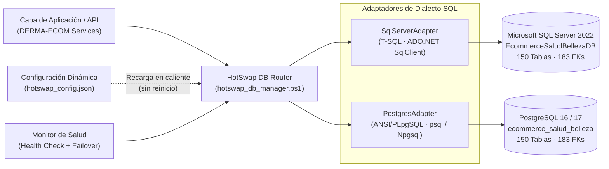

# ARQUITECTURA E IMPLEMENTACIÓN DE HOT SWAP ENTRE SGBD
## CONMUTACIÓN EN CALIENTE: MICROSOFT SQL SERVER 2022 ↔ POSTGRESQL 16 / 17
### PROYECTO INTEGRADOR V — FUNDAMENTOS DE BASE DE DATOS (FBD — AEF-1031) — SECCIÓN 4.2.5

---

## 1. CONCEPTO Y PROPÓSITO DEL HOT SWAP ENTRE SGBD

El **Hot Swap (cambio en caliente) entre SGBD** es la capacidad del sistema **DERMA-ECOM** para cambiar el motor de base de datos activo (**Microsoft SQL Server 2022** ↔ **PostgreSQL 16/17**) **sin detener la aplicación, sin recompilar código fuente y sin pérdida de disponibilidad**, garantizando:

1. **Continuidad operativa (Alta Disponibilidad / SLA 99.9%):** Failover automático ante caída, mantenimiento o saturación del motor primario.
2. **Independencia de proveedor (*Zero Vendor Lock-in*):** Permite migrar de licenciamiento comercial (SQL Server) a software libre (PostgreSQL) con impacto cero en la lógica de negocio.
3. **Pruebas y auditoría multi-motor en vivo:** Permite validar las mismas consultas de negocio y verificaciones criptográficas sobre ambos SGBD en tiempo real.

---

## 2. ARQUITECTURA DE CAPA DE ABSTRACCIÓN (PATRÓN ADAPTER + STRATEGY)



### Componentes Clave

1. **Archivo de configuración dinámica ([hotswap_config.json](file:///c:/Users/monca/Downloads/base-de-datos--main/base-de-datos--main/proyecto_integrador_ecommerce/01_FBD_Base_de_Datos/07_Portabilidad_y_HotSwap/hotswap_config.json)):**
   Define el motor activo (`active_engine`: `"sqlserver"` o `"postgresql"`), el motor de respaldo (`fallback_engine`), el modo de conmutación automática (`auto_failover: true`) y los parámetros de conexión de cada motor.
2. **Gestor de conmutación en caliente ([hotswap_db_manager.ps1](file:///c:/Users/monca/Downloads/base-de-datos--main/base-de-datos--main/proyecto_integrador_ecommerce/01_FBD_Base_de_Datos/07_Portabilidad_y_HotSwap/hotswap_db_manager.ps1)):**
   - Lee `hotswap_config.json` dinámicamente en cada operación (sin reiniciar procesos).
   - Ejecuta *Health Checks* sobre el motor activo (`SELECT 1` + conteo de tablas del catálogo).
   - **Cambio manual en caliente (`-Action swap`):** Valida primero que el motor destino responda correctamente y actualiza atómicamente `active_engine` en `hotswap_config.json` (si el destino no responde, aborta el cambio para no dejar caer el servicio, salvo que se use `-Force`).
   - **Failover automático (`-Action query`):** Si el motor activo falla durante una consulta de negocio, redirige automáticamente la consulta al `fallback_engine` traduciendo el dialecto SQL de forma transparente y registrando el evento de conmutación.
3. **Isomorfismo de Esquema:**
   Gracias a que las **150 tablas**, los **14 esquemas** (`seguridad`, `clientes`, `catalogo`, `comunidad`, `ventas`, `pagos`, `fiscal`, `promos`, `compras`, `wms`, `envios`, `postventa`, `auditoria`, `sistema`) y los nombres de columnas son **100% idénticos** en ambos motores, la capa de negocio solo adapta diferencias menores de dialecto (`1/0` vs `TRUE/FALSE`, `TOP` vs `LIMIT`, `DATEDIFF` vs `EXTRACT`).

---

## 3. PROTOCOLO DE SINCRONIZACIÓN Y CONMUTACIÓN SIN PÉRDIDA DE DATOS

En un despliegue productivo con los servidores de la **VLAN 10 (Data Center / SITE)**:

1. **Replicación CDC (*Change Data Capture*):** Un conector Debezium (Kafka Connect) captura el log de transacciones de SQL Server y replica cambios DML hacia PostgreSQL con latencia sub-segundo ($RPO < 15\text{ s}$).
2. **Pre-verificación (Dry-Run):** El *Health Check* comprueba conectividad, número de tablas (`150`) y retraso de replicación (`lag = 0`).
3. **Drenaje de transacciones (*Drain*):** Se activa brevemente el modo de espera de escritura (1–2 s) para finalizar transacciones abiertas en el motor saliente.
4. **Conmutación atómica (*Hot Swap*):** Se cambia `active_engine` en `hotswap_config.json` (o en el gestor de configuración/Consul) y se redirige el pool de conexiones al motor entrante.
5. **Validación post-cambio:** Se ejecuta la consulta de control de salud e integridad sobre el nuevo motor activo.

---

## 4. GUÍA DE EJECUCIÓN DE LA DEMOSTRACIÓN EN VIVO

Desde PowerShell en la carpeta `01_FBD_Base_de_Datos\07_Portabilidad_y_HotSwap`:

```powershell
# 1. Consultar estado y salud de ambos motores (SQL Server y PostgreSQL)
.\hotswap_db_manager.ps1 -Action status

# 2. Ejecutar una consulta de negocio sobre el motor activo (con failover automático)
.\hotswap_db_manager.ps1 -Action query

# 3. Realizar Hot Swap en caliente hacia PostgreSQL (o de regreso a SQL Server)
.\hotswap_db_manager.ps1 -Action swap -TargetEngine postgresql
.\hotswap_db_manager.ps1 -Action swap -TargetEngine sqlserver

# 4. Simular caída del motor primario para comprobar failover automático en vivo
.\hotswap_db_manager.ps1 -Action test-failover
```
