# COMPENDIO MAESTRO DE DIAGRAMAS UML 2.5 EN MERMAID — DERMA-ECOM

- **Asignatura:** Análisis y Modelado de Sistemas de Información (AMSI — IFE-1005)
- **Docente Titular:** Ing. Mayela del C. Valadez Zamarrón
- **Institución:** Tecnológico Nacional de México — Instituto Tecnológico Superior de Monclova
- **Equipo:** José Luis Luna García (SM1) · Sheyla Estefanía Moncada Guel (SM2) · Eduardo Salazar Martínez (SM3)
- **Total de diagramas incluidos:** **31 diagramas Mermaid** (consolidados desde los 8 entregables de modelado UML).

## Índice General de Diagramas

| # | Ref. | Nombre del Diagrama | Archivo Fuente |
|---:|:---:|---|---|
| 1 | 1.1 | 1.1 Diagrama de Generalización de Actores (UML) | `02_diagramas_casos_de_uso.md` |
| 2 | 1.2 | 2. MODELADO DEL NEGOCIO: DIAGRAMA DE CASOS DE USO DEL NEGOCIO (DCU DE NEGOCIO) | `02_diagramas_casos_de_uso.md` |
| 3 | 1.3 | 3.1 Diagrama General de Casos de Uso del Sistema (Vista Integrada — 18 Casos de Uso) | `02_diagramas_casos_de_uso.md` |
| 4 | 1.4 | 3.2 DCU del Submódulo 1: Identidad, Perfil Dermo-Salud, Catálogo INCI y Comunidad (Tablas 001–050) | `02_diagramas_casos_de_uso.md` |
| 5 | 1.5 | 3.3 DCU del Submódulo 2: Motor Comercial, Suscripciones, Pagos, Antifraude, CFDI 4.0 y Promociones (Tablas 051–100) | `02_diagramas_casos_de_uso.md` |
| 6 | 1.6 | 3.4 DCU del Submódulo 3: Compras, WMS FEFO, Cadena de Frío IoT, Envíos, Postventa RMA y Auditoría Forense (Tablas 101–150) | `02_diagramas_casos_de_uso.md` |
| 7 | 2.1 | 1.2 DIAGRAMA DE PAQUETES DEL SISTEMA (UML 2.5 — 3 SUBMÓDULOS Y 14 PAQUETES) | `03_diagrama_de_clases.md` |
| 8 | 2.2 | 2. DIAGRAMA DE CLASES DEL SUBMÓDULO 1: SEGURIDAD, IDENTIDAD, PERFIL CLÍNICO Y CATÁLOGO INCI | `03_diagrama_de_clases.md` |
| 9 | 2.3 | 3. DIAGRAMA DE CLASES DEL SUBMÓDULO 2: VENTAS, SUSCRIPCIONES, PAGOS, ANTIFRAUDE Y CFDI 4.0 | `03_diagrama_de_clases.md` |
| 10 | 2.4 | 4. DIAGRAMA DE CLASES DEL SUBMÓDULO 3: COMPRAS, WMS FEFO, IOT FRÍO, ENVÍOS, RMA Y FORENSE | `03_diagrama_de_clases.md` |
| 11 | 3.1 | 2. DS-01: AUTENTICACIÓN SEGURA DE USUARIO (LOGIN CRIPTOGRÁFICO, MFA TOTP Y BLOQUEO POR FUERZA BRUTA) — CU-01 *(OBLIGATORIO)* | `04_diagramas_de_secuencia.md` |
| 12 | 3.2 | 3. DS-02: DIAGNÓSTICO CLÍNICO CUTÁNEO Y CONSENTIMIENTO EXPRESO LFPDPPP — CU-02 | `04_diagramas_de_secuencia.md` |
| 13 | 3.3 | 4. DS-03: CHECKOUT SEGURO, RESERVA 15 MIN, ANTIFRAUDE, PAGO PCI-DSS Y SPLIT MULTIALMACÉN — CU-03 | `04_diagramas_de_secuencia.md` |
| 14 | 3.4 | 5. DS-04: COBRO RECURRENTE Y PROGRAMACIÓN DE SUSCRIPCIÓN BEAUTY-BOX — CU-04 | `04_diagramas_de_secuencia.md` |
| 15 | 3.5 | 6. DS-05: EMISIÓN, SELLADO CSD Y TIMBRADO DE FACTURA ELECTRÓNICA CFDI 4.0 — CU-05 | `04_diagramas_de_secuencia.md` |
| 16 | 3.6 | 7. DS-06: RECEPCIÓN EN CEDIS, TELEMETRÍA IOT, DICTAMEN QA Y ALTA DE LOTE FEFO — CU-06 | `04_diagramas_de_secuencia.md` |
| 17 | 3.7 | 8. DS-07: DEVOLUCIÓN RMA, INSPECCIÓN HIGIÉNICA Y FARMACOVIGILANCIA COFEPRIS — CU-07 | `04_diagramas_de_secuencia.md` |
| 18 | 3.8 | 9. DS-08: EJERCICIO DE DERECHOS ARCO Y AUDITORÍA FORENSE CON SOFT-DELETE JSON — CU-08 / CU-12 | `04_diagramas_de_secuencia.md` |
| 19 | 4.1 | 1. DIAGRAMA DE COMPONENTES DE SOFTWARE (ARQUITECTURA POR CAPAS) | `05_diagrama_de_componentes.md` |
| 20 | 5.1 | 1. DIAGRAMA DE DESPLIEGUE FÍSICO Y TOPOLOGÍA REAL DE RED (VLSM `10.40.0.0/16`) | `06_diagrama_de_despliegue.md` |
| 21 | 6.1 | 1. DA-01: AUTENTICACIÓN SEGURA (LOGIN), MFA TOTP, BLOQUEO POR FUERZA BRUTA Y DIAGNÓSTICO LFPDPPP | `08_diagramas_de_actividades.md` |
| 22 | 6.2 | 2. DA-02: CHECKOUT SEGURO, RESERVA 15 MIN, ANTIFRAUDE, PAGO PCI-DSS, SPLIT MULTIALMACÉN Y CFDI 4.0 | `08_diagramas_de_actividades.md` |
| 23 | 6.3 | 3. DA-03: RECEPCIÓN EN CEDIS, TELEMETRÍA IOT (2–8 °C), DICTAMEN QA Y ALTA/DESPACHO FEFO | `08_diagramas_de_actividades.md` |
| 24 | 6.4 | 4. DA-04: DEVOLUCIÓN RMA, INSPECCIÓN HIGIÉNICA, FARMACOVIGILANCIA COFEPRIS Y REEMBOLSO | `08_diagramas_de_actividades.md` |
| 25 | 7.1 | 1. DE-01: MÁQUINA DE ESTADOS DE CUENTA DE USUARIO Y SESIÓN (`seguridad.usuarios`) | `09_diagramas_de_estados.md` |
| 26 | 7.2 | 2. DE-02: MÁQUINA DE ESTADOS DE ORDEN DE VENTA (`ventas.ordenes`) | `09_diagramas_de_estados.md` |
| 27 | 7.3 | 3. DE-03: MÁQUINA DE ESTADOS DE LOTE SANITARIO FEFO (`wms.lotes_fabricacion_sanitaria`) | `09_diagramas_de_estados.md` |
| 28 | 7.4 | 4. DE-04: MÁQUINA DE ESTADOS DE SOLICITUD RMA Y FARMACOVIGILANCIA (`postventa.solicitudes_rma`) | `09_diagramas_de_estados.md` |
| 29 | 8.1 | 2. DC-01: COMUNICACIÓN DE AUTENTICACIÓN SEGURA (LOGIN CRIPTOGRÁFICO, MFA Y BLOQUEO HMAC) — CU-01 | `10_diagramas_de_comunicacion.md` |
| 30 | 8.2 | 3. DC-02: COMUNICACIÓN DE CHECKOUT, ANTIFRAUDE, PAGO PCI-DSS, SPLIT Y CFDI 4.0 — CU-03 / CU-05 | `10_diagramas_de_comunicacion.md` |
| 31 | 8.3 | 4. DC-03: COMUNICACIÓN DE RECEPCIÓN CEDIS, IOT CADENA DE FRÍO, QA Y ALTA FEFO — CU-06 | `10_diagramas_de_comunicacion.md` |

---

## 1. Diagramas de Casos de Uso (Negocio, Actores y Sistema)
> Archivo fuente: `02_diagramas_casos_de_uso.md`

### Diagrama 1 — 1.1 Diagrama de Generalización de Actores (UML)

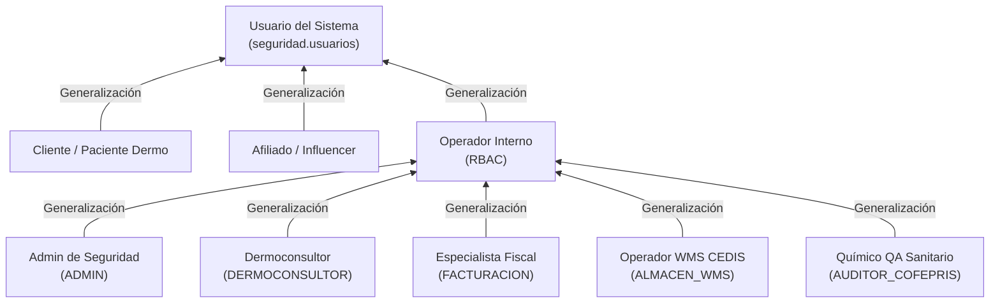

### Diagrama 2 — 2. MODELADO DEL NEGOCIO: DIAGRAMA DE CASOS DE USO DEL NEGOCIO (DCU DE NEGOCIO)

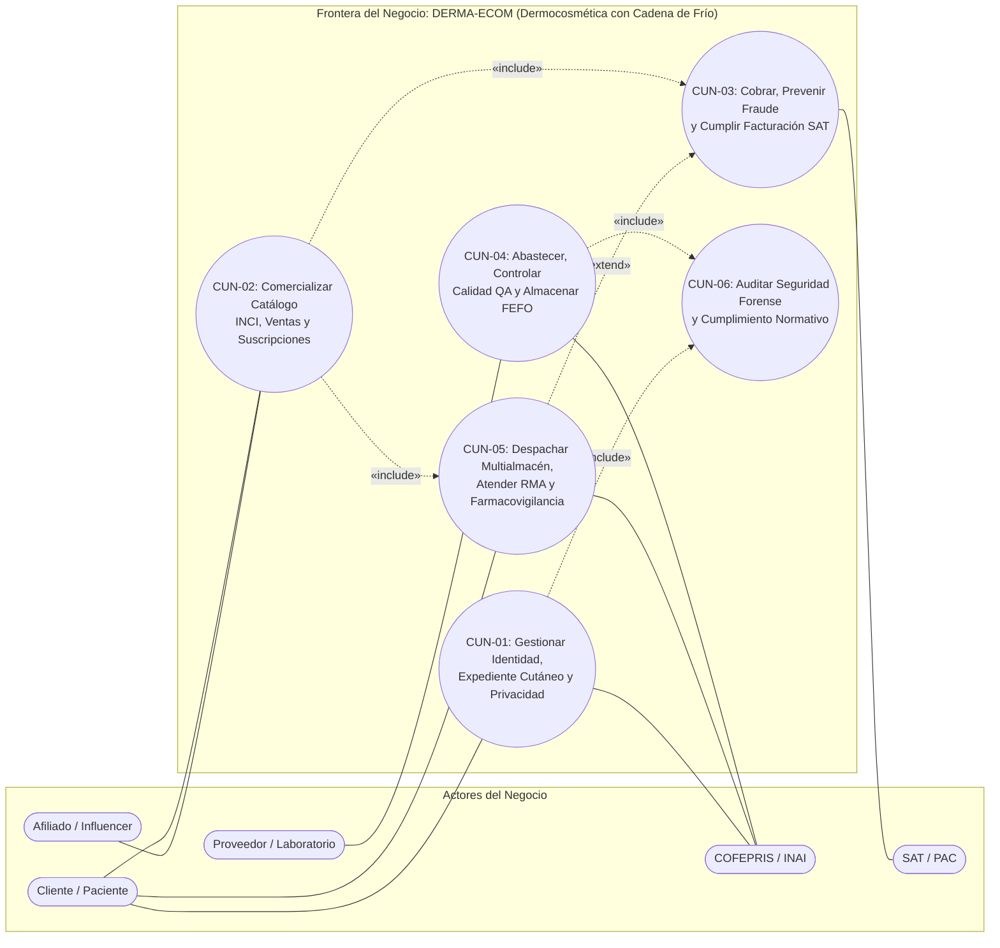

### Diagrama 3 — 3.1 Diagrama General de Casos de Uso del Sistema (Vista Integrada — 18 Casos de Uso)

```mermaid
flowchart LR
    USR(["Usuario"])
    CLI(["Cliente / Paciente"])
    AFI(["Afiliado"])
    DER(["Dermoconsultor"])
    ADM(["Admin Seguridad"])
    FAC(["Especialista Fiscal"])
    WMS(["Operador WMS"])
    QA(["Químico QA"])
    PAS(["Pasarela PCI-DSS"])
    SAT(["PAC / SAT 4.0"])
    LOG(["API Paquetería"])
    IOT(["Sensores IoT"])

    subgraph DERMA_SYS["Sistema DERMA-ECOM (150 Tablas · 14 Esquemas)"]
        subgraph SM1["Submódulo 1 — José Luis Luna García (001–050)"]
            CU01(("CU-01: Autenticar Usuario\nLogin + MFA"))
            CU02(("CU-02: Diagnóstico Cutáneo\ny Perfil Dermo"))
            CU08(("CU-08: Ejercer y Resolver\nDerechos ARCO"))
            CU09(("CU-09: Consultar Catálogo\nINCI y COFEPRIS"))
            CU13(("CU-13: Gestionar Rutinas,\nKits y Wishlist"))
        end

        subgraph SM2["Submódulo 2 — Sheyla Estefanía Moncada Guel (051–100)"]
            CU03(("CU-03: Checkout, Split\ny Pago Seguro"))
            CU04(("CU-04: Suscripción\nBeauty-Box"))
            CU05(("CU-05: Emitir / Cancelar\nCFDI 4.0"))
            CU10(("CU-10: Cupones, GWP\ny Ventas Flash"))
            CU14(("CU-14: Gestionar Afiliados\ny Comisiones"))
        end

        subgraph SM3["Submódulo 3 — Eduardo Salazar Martínez (101–150)"]
            CU06(("CU-06: Compras, QA\ny Lotes FEFO"))
            CU07(("CU-07: Devoluciones RMA\ny Farmacovigilancia"))
            CU11(("CU-11: Despacho, Tracking\ny Pickup"))
            CU12(("CU-12: Auditoría Forense\ny Soft-Delete"))
            CU15(("CU-15: Monitoreo IoT Frío\ny Alertas FEFO"))
        end
    end

    USR --- CU01
    CLI --- CU02
    CLI --- CU03
    CLI --- CU04
    CLI --- CU05
    CLI --- CU07
    CLI --- CU08
    CLI --- CU09
    CLI --- CU10
    CLI --- CU13
    AFI --- CU14
    DER --- CU02
    DER --- CU09
    DER --- CU13
    ADM --- CU08
    ADM --- CU12
    FAC --- CU05
    WMS --- CU06
    WMS --- CU11
    WMS --- CU15
    QA --- CU06
    QA --- CU07
    QA --- CU15

    CU03 --- PAS
    CU04 --- PAS
    CU05 --- SAT
    CU11 --- LOG
    CU15 --- IOT
```

### Diagrama 4 — 3.2 DCU del Submódulo 1: Identidad, Perfil Dermo-Salud, Catálogo INCI y Comunidad (Tablas 001–050)

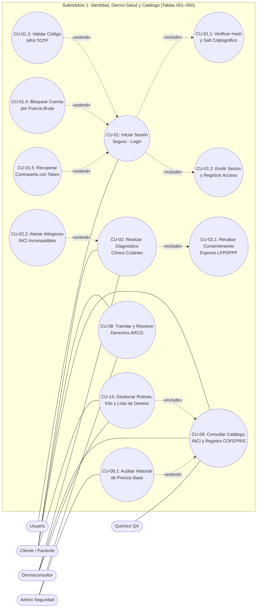

### Diagrama 5 — 3.3 DCU del Submódulo 2: Motor Comercial, Suscripciones, Pagos, Antifraude, CFDI 4.0 y Promociones (Tablas 051–100)

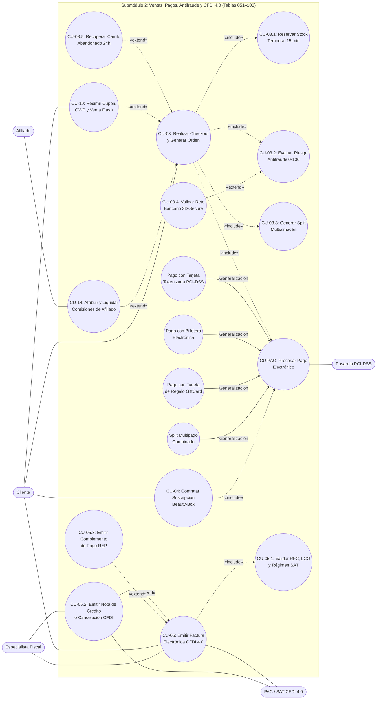

### Diagrama 6 — 3.4 DCU del Submódulo 3: Compras, WMS FEFO, Cadena de Frío IoT, Envíos, Postventa RMA y Auditoría Forense (Tablas 101–150)

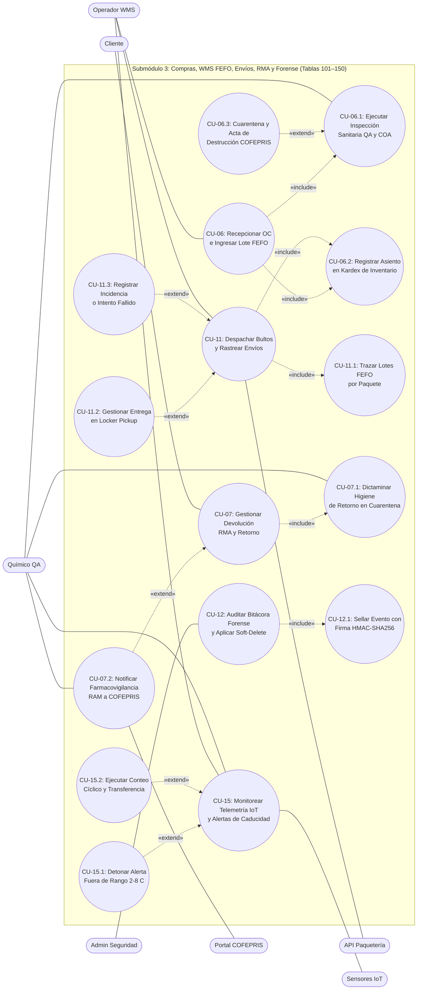

---

## 2. Diagramas de Clases y Paquetes (Dominio y Seguridad RBAC)
> Archivo fuente: `03_diagrama_de_clases.md`

### Diagrama 7 — 1.2 DIAGRAMA DE PAQUETES DEL SISTEMA (UML 2.5 — 3 SUBMÓDULOS Y 14 PAQUETES)

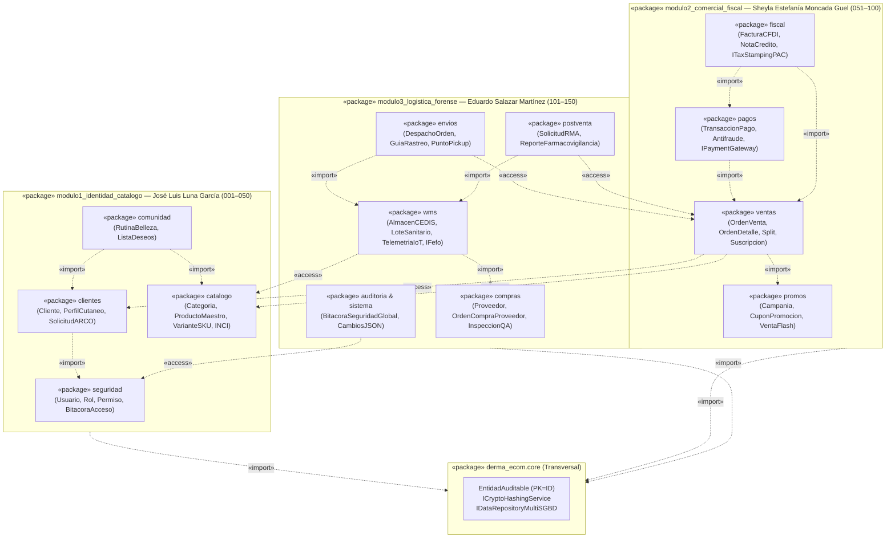

### Diagrama 8 — 2. DIAGRAMA DE CLASES DEL SUBMÓDULO 1: SEGURIDAD, IDENTIDAD, PERFIL CLÍNICO Y CATÁLOGO INCI

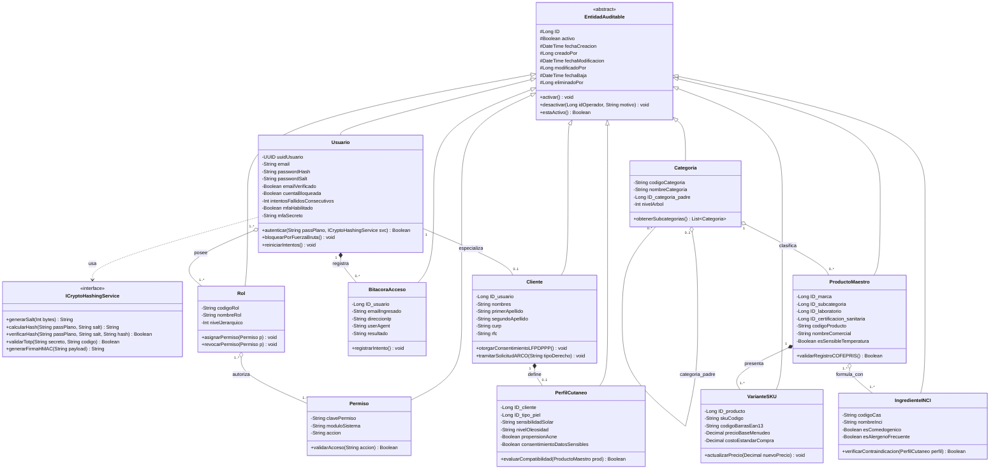

### Diagrama 9 — 3. DIAGRAMA DE CLASES DEL SUBMÓDULO 2: VENTAS, SUSCRIPCIONES, PAGOS, ANTIFRAUDE Y CFDI 4.0

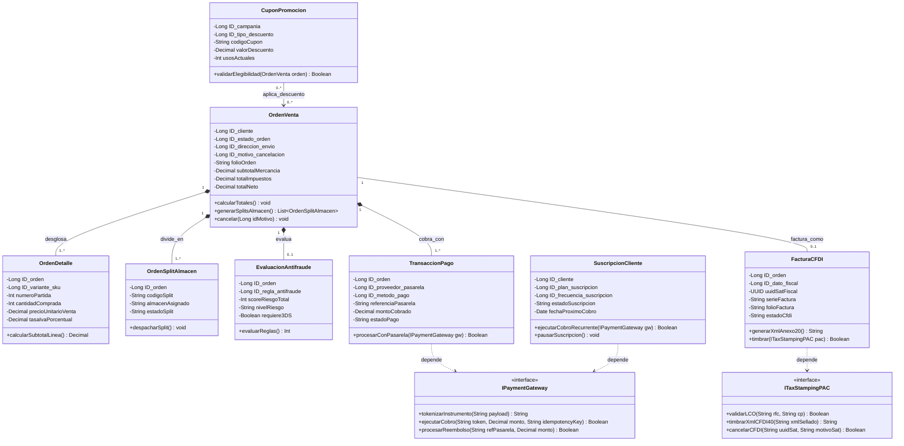

### Diagrama 10 — 4. DIAGRAMA DE CLASES DEL SUBMÓDULO 3: COMPRAS, WMS FEFO, IOT FRÍO, ENVÍOS, RMA Y FORENSE

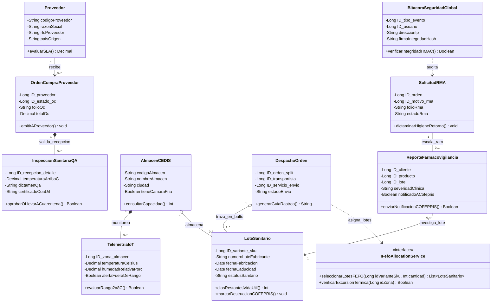

---

## 3. Diagramas de Secuencia (Login Criptográfico y Transacciones Críticas)
> Archivo fuente: `04_diagramas_de_secuencia.md`

### Diagrama 11 — 2. DS-01: AUTENTICACIÓN SEGURA DE USUARIO (LOGIN CRIPTOGRÁFICO, MFA TOTP Y BLOQUEO POR FUERZA BRUTA) — CU-01 *(OBLIGATORIO)*

```mermaid
sequenceDiagram
    autonumber
    actor Usuario as Usuario / Navegador
    participant Vista as Vista (LoginSPA)
    participant Ctrl as Controlador (AuthController)
    participant Crypto as Servicio Criptográfico (CryptoHashingService)
    participant UserRepo as Repositorio Datos (UsuarioRepository)
    participant AuditRepo as Repositorio Auditoría (BitacoraSeguridadRepository)

    Usuario->>Vista: Ingresa email y contraseña (TLS 1.3)
    activate Vista
    Vista->>Ctrl: POST /api/v1/auth/login {email, password}
    activate Ctrl

    Ctrl->>UserRepo: obtenerUsuarioPorEmail(email) [seguridad.usuarios]
    activate UserRepo
    alt Usuario no existe o activo = 0
        UserRepo-->>Ctrl: null
        deactivate UserRepo
        Ctrl->>Crypto: simularHashDummy() [Mitigación Timing Attack]
        activate Crypto
        Crypto-->>Ctrl: ok
        deactivate Crypto
        Ctrl->>AuditRepo: registrarIntentoLogin(ID_usuario=NULL, IP, "FALLIDO_CREDENCIALES")
        Ctrl-->>Vista: HTTP 401 "Credenciales inválidas"
        Vista-->>Usuario: Muestra error genérico de autenticación
    else Usuario encontrado
        UserRepo-->>Ctrl: Usuario {ID, password_hash, password_salt, cuenta_bloqueada, intentos_fallidos_consecutivos, mfa_habilitado, mfa_secreto}
        deactivate UserRepo
        alt cuenta_bloqueada = 1 y (ahora - fecha_bloqueo < 15 min)
            Ctrl->>AuditRepo: registrarIntentoLogin(ID, IP, "BLOQUEADO_FUERZA_BRUTA")
            Ctrl-->>Vista: HTTP 429 "Cuenta bloqueada temporalmente (15 min)"
            Vista-->>Usuario: Notifica bloqueo preventivo y enlace de recuperación
        else Cuenta habilitada
            Ctrl->>Crypto: verificarPassword(password, password_salt, password_hash)
            activate Crypto
            Note over Crypto: Hash iterativo con salt individual<br/>(PBKDF2-SHA512 / bcrypt / Argon2id)<br/>Comparación en tiempo constante
            alt Contraseña incorrecta
                Crypto-->>Ctrl: false
                deactivate Crypto
                Ctrl->>UserRepo: incrementarIntentosFallidos(ID) [seguridad.usuarios]
                Ctrl->>AuditRepo: registrarIntentoLogin(ID, IP, "FALLIDO_PASSWORD") [seguridad.intentos_login]
                opt intentos_fallidos_consecutivos >= 5
                    Ctrl->>UserRepo: bloquearCuenta(ID, cuenta_bloqueada=1, fecha_bloqueo=NOW)
                    Ctrl->>Crypto: generarFirmaHMAC_SHA256(payloadEvento)
                    activate Crypto
                    Crypto-->>Ctrl: firma_integridad_hash
                    deactivate Crypto
                    Ctrl->>AuditRepo: insertarBitacoraForense(ID, "BLOQUEO_FUERZA_BRUTA", firma_integridad_hash) [auditoria.bitacora_seguridad_global]
                end
                Ctrl-->>Vista: HTTP 401 "Credenciales inválidas"
                Vista-->>Usuario: Solicita reintento o recuperación de contraseña
            else Contraseña correcta
                Crypto-->>Ctrl: true
                deactivate Crypto
                opt mfa_habilitado = 1
                    Ctrl-->>Vista: HTTP 206 "Requiere código MFA TOTP (6 dígitos)"
                    Vista-->>Usuario: Solicita código de app autenticadora
                    Usuario->>Vista: Ingresa totpCode ("849201")
                    Vista->>Ctrl: POST /api/v1/auth/mfa-verify {tempId, totpCode}
                    Ctrl->>Crypto: validarTotpRFC6238(mfa_secreto, totpCode, +-30s)
                    activate Crypto
                    alt TOTP inválido o expirado
                        Crypto-->>Ctrl: false
                        deactivate Crypto
                        Ctrl->>AuditRepo: registrarIntentoLogin(ID, IP, "FALLIDO_MFA")
                        Ctrl-->>Vista: HTTP 401 "Código MFA inválido"
                        Vista-->>Usuario: Permite hasta 2 reintentos
                    else TOTP válido
                        Crypto-->>Ctrl: true
                        deactivate Crypto
                    end
                end
                Ctrl->>UserRepo: cargarRolesPermisosRBAC(ID) [seguridad.usuarios_roles + roles_permisos]
                UserRepo-->>Ctrl: permisosRBAC[]
                Ctrl->>Crypto: firmarJWT_RS256(ID, permisosRBAC) + hashTokenSesion()
                activate Crypto
                Crypto-->>Ctrl: {jwt, token_sesion_hash}
                deactivate Crypto
                Ctrl->>UserRepo: resetearIntentosYActualizarUltimoLogin(ID)
                Ctrl->>UserRepo: crearSesionActiva(ID_usuario=ID, token_sesion_hash, IP) [seguridad.sesiones_activas]
                Ctrl->>AuditRepo: registrarIntentoLogin(ID, IP, "EXITOSO") [seguridad.intentos_login]
                Ctrl-->>Vista: HTTP 200 {jwt, perfil, permisosRBAC}
                Vista-->>Usuario: Redirige al portal según rol RBAC
            end
        end
    end
    deactivate Ctrl
    deactivate Vista
```

### Diagrama 12 — 3. DS-02: DIAGNÓSTICO CLÍNICO CUTÁNEO Y CONSENTIMIENTO EXPRESO LFPDPPP — CU-02

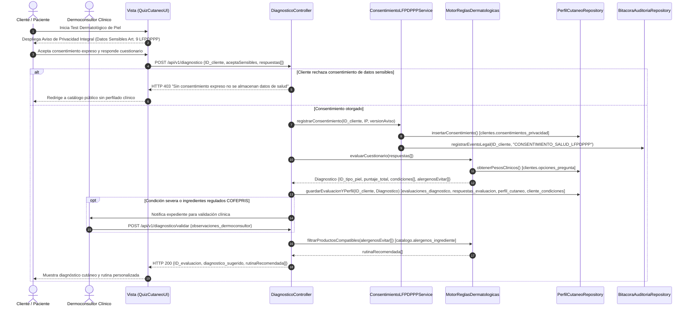

### Diagrama 13 — 4. DS-03: CHECKOUT SEGURO, RESERVA 15 MIN, ANTIFRAUDE, PAGO PCI-DSS Y SPLIT MULTIALMACÉN — CU-03

```mermaid
sequenceDiagram
    autonumber
    actor Cliente as Cliente Comprador
    participant WebUI as Vista (CheckoutUI)
    participant GateSDK as Pasarela SDK (PCI-DSS)
    participant OrderCtrl as OrdenesController
    participant FraudSvc as AntifraudeService
    participant SplitSvc as MultiCedisSplitService
    participant WmsRepo as InventarioLotesRepository
    participant OrderRepo as OrdenesVentaRepository

    Cliente->>WebUI: Pulsa "Proceder al Pago"
    WebUI->>OrderCtrl: POST /api/v1/checkout/reservar {ID_carrito}
    OrderCtrl->>WmsRepo: reservarStock15Min(items) [ventas.reservas_temporales_stock]
    WmsRepo-->>OrderCtrl: reservaActiva (expira +15 min)
    OrderCtrl-->>WebUI: HTTP 200 {totales, IVA_16, descuentos}

    Cliente->>WebUI: Selecciona dirección y captura datos de pago en iframe PCI-DSS
    WebUI->>GateSDK: tokenizarTarjeta(PAN, CVV, vigencia)
    GateSDK-->>WebUI: tokenEfimero ("tok_pci_9a8f") [Sin PAN/CVV en BD]
    WebUI->>OrderCtrl: POST /api/v1/ordenes/confirmar {ID_carrito, ID_direccion_envio, tokenEfimero, idempotencyKey}

    OrderCtrl->>FraudSvc: evaluarRiesgo(ID_cliente, monto, IP, reglas) [pagos.reglas_antifraude]
    FraudSvc-->>OrderCtrl: Evaluacion {score_riesgo_total, nivel_riesgo}
    OrderCtrl->>OrderRepo: guardarEvaluacionAntifraude() [pagos.evaluaciones_antifraude]

    alt Score >= 85 (Alto Riesgo / Fraude)
        OrderCtrl->>WmsRepo: liberarReservaStock(ID_carrito)
        OrderCtrl-->>WebUI: HTTP 403 "Operación rechazada por seguridad antifraude"
    else Score < 85 (Continuar; 3DS si >= 65)
        opt score_riesgo_total >= 65
            OrderCtrl->>GateSDK: iniciarReto3DSecure(tokenEfimero)
            GateSDK-->>OrderCtrl: 3DS_VERIFICADO
        end
        OrderCtrl->>GateSDK: ejecutarCobro(tokenEfimero, monto, MXN, idempotencyKey)
        alt Cobro declinado por banco
            GateSDK-->>OrderCtrl: HTTP 402 Declinado
            OrderCtrl->>OrderRepo: registrarIntentoFallido() [pagos.intentos_cobro]
            OrderCtrl-->>WebUI: HTTP 402 "Pago declinado; puede elegir otro método o Split Multipago"
        else Cobro aprobado
            GateSDK-->>OrderCtrl: Aprobado {referencia_pasarela, codigo_autorizacion}
            OrderCtrl->>SplitSvc: calcularSplitsPorCEDIS(items, ID_direccion_envio) [wms.inventario_lotes_ubicacion]
            SplitSvc-->>OrderCtrl: splits[] (ej. CEDIS MTY + CEDIS CDMX)
            OrderCtrl->>OrderRepo: guardarOrdenDetallesSplitsYPago() [ventas.ordenes, ordenes_detalles, ordenes_splits_almacen, pagos.transacciones]
            OrderCtrl->>WmsRepo: confirmarReservaComoVendido(ID_carrito)
            OrderCtrl-->>WebUI: HTTP 201 {ID_orden, folio_orden, splits}
            WebUI-->>Cliente: Confirmación de compra y seguimiento por almacén
        end
    end
```

### Diagrama 14 — 5. DS-04: COBRO RECURRENTE Y PROGRAMACIÓN DE SUSCRIPCIÓN BEAUTY-BOX — CU-04

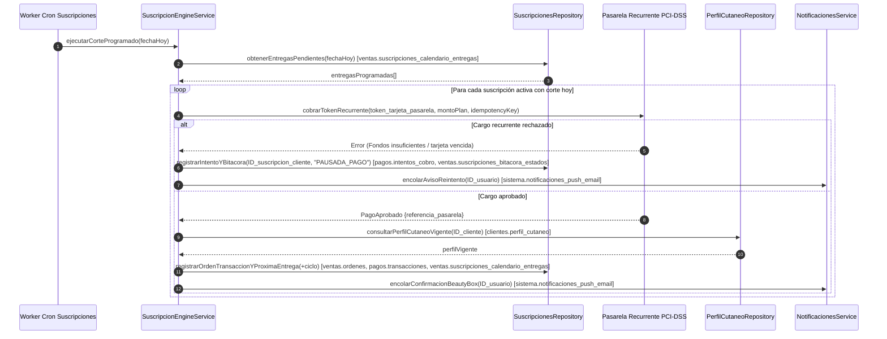

### Diagrama 15 — 6. DS-05: EMISIÓN, SELLADO CSD Y TIMBRADO DE FACTURA ELECTRÓNICA CFDI 4.0 — CU-05

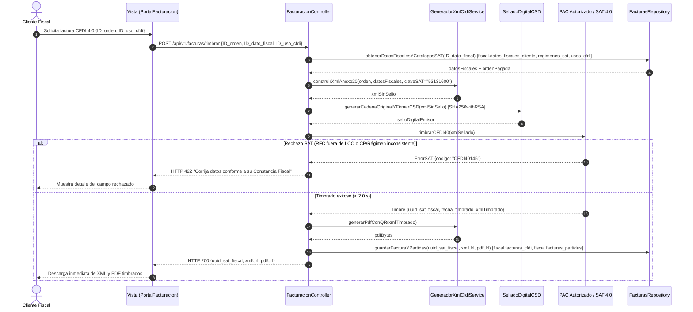

### Diagrama 16 — 7. DS-06: RECEPCIÓN EN CEDIS, TELEMETRÍA IOT, DICTAMEN QA Y ALTA DE LOTE FEFO — CU-06

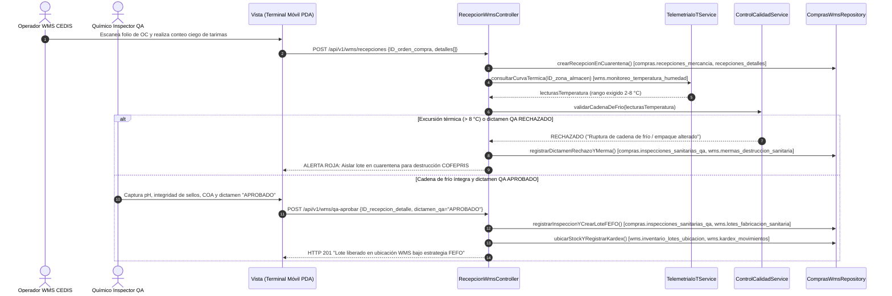

### Diagrama 17 — 8. DS-07: DEVOLUCIÓN RMA, INSPECCIÓN HIGIÉNICA Y FARMACOVIGILANCIA COFEPRIS — CU-07

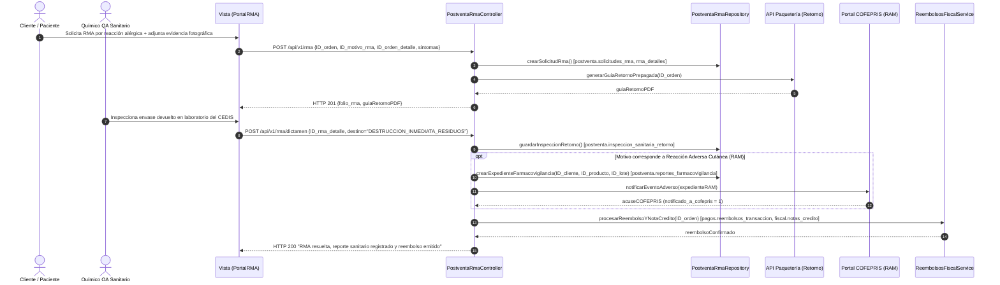

### Diagrama 18 — 9. DS-08: EJERCICIO DE DERECHOS ARCO Y AUDITORÍA FORENSE CON SOFT-DELETE JSON — CU-08 / CU-12

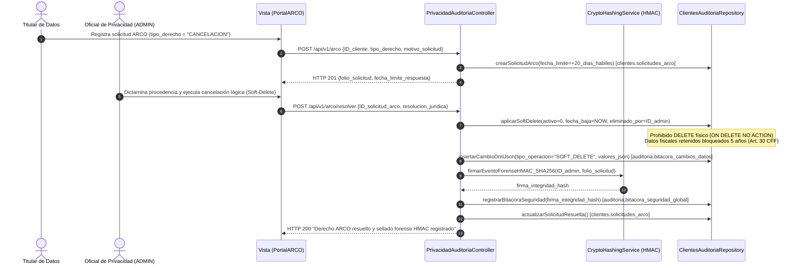

---

## 4. Diagrama de Componentes (Arquitectura de 5 Capas y Hot-Swap)
> Archivo fuente: `05_diagrama_de_componentes.md`

### Diagrama 19 — 1. DIAGRAMA DE COMPONENTES DE SOFTWARE (ARQUITECTURA POR CAPAS)

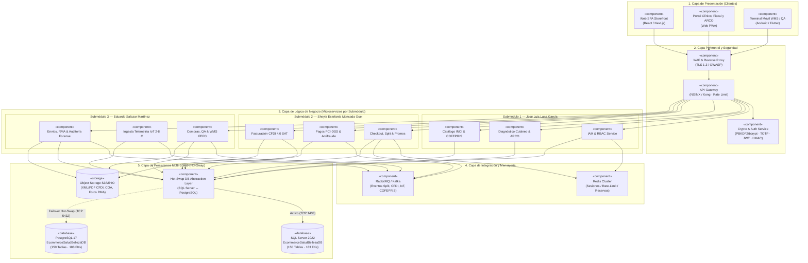

---

## 5. Diagrama de Despliegue Físico (Topología VLSM 10.40.0.0/16)
> Archivo fuente: `06_diagrama_de_despliegue.md`

### Diagrama 20 — 1. DIAGRAMA DE DESPLIEGUE FÍSICO Y TOPOLOGÍA REAL DE RED (VLSM `10.40.0.0/16`)

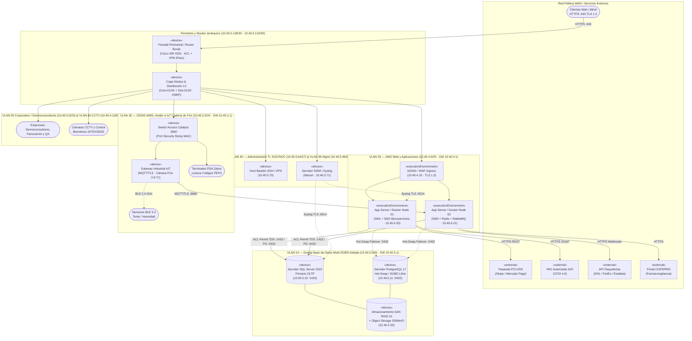

---

## 6. Diagramas de Actividades (Carriles y Paralelismo Fork/Join)
> Archivo fuente: `08_diagramas_de_actividades.md`

### Diagrama 21 — 1. DA-01: AUTENTICACIÓN SEGURA (LOGIN), MFA TOTP, BLOQUEO POR FUERZA BRUTA Y DIAGNÓSTICO LFPDPPP

```mermaid
flowchart TD
    START(("● Inicio")) --> A1["Ingresar email y contraseña\n(Canal TLS 1.3)"]
    A1 --> A2["Consultar cuenta en seguridad.usuarios\ny verificar bloqueo vigente"]
    A2 --> D1{"¿Cuenta activa y\nno bloqueada?"}
    D1 -->|"[No: bloqueada 15 min]"| A_BLK["Registrar intento en seguridad.intentos_login\nMostrar aviso de bloqueo temporal"]
    A_BLK --> END1(("◉ Fin"))

    D1 -->|"[Sí]"| A3["Recalcular hash con password_salt\n(PBKDF2-SHA512 / bcrypt / Argon2id)"]
    A3 --> D2{"¿Hash coincide?"}
    D2 -->|"[No]"| A4["Incrementar intentos_fallidos_consecutivos\ne insertar en seguridad.intentos_login"]
    A4 --> D3{"¿Intentos >= 5?"}
    D3 -->|"[Sí]"| A5["Bloquear cuenta 15 min + Firmar HMAC-SHA256\nen auditoria.bitacora_seguridad_global"]
    A5 --> END1
    D3 -->|"[No]"| A1

    D2 -->|"[Sí]"| D4{"¿mfa_habilitado = 1?"}
    D4 -->|"[Sí]"| A6["Solicitar y validar código TOTP\n6 dígitos (RFC 6238 +-30s)"]
    A6 --> D5{"¿TOTP válido?"}
    D5 -->|"[No]"| A4
    D5 -->|"[Sí]"| A7["Cargar permisos RBAC, crear sesión\nen seguridad.sesiones_activas y reiniciar intentos"]
    D4 -->|"[No]"| A7

    A7 --> D6{"¿Desea Diagnóstico\nCutáneo?"}
    D6 -->|"[No]"| END2(("◉ Fin: Acceso Portal"))
    D6 -->|"[Sí]"| A8["Desplegar Aviso de Privacidad Integral\n(Art. 9 LFPDPPP — Datos Sensibles)"]
    A8 --> D7{"¿Otorga consentimiento\nexpreso?"}
    D7 -->|"[No]"| A9["Navegar catálogo público\nsin almacenar perfil clínico"]
    A9 --> END2
    D7 -->|"[Sí]"| A10["Guardar consentimiento + Evaluar cuestionario\nGuardar clientes.perfil_cutaneo y filtrar alérgenos INCI"]
    A10 --> END2
```

### Diagrama 22 — 2. DA-02: CHECKOUT SEGURO, RESERVA 15 MIN, ANTIFRAUDE, PAGO PCI-DSS, SPLIT MULTIALMACÉN Y CFDI 4.0

```mermaid
flowchart TD
    START(("● Inicio")) --> B1["Confirmar carrito (ventas.carritos)\ny reservar stock 15 min (ventas.reservas_temporales_stock)"]
    B1 --> B2["Seleccionar dirección, cupón/GWP opcional\n(promos.cupones) y calcular IVA 16%"]
    B2 --> B3["Tokenizar instrumento en SDK PCI-DSS\n(sin almacenar PAN ni CVV)"]
    B3 --> B4["Evaluar reglas antifraude (pagos.reglas_antifraude)\ny persistir en pagos.evaluaciones_antifraude"]
    B4 --> D1{"Score de riesgo"}
    D1 -->|"[>= 85: Fraude]"| B_REJ["Cancelar orden (ventas.motivos_cancelacion_orden)\ny liberar reserva de stock"]
    B_REJ --> END_F(("◉ Fin: Rechazada"))

    D1 -->|"[65..84: Reto 3DS]"| B5["Ejecutar reto bancario 3D-Secure"]
    B5 --> D2{"¿3DS aprobado?"}
    D2 -->|"[No]"| B_REJ
    D2 -->|"[Sí]"| B6["Ejecutar cobro idempotente en Pasarela\n(Tarjeta / Billetera / GiftCard / Split Multipago)"]
    D1 -->|"[< 65: Bajo riesgo]"| B6

    B6 --> D3{"¿Pago aprobado?"}
    D3 -->|"[No: HTTP 402]"| B7["Registrar en pagos.intentos_cobro\nPermitir cambiar método dentro de los 15 min"]
    B7 --> B3

    D3 -->|"[Sí: HTTP 200]"| FORK["▬▬▬▬ FORK (Ejecución Paralela) ▬▬▬▬"]
    FORK --> P1["Crear ventas.ordenes + ordenes_detalles\ny pagos.transacciones"]
    FORK --> P2["Generar splits CEDIS Monterrey/CDMX\n(ventas.ordenes_splits_almacen)"]
    FORK --> P3["Confirmar reserva como vendida\nen wms.inventario_lotes_ubicacion"]
    FORK --> P4["Emitir y timbrar CFDI 4.0 si fue solicitado\n(fiscal.facturas_cfdi + PAC SAT)"]
    P1 --> JOIN["▬▬▬▬ JOIN (Sincronización) ▬▬▬▬"]
    P2 --> JOIN
    P3 --> JOIN
    P4 --> JOIN
    JOIN --> B8["Enviar confirmación y XML/PDF vía\nsistema.notificaciones_push_email"]
    B8 --> END_OK(("◉ Fin: Orden Confirmada"))
```

### Diagrama 23 — 3. DA-03: RECEPCIÓN EN CEDIS, TELEMETRÍA IOT (2–8 °C), DICTAMEN QA Y ALTA/DESPACHO FEFO

```mermaid
flowchart TD
    START(("● Inicio")) --> C1["Arribo de proveedor a CEDIS\nValidar compras.ordenes_compra"]
    C1 --> C2["Conteo ciego de piezas y registro en\ncompras.recepciones_mercancia (Estado: CUARENTENA_QA)"]
    C2 --> C3["Extraer curva térmica IoT\n(wms.monitoreo_temperatura_humedad)"]
    C3 --> D1{"¿Temperatura dentro\nde 2 °C a 8 °C?"}
    D1 -->|"[No: Excursión térmica]"| C_QUA["Marcar alerta_fuera_de_rango = 1\nAislar lote en cuarentena"]
    C_QUA --> C_DES["Emitir acta de destrucción COFEPRIS\n(wms.mermas_destruccion_sanitaria)"]
    C_DES --> END_R(("◉ Fin: Lote Rechazado"))

    D1 -->|"[Sí: Cadena de frío íntegra]"| C4["Químico QA inspecciona pH, sellos y COA\n(compras.inspecciones_sanitarias_qa)"]
    C4 --> D2{"¿Dictamen QA\nAPROBADO?"}
    D2 -->|"[No: Rechazado]"| C_QUA
    D2 -->|"[Sí]"| C5["Crear lote en wms.lotes_fabricacion_sanitaria\ncon fecha_fabricacion y fecha_caducidad"]
    C5 --> C6["Ubicar en wms.pasillos_ubicaciones\nActualizar wms.inventario_lotes_ubicacion"]
    C6 --> C7["Registrar asiento positivo en\nwms.kardex_movimientos"]
    C7 --> C8["Habilitar lote para algoritmo FEFO\ny monitoreo de alertas 90/60/30 días"]
    C8 --> END_OK(("◉ Fin: Stock Disponible FEFO"))
```

### Diagrama 24 — 4. DA-04: DEVOLUCIÓN RMA, INSPECCIÓN HIGIÉNICA, FARMACOVIGILANCIA COFEPRIS Y REEMBOLSO

```mermaid
flowchart TD
    START(("● Inicio")) --> R1["Cliente solicita devolución RMA con evidencia\n(postventa.solicitudes_rma + rma_detalles)"]
    R1 --> R2["Generar guía prepagada de retorno\nvía API Paquetería (envios.guias_rastreo)"]
    R2 --> R3["Arribo físico al laboratorio CEDIS\nInspección higiénica QA (postventa.inspeccion_sanitaria_retorno)"]
    R3 --> D1{"¿Motivo es Reacción\nAdversa Cutánea (RAM)?"}

    D1 -->|"[Sí]"| R4["Crear expediente en postventa.reportes_farmacovigilancia\ncruzando ID_cliente + ID_producto + ID_lote"]
    R4 --> R5["Notificar a Portal COFEPRIS (notificado_a_cofepris = 1)\ny decretar DESTRUCCION_INMEDIATA_RESIDUOS"]
    R5 --> R6["Autorizar reembolso y Nota de Crédito"]

    D1 -->|"[No]"| D2{"¿Producto sellado\ne intacto?"}
    D2 -->|"[Sí]"| R7["Autorizar REINGRESO_STOCK al WMS\ny registrar entrada en wms.kardex_movimientos"]
    R7 --> R6
    D2 -->|"[No: Abierto/Dañado]"| R8["Destrucción sanitaria por norma higiénica\n(wms.mermas_destruccion_sanitaria)"]
    R8 --> R6

    R6 --> FORK["▬▬▬▬ FORK (Cierre Financiero) ▬▬▬▬"]
    FORK --> F1["Procesar reembolso bancario o Billetera\n(pagos.reembolsos_transaccion)"]
    FORK --> F2["Emitir Nota de Crédito CFDI Egreso\n(fiscal.notas_credito)"]
    F1 --> JOIN["▬▬▬▬ JOIN ▬▬▬▬"]
    F2 --> JOIN
    JOIN --> R9["Notificar resolución final y cerrar ticket\n(postventa.tickets_soporte)"]
    R9 --> END(("◉ Fin: RMA Cerrada"))
```

---

## 7. Diagramas de Estados (Máquinas de Estado / Ciclos de Vida)
> Archivo fuente: `09_diagramas_de_estados.md`

### Diagrama 25 — 1. DE-01: MÁQUINA DE ESTADOS DE CUENTA DE USUARIO Y SESIÓN (`seguridad.usuarios`)

```mermaid
stateDiagram-v2
    [*] --> PendienteVerificacion : registrarUsuario() / generarHashSalt()
    PendienteVerificacion --> Activa : validarCorreo() [tokenValido] / email_verificado=1
    PendienteVerificacion --> BajaLogica : cancelarRegistro() / activo=0

    Activa --> DesafioMFA : loginExitoso() [mfa_habilitado=1]
    DesafioMFA --> SesionAutenticada : validarTOTP() [codigoValido] / crearSesion()
    DesafioMFA --> Activa : falloMFA() [intentos < 3]
    Activa --> SesionAutenticada : loginExitoso() [mfa_habilitado=0] / crearSesion()
    SesionAutenticada --> Activa : cerrarORevocarSesion() / revocada=1

    Activa --> BloqueadaFuerzaBruta : loginFallido() [intentos >= 5] / cuenta_bloqueada=1 + HMAC
    BloqueadaFuerzaBruta --> Activa : expirar15MinORecuperar() / reiniciarIntentos()

    Activa --> BajaLogica : solicitudARCO_Cancelacion() / activo=0, fecha_baja=NOW
    BloqueadaFuerzaBruta --> BajaLogica : revocacionAdmin() / activo=0
    BajaLogica --> [*]
```

### Diagrama 26 — 2. DE-02: MÁQUINA DE ESTADOS DE ORDEN DE VENTA (`ventas.ordenes`)

```mermaid
stateDiagram-v2
    [*] --> Creada : iniciarCheckout()
    Creada --> StockReservado15m : reservarStock() / crearReserva15m()
    StockReservado15m --> Cancelada : timeout15Min() / liberarStock()

    StockReservado15m --> EvaluacionAntifraude : enviarPagoTokenizado() / evaluarReglas()
    EvaluacionAntifraude --> Reto3DSecure : scoreEnRango65a84()
    EvaluacionAntifraude --> CanceladaFraude : scoreMayorIgual85() / liberarStock()
    Reto3DSecure --> CanceladaFraude : rechazo3DS() / liberarStock()
    Reto3DSecure --> PagadaConfirmada : aprobacion3DS_y_Cobro() / registrarTransaccion()
    EvaluacionAntifraude --> PagadaConfirmada : scoreMenor65_y_CobroOK() / registrarTransaccion()

    PagadaConfirmada --> EnSurtidoCEDIS : generarSplitsAlmacen() / asignarLotesFEFO()
    EnSurtidoCEDIS --> EnTransito : emitirGuiaPaqueteria() / descontarKardex()
    EnTransito --> Entregada : webhookEntregaOK() / registrarFechaEntrega()
    Entregada --> EnDevolucionRMA : solicitarRMA() [dentroGarantia]
    EnDevolucionRMA --> Reembolsada : aprobarRMA() / emitirNotaCredito()

    Entregada --> [*]
    Reembolsada --> [*]
    Cancelada --> [*]
    CanceladaFraude --> [*]
```

### Diagrama 27 — 3. DE-03: MÁQUINA DE ESTADOS DE LOTE SANITARIO FEFO (`wms.lotes_fabricacion_sanitaria`)

```mermaid
stateDiagram-v2
    [*] --> CuarentenaQA : recepcionarOC() / conteoCiego()
    CuarentenaQA --> RechazadoSanitario : dictamenQA_Rechazado() / excursionTermicaIoT()
    CuarentenaQA --> DisponibleFEFO : dictamenQA_Aprobado() [temp 2-8C y COA OK] / altaKardex()

    DisponibleFEFO --> AlertaCaducidad : diasRestantes <= 90 / crearAlertaFEFO()
    DisponibleFEFO --> CuarentenaPreventiva : excursionIoT_o_RAM() / bloquearStock()
    AlertaCaducidad --> EnVentaFlash : asignarPromocion() [diasRestantes >= 30]
    EnVentaFlash --> Agotado : stockDisponible == 0
    DisponibleFEFO --> Agotado : surtidoFEFO() [stockDisponible == 0]

    AlertaCaducidad --> Caducado : fechaActual > fecha_caducidad / bloquearVenta()
    CuarentenaPreventiva --> DisponibleFEFO : liberacionQA()
    CuarentenaPreventiva --> DestruidoCOFEPRIS : dictamenInviable() / actaDestruccion()
    RechazadoSanitario --> DestruidoCOFEPRIS : emitirManifiestoResiduos()
    Caducado --> DestruidoCOFEPRIS : emitirManifiestoResiduos()

    Agotado --> [*]
    DestruidoCOFEPRIS --> [*]
```

### Diagrama 28 — 4. DE-04: MÁQUINA DE ESTADOS DE SOLICITUD RMA Y FARMACOVIGILANCIA (`postventa.solicitudes_rma`)

```mermaid
stateDiagram-v2
    [*] --> Solicitada : registrarRMA() / adjuntarEvidencia()
    Solicitada --> GuiaRetornoEmitida : aprobarRetorno() / generarGuiaPrepagada()
    Solicitada --> RechazadaPolitica : fueraDePlazo() / cerrarTicket()

    GuiaRetornoEmitida --> EnInspeccionHigienica : recibirPaqueteEnCEDIS()
    EnInspeccionHigienica --> NotificadaCOFEPRIS : motivoRAM() / crearReporteFarmacovigilancia()
    EnInspeccionHigienica --> ReingresoWMS : selloIntacto() / entradaKardex()
    EnInspeccionHigienica --> DestruccionHigienica : envaseAbiertoODaniado() / actaMerma()

    NotificadaCOFEPRIS --> ReembolsadaYCerrada : reembolsarPago() + emitirNotaCredito()
    ReingresoWMS --> ReembolsadaYCerrada : reembolsarPago() + emitirNotaCredito()
    DestruccionHigienica --> ReembolsadaYCerrada : reembolsarPago() + emitirNotaCredito()

    ReembolsadaYCerrada --> [*]
    RechazadaPolitica --> [*]
```

---

## 8. Diagramas de Comunicación (Colaboración con Numeración Decimal)
> Archivo fuente: `10_diagramas_de_comunicacion.md`

### Diagrama 29 — 2. DC-01: COMUNICACIÓN DE AUTENTICACIÓN SEGURA (LOGIN CRIPTOGRÁFICO, MFA Y BLOQUEO HMAC) — CU-01

```mermaid
flowchart LR
    USR([":Usuario"])
    SPA[":LoginSPA"]
    CTRL[":AuthController"]
    CRYP[":CryptoHashingService"]
    UREP[":UsuarioRepository"]
    AREP[":BitacoraSeguridadRepository"]

    USR -->|"1: ingresarCredenciales(email, pass)"| SPA
    SPA -->|"1.1: POST /auth/login"| CTRL
    CTRL -->|"1.1.1: obtenerPorEmail(email)"| UREP
    CTRL -->|"1.1.2: verificarHash(pass, salt, hash)"| CRYP
    CTRL -->|"1.1.3 [mfa=1]: validarTotp(secreto, cod)"| CRYP
    CTRL -->|"1.1.4 [fallo>=5]: generarHMAC()"| CRYP
    CTRL -->|"1.1.5 [fallo>=5]: bloquearCuenta(ID)"| UREP
    CTRL -->|"1.1.6: registrarEvento(ID, IP, resultado)"| AREP
    CTRL -->|"1.1.7 [ok]: crearSesionYCargarRBAC(ID)"| UREP
    CTRL -->|"1.2: retornarHTTP200(jwt, permisos)"| SPA
```

### Diagrama 30 — 3. DC-02: COMUNICACIÓN DE CHECKOUT, ANTIFRAUDE, PAGO PCI-DSS, SPLIT Y CFDI 4.0 — CU-03 / CU-05

```mermaid
flowchart LR
    CLI([":Cliente"])
    UI[":CheckoutUI"]
    SDK[":PasarelaSDK_PCI"]
    CTRL[":OrdenesController"]
    FRD[":AntifraudeService"]
    SPL[":MultiCedisSplitService"]
    PAC[":FacturacionCFDI_PAC"]
    REP[":OrdenesPagosRepository"]

    CLI -->|"1: iniciarPago()"| UI
    UI -->|"1.1: tokenizarTarjeta()"| SDK
    UI -->|"2: POST /ordenes/confirmar(tok, key)"| CTRL
    CTRL -->|"2.1: reservarStock15m(ID_carrito)"| REP
    CTRL -->|"2.2: evaluarRiesgo(ID_cliente, monto)"| FRD
    CTRL -->|"2.3 [score<85]: cobrar(tok, monto, key)"| SDK
    CTRL -->|"2.4 [ok]: calcularSplitsCEDIS(items)"| SPL
    CTRL -->|"2.5: persistirOrdenSplitsYPago()"| REP
    CTRL -->|"2.6 [factura]: timbrarCFDI40(ID_orden)"| PAC
    CTRL -->|"3: confirmarOrden(folio, splits, uuid)"| UI
```

### Diagrama 31 — 4. DC-03: COMUNICACIÓN DE RECEPCIÓN CEDIS, IOT CADENA DE FRÍO, QA Y ALTA FEFO — CU-06

```mermaid
flowchart LR
    WMS([":OperadorWMS"])
    QA([":QuimicoQA"])
    PDA[":TerminalPDA"]
    CTRL[":RecepcionWmsController"]
    IOT[":TelemetriaIoTService"]
    QAS[":ControlCalidadService"]
    REP[":ComprasWmsRepository"]

    WMS -->|"1: escanearOC_y_ConteoCiego()"| PDA
    PDA -->|"1.1: POST /wms/recepciones"| CTRL
    CTRL -->|"1.1.1: crearRecepcionCuarentena()"| REP
    CTRL -->|"1.1.2: obtenerCurvaTermica(ID_zona)"| IOT
    CTRL -->|"1.1.3: validarRango2a8C(lecturas)"| QAS
    QA -->|"2: registrarDictamenQA_y_COA()"| PDA
    PDA -->|"2.1: POST /wms/qa-aprobar"| CTRL
    CTRL -->|"2.1.1 [aprobado]: crearLoteFEFO_y_Kardex()"| REP
    CTRL -->|"2.1.2 [rechazado]: registrarActaCOFEPRIS()"| REP
    CTRL -->|"2.2: notificarUbicacionRack()"| PDA
```

