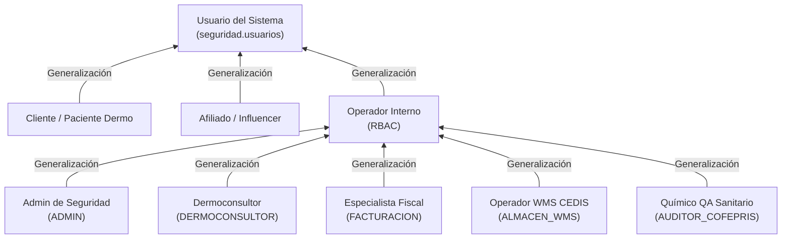
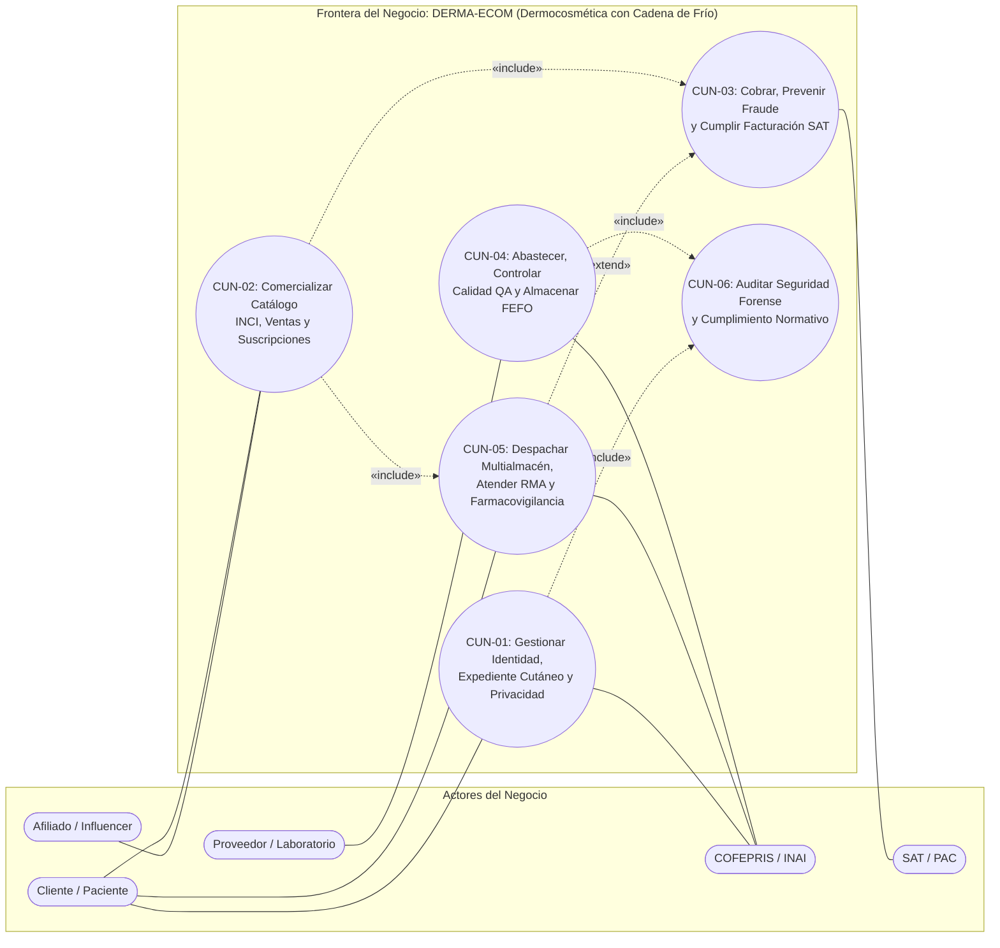
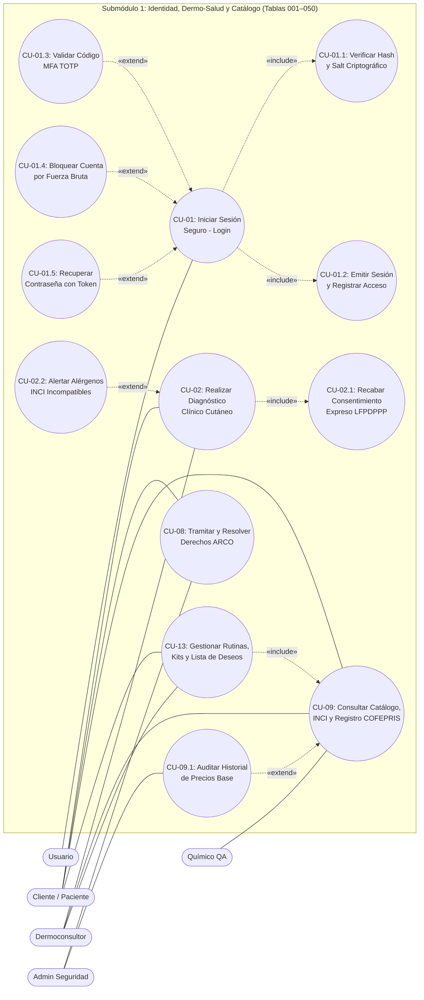
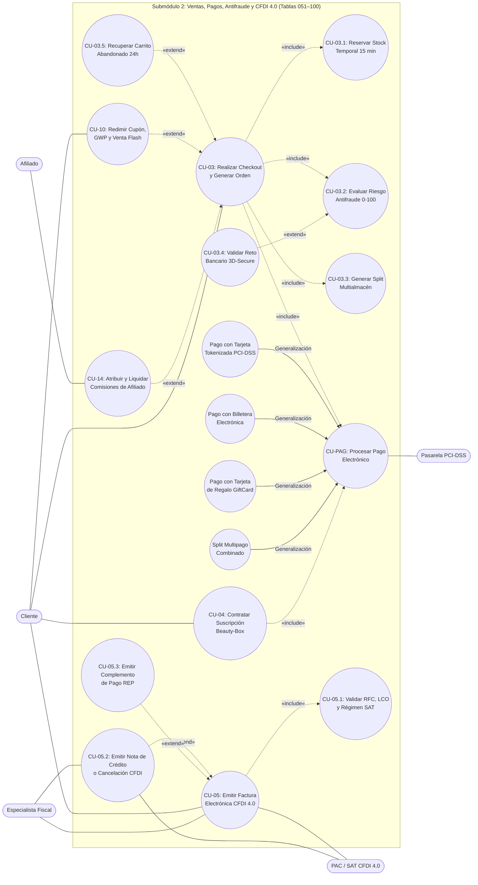
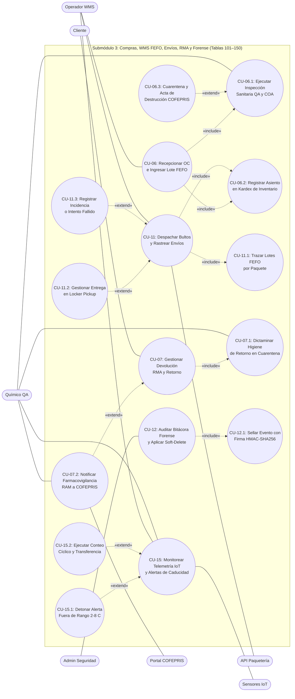

# MODELADO DEL NEGOCIO Y CASOS DE USO DEL SISTEMA (UML 2.5)
## PROYECTO INTEGRADOR V — TECNM / INSTITUTO TECNOLÓGICO SUPERIOR DE MONCLOVA
### ASIGNATURA: ANÁLISIS Y MODELADO DE SISTEMAS DE INFORMACIÓN (AMSI — IFE-1005) — CRITERIO 1.2 (25%)
**Sistema:** DERMA-ECOM (E-Commerce de Salud Cutánea, Belleza y Maquillaje con Trazabilidad FEFO y Cadena de Frío)  
**Autores y Distribución Equitativa:**
- **Submódulo 1 (`Tablas 001–050` · `seguridad`, `clientes`, `catalogo`, `comunidad`):** José Luis Luna García
- **Submódulo 2 (`Tablas 051–100` · `ventas`, `pagos`, `fiscal`, `promos`):** Sheyla Estefanía Moncada Guel
- **Submódulo 3 (`Tablas 101–150` · `compras`, `wms`, `envios`, `postventa`, `auditoria`, `sistema`):** Eduardo Salazar Martínez

> [!IMPORTANT]
> **Diagramas UML 2.5 Visuales Editables (Actores con figura humana, óvalos, fronteras de sistema, `«include»`, `«extend»` y generalización):**
> - Editable `.drawio`: [`02a_diagrama_casos_de_uso_UML.drawio`](./02a_diagrama_casos_de_uso_UML.drawio)
> - Visor Interactivo HTML/SVG (con zoom, filtro por submódulo y exportación SVG): [`02b_visor_interactivo_casos_de_uso_UML.html`](./02b_visor_interactivo_casos_de_uso_UML.html)

---

## 1. CATÁLOGO DE ACTORES Y JERARQUÍA DE GENERALIZACIÓN UML

Los actores se derivan directamente de los roles RBAC (`seguridad.roles`), especializaciones de usuario (`clientes.clientes`, `ventas.afiliados_influencers`) e integraciones externas modeladas en las **150 tablas** de `EcommerceSaludBellezaDB`.

| Actor | Tipo | Rol BD / Sistema | Responsabilidad y Alcance Operativo | Submódulo |
| :--- | :---: | :--- | :--- | :---: |
| **Usuario del Sistema** *(Abstracto)* | Humano (General) | `seguridad.usuarios` | Superclase de todo actor humano autenticado (Login, MFA TOTP, gestión de sesiones y recuperación de contraseña). | Global |
| **Cliente / Paciente Dermo** | Humano (Primario) | `CLIENTE` (`clientes.clientes`) | Responde diagnósticos cutáneos, otorga consentimiento LFPDPPP, compra cosméticos, contrata suscripciones Beauty-Box, factura CFDI 4.0, tramita RMA y ejerce Derechos ARCO. | SM1, SM2, SM3 |
| **Afiliado / Influencer** | Humano (Primario) | `ventas.afiliados_influencers` | Comparte códigos promocionales dermatológicos, consulta ventas atribuidas y cobra comisiones porcentuales. | SM1, SM2 |
| **Operador Interno** *(Abstracto)* | Humano (General) | `seguridad.usuarios_roles` | Superclase de personal interno autenticado con matriz RBAC (`seguridad.roles_permisos`). | Global |
| **Administrador de Seguridad** | Humano (Primario) | `ADMIN` | Supervisa usuarios/roles RBAC, atiende solicitudes ARCO, administra parámetros del sistema y audita bitácoras forenses HMAC y cambios DML JSON. | SM1, SM3 |
| **Dermoconsultor Clínico** | Humano (Secundario) | `DERMOCONSULTOR` | Revisa perfiles cutáneos, valida incompatibilidades de alérgenos INCI, aprueba rutinas personalizadas y atiende tickets de soporte. | SM1, SM3 |
| **Especialista en Facturación** | Humano (Secundario) | `FACTURACION` | Gestiona timbrado CFDI 4.0, complementos de pago (REP), notas de crédito por devoluciones y cancelaciones SAT. | SM2 |
| **Operador WMS / Almacenista** | Humano (Primario) | `ALMACEN_WMS` | Recepciona tarimas de proveedores, administra ubicaciones, ejecuta surtido FEFO, conteos cíclicos, transferencias inter-CEDIS y despacho de bultos. | SM3 |
| **Químico Farmacéutico QA** | Humano (Primario) | `AUDITOR_COFEPRIS` | Emite dictámenes QA en recepción, libera o pone en cuarentena lotes sanitarios, autoriza actas de destrucción y notifica farmacovigilancia a COFEPRIS. | SM1, SM3 |
| **Pasarela de Pago (Stripe/MP)** | Sistema Externo | `pagos.proveedores_pasarela` | Tokeniza tarjetas (PCI-DSS SAQ A-EP), ejecuta cobros, reto 3D-Secure, reembolsos y notifica liquidaciones/contracargos vía Webhooks. | SM2 |
| **PAC / Servidor SAT CFDI 4.0** | Sistema Externo | `fiscal.facturas_cfdi` | Valida RFC/LCO/Régimen y timbra facturas, complementos de pago y notas de crédito asignando `uuid_sat_fiscal`. | SM2 |
| **API Paquetería (DHL/FedEx/Estafeta)** | Sistema Externo | `envios.transportistas_paqueterias` | Cotiza tarifas por código postal, emite guías de rastreo (directa y retorno RMA), gestiona lockers pickup y envía eventos de tracking. | SM3 |
| **Sensores IoT Cadena de Frío** | Sistema Externo | `wms.monitoreo_temperatura_humedad` | Emite lecturas continuas de temperatura (2–8 °C) y humedad relativa de cámaras frías de activos biológicos. | SM3 |
| **Portal COFEPRIS** | Sistema Externo | `postventa.reportes_farmacovigilancia` | Recibe notificaciones de reacciones adversas (RAM) y valida vigencia de registros sanitarios cosméticos. | SM1, SM3 |

### 1.1 Diagrama de Generalización de Actores (UML)

---

## 2. MODELADO DEL NEGOCIO: DIAGRAMA DE CASOS DE USO DEL NEGOCIO (DCU DE NEGOCIO)

El **Diagrama de Casos de Uso del Negocio** modela los macroprocesos de valor de **DERMA-ECOM** desde la perspectiva de los actores del negocio (clientes, proveedores, autoridades regulatorias y operadores) antes de descender al detalle técnico del software.

---

## 3. DIAGRAMAS DE CASOS DE USO DEL SISTEMA (UML 2.5 CON `«include»`, `«extend»` Y GENERALIZACIÓN)

### 3.1 Diagrama General de Casos de Uso del Sistema (Vista Integrada — 18 Casos de Uso)

```mermaid
flowchart LR
    USR(["Usuario"])
    CLI(["Cliente / Paciente"])
    AFI(["Afiliado"])
    DER(["Dermoconsultor"])
    ADM(["Admin Seguridad"])
    FAC(["Especialista Fiscal"])
    WMS(["Operador WMS"])
    QA(["Químico QA"])
    PAS(["Pasarela PCI-DSS"])
    SAT(["PAC / SAT 4.0"])
    LOG(["API Paquetería"])
    IOT(["Sensores IoT"])

    subgraph DERMA_SYS["Sistema DERMA-ECOM (150 Tablas · 14 Esquemas)"]
        subgraph SM1["Submódulo 1 — José Luis Luna García (001–050)"]
            CU01(("CU-01: Autenticar Usuario\nLogin + MFA"))
            CU02(("CU-02: Diagnóstico Cutáneo\ny Perfil Dermo"))
            CU08(("CU-08: Ejercer y Resolver\nDerechos ARCO"))
            CU09(("CU-09: Consultar Catálogo\nINCI y COFEPRIS"))
            CU13(("CU-13: Gestionar Rutinas,\nKits y Wishlist"))
        end

        subgraph SM2["Submódulo 2 — Sheyla Estefanía Moncada Guel (051–100)"]
            CU03(("CU-03: Checkout, Split\ny Pago Seguro"))
            CU04(("CU-04: Suscripción\nBeauty-Box"))
            CU05(("CU-05: Emitir / Cancelar\nCFDI 4.0"))
            CU10(("CU-10: Cupones, GWP\ny Ventas Flash"))
            CU14(("CU-14: Gestionar Afiliados\ny Comisiones"))
        end

        subgraph SM3["Submódulo 3 — Eduardo Salazar Martínez (101–150)"]
            CU06(("CU-06: Compras, QA\ny Lotes FEFO"))
            CU07(("CU-07: Devoluciones RMA\ny Farmacovigilancia"))
            CU11(("CU-11: Despacho, Tracking\ny Pickup"))
            CU12(("CU-12: Auditoría Forense\ny Soft-Delete"))
            CU15(("CU-15: Monitoreo IoT Frío\ny Alertas FEFO"))
        end
    end

    USR --- CU01
    CLI --- CU02
    CLI --- CU03
    CLI --- CU04
    CLI --- CU05
    CLI --- CU07
    CLI --- CU08
    CLI --- CU09
    CLI --- CU10
    CLI --- CU13
    AFI --- CU14
    DER --- CU02
    DER --- CU09
    DER --- CU13
    ADM --- CU08
    ADM --- CU12
    FAC --- CU05
    WMS --- CU06
    WMS --- CU11
    WMS --- CU15
    QA --- CU06
    QA --- CU07
    QA --- CU15

    CU03 --- PAS
    CU04 --- PAS
    CU05 --- SAT
    CU11 --- LOG
    CU15 --- IOT
```

---

### 3.2 DCU del Submódulo 1: Identidad, Perfil Dermo-Salud, Catálogo INCI y Comunidad (Tablas 001–050)
**Autor Responsable:** José Luis Luna García (`seguridad`, `clientes`, `catalogo`, `comunidad`)

---

### 3.3 DCU del Submódulo 2: Motor Comercial, Suscripciones, Pagos, Antifraude, CFDI 4.0 y Promociones (Tablas 051–100)
**Autor Responsable:** Sheyla Estefanía Moncada Guel (`ventas`, `pagos`, `fiscal`, `promos`)

---

### 3.4 DCU del Submódulo 3: Compras, WMS FEFO, Cadena de Frío IoT, Envíos, Postventa RMA y Auditoría Forense (Tablas 101–150)
**Autor Responsable:** Eduardo Salazar Martínez (`compras`, `wms`, `envios`, `postventa`, `auditoria`, `sistema`)

---

## 4. MATRIZ DE TRAZABILIDAD: CASOS DE USO ↔ REQUISITOS (RF) ↔ BASE DE DATOS (150 TABLAS)

| Caso de Uso | Submódulo / Autor | Requisitos (SRS) | Esquemas y Tablas Clave en BD (`PK = ID`, `FK = ID_*`) |
| :---: | :--- | :---: | :--- |
| **CU-01** | SM1 · José Luis Luna García | RF-01 a RF-05 | `seguridad.usuarios`, `roles`, `permisos`, `roles_permisos`, `usuarios_roles`, `sesiones_activas`, `historial_passwords`, `intentos_login`, `tokens_recuperacion`, `dispositivos_confianza` |
| **CU-02** | SM1 · José Luis Luna García | RF-06, RF-07 | `clientes.clientes`, `tipos_piel`, `condiciones_dermatologicas`, `perfil_cutaneo`, `cliente_condiciones`, `cuestionarios_diagnostico`, `preguntas_diagnostico`, `opciones_pregunta`, `evaluaciones_diagnostico`, `respuestas_evaluacion`, `consentimientos_privacidad` |
| **CU-08** | SM1 · José Luis Luna García | RF-08, RF-09 | `clientes.solicitudes_arco`, `clientes.preferencias_comunicacion`, `clientes.direcciones`, `clientes.metodos_pago_tokenizados` |
| **CU-09** | SM1 · José Luis Luna García | RF-10 a RF-13, RF-15 | `catalogo.marcas`, `laboratorios_fabricantes`, `categorias`, `subcategorias`, `tipos_aplicacion`, `certificaciones_sanitarias`, `productos_maestros`, `variantes_sku`, `tonos_variante`, `subtonos_maquillaje`, `acabados_maquillaje`, `ingredientes_inci`, `alergenos_ingrediente`, `formula_ingredientes`, `registros_sanitarios_cofepris`, `advertencias_contraindicaciones`, `multimedia_variantes`, `historial_precios_base` |
| **CU-13** | SM1 · José Luis Luna García | RF-14 | `catalogo.kits_sets`, `kits_items`, `productos_relacionados`, `comunidad.rutinas_belleza`, `rutinas_pasos`, `rutinas_productos`, `listas_deseos` |
| **CU-03** | SM2 · Sheyla Estefanía Moncada Guel | RF-16, RF-17, RF-20 a RF-22, RF-24 a RF-27 | `ventas.carritos`, `items_carrito`, `carritos_abandonados_seguimiento`, `reservas_temporales_stock`, `ordenes`, `estados_orden`, `motivos_cancelacion_orden`, `ordenes_detalles`, `ordenes_historial_estados`, `ordenes_splits_almacen`, `ordenes_impuestos`, `ordenes_descuentos`, `ordenes_notas_instrucciones`, `pagos.proveedores_pasarela`, `metodos_pago`, `transacciones`, `intentos_cobro`, `split_multipagos`, `billetera_electronica`, `movimientos_billetera`, `tarjetas_regalo_giftcards`, `redenciones_giftcards`, `reglas_antifraude`, `evaluaciones_antifraude`, `contracargos_chargebacks`, `reembolsos_transaccion` |
| **CU-04** | SM2 · Sheyla Estefanía Moncada Guel | RF-18 | `ventas.planes_suscripcion`, `frecuencias_suscripcion`, `suscripciones_cliente`, `suscripciones_items`, `suscripciones_calendario_entregas`, `suscripciones_bitacora_estados` |
| **CU-05** | SM2 · Sheyla Estefanía Moncada Guel | RF-28, RF-29 | `fiscal.regimenes_sat`, `usos_cfdi`, `datos_fiscales_cliente`, `facturas_cfdi`, `facturas_partidas`, `complementos_pago`, `notas_credito`, `cancelaciones_cfdi` |
| **CU-10** | SM2 · Sheyla Estefanía Moncada Guel | RF-19, RF-30 | `ventas.tipos_descuento`, `regalos_por_compra_gwp`, `promos.campanias`, `cupones`, `reglas_elegibilidad_cupon`, `cupones_categorias_excluidas`, `redenciones_cupones`, `ventas_flash_horarias` |
| **CU-14** | SM2 · Sheyla Estefanía Moncada Guel | RF-23 | `ventas.afiliados_influencers`, `ventas.comisiones_afiliados` |
| **CU-06** | SM3 · Eduardo Salazar Martínez | RF-31 a RF-36, RF-38 | `compras.proveedores`, `contactos_proveedor`, `proveedor_slas`, `proveedor_productos`, `requisiciones`, `requisiciones_detalles`, `estados_orden_compra`, `ordenes_compra`, `ordenes_compra_detalles`, `recepciones_mercancia`, `recepciones_detalles`, `inspecciones_sanitarias_qa`, `wms.almacenes_cedis`, `zonas_almacen`, `pasillos_ubicaciones`, `lotes_fabricacion_sanitaria`, `inventario_lotes_ubicacion`, `tipos_movimiento_inventario`, `kardex_movimientos`, `mermas_destruccion_sanitaria` |
| **CU-15** | SM3 · Eduardo Salazar Martínez | RF-37, RF-39, RF-40 | `wms.alertas_caducidad_proxima`, `wms.conteos_ciclicos_auditoria`, `wms.conteos_ciclicos_detalles`, `wms.transferencias_almacenes`, `wms.transferencias_detalles`, `wms.monitoreo_temperatura_humedad` |
| **CU-11** | SM3 · Eduardo Salazar Martínez | RF-41 | `envios.transportistas_paqueterias`, `tipos_servicio_envio`, `tarifas_zonas_postales`, `despachos_orden`, `paquetes_bultos`, `paquetes_contenido_lotes`, `guias_rastreo`, `eventos_tracking_bitacora`, `intentos_entrega_fallidos`, `incidencias_logisticas`, `seguros_mercancia`, `puntos_recoleccion_pickup` |
| **CU-07** | SM3 · Eduardo Salazar Martínez | RF-42, RF-43 | `postventa.motivos_devolucion_rma`, `solicitudes_rma`, `rma_detalles`, `inspeccion_sanitaria_retorno`, `tickets_soporte`, `tickets_mensajes`, `reportes_farmacovigilancia` |
| **CU-12** | SM3 · Eduardo Salazar Martínez | RF-44, RF-45 | `auditoria.tipos_evento_sistema`, `bitacora_seguridad_global`, `bitacora_cambios_datos`, `sistema.parametros_configuracion`, `notificaciones_push_email` |

---

## 5. ESPECIFICACIÓN DETALLADA DE CASOS DE USO (12 FICHAS FORMALES)

Todas las fichas incluyen obligatoriamente **Precondiciones**, **Flujo Principal**, **Flujos Alternativos / Excepciones** y **Postcondiciones**, comenzando por el caso de uso obligatorio **CU-01: Autenticación Segura de Usuario (Login)**.

---

### FICHA CU-01: Autenticación Segura de Usuario (Login con Hashing, MFA TOTP y Bloqueo por Fuerza Bruta) *(OBLIGATORIO)*
- **Autor Responsable:** José Luis Luna García (Submódulo 1 — Seguridad e Identidad)
- **Actores:** Usuario del Sistema *(Primario)*, Administrador de Seguridad *(Secundario)*.
- **Relaciones UML:** `«include»` CU-01.1 (Verificar Hash y Salt), `«include»` CU-01.2 (Emitir Sesión y Registrar Acceso); extendido por CU-01.3 (MFA TOTP), CU-01.4 (Bloqueo Fuerza Bruta), CU-01.5 (Recuperación con Token).
- **Tablas BD:** `seguridad.usuarios`, `seguridad.roles`, `seguridad.usuarios_roles`, `seguridad.sesiones_activas`, `seguridad.intentos_login`, `seguridad.dispositivos_confianza`, `auditoria.bitacora_seguridad_global`.
- **Propósito:** Autenticar la identidad del usuario sin almacenar ni comparar contraseñas en texto plano, validando factor múltiple (TOTP) y mitigando ataques de diccionario o fuerza bruta.
- **Precondiciones:**
  1. La cuenta existe en `seguridad.usuarios` con `activo = 1` y `email_verificado = 1`.
  2. La cuenta no se encuentra bloqueada (`cuenta_bloqueada = 0`) o ya transcurrieron más de 15 minutos desde `fecha_bloqueo`.
  3. El canal de comunicación opera sobre TLS 1.3.

| Paso | Acción del Actor | Respuesta del Sistema |
| :---: | :--- | :--- |
| 1 | El usuario ingresa su `email` y contraseña en el formulario de acceso. | El sistema valida formato, sanitiza entradas y consulta `seguridad.usuarios` por `email` (índice `IX_seguridad_usuarios_activo_email`). |
| 2 | — | *[«include» CU-01.1]* El Servicio Criptográfico combina la contraseña recibida con `password_salt` y recalcula el hash (PBKDF2/SHA2-512 en SQL Server o bcrypt/Argon2id en PostgreSQL), comparándolo en tiempo constante contra `password_hash`. |
| 3 | Las credenciales coinciden. Si `mfa_habilitado = 1`, el sistema solicita el código TOTP de 6 dígitos *[«extend» CU-01.3]*. | El sistema espera la captura del código dinámico con ventana de tolerancia de ±30 segundos. |
| 4 | El usuario ingresa el código TOTP generado en su app autenticadora. | El sistema verifica el código contra `mfa_secreto` y carga los roles/permisos RBAC desde `seguridad.usuarios_roles` y `seguridad.roles_permisos`. |
| 5 | — | *[«include» CU-01.2]* El sistema reinicia `intentos_fallidos_consecutivos = 0`, actualiza `ultimo_login_exitoso`, inserta el registro de éxito en `seguridad.intentos_login`, genera el token de sesión en `seguridad.sesiones_activas` (almacenando `token_sesion_hash`) y redirige al portal según el rol RBAC. |

- **Flujos Alternativos y Excepciones:**
  - **1a. Correo inexistente o cuenta inactiva (`activo = 0`):** El sistema ejecuta un cálculo de hash simulado (*timing-attack mitigation*), registra el intento en `seguridad.intentos_login` (`ID_usuario = NULL`, `resultado = 'FALLIDO_CREDENCIALES'`) y muestra el mensaje genérico *"Credenciales inválidas"* sin revelar si el correo existe.
  - **2a. Contraseña incorrecta:** Incrementa `intentos_fallidos_consecutivos + 1` e inserta en `seguridad.intentos_login`. Si alcanza **5 intentos consecutivos** *[«extend» CU-01.4]*: actualiza `cuenta_bloqueada = 1`, `fecha_bloqueo = SYSDATETIME()`, inserta evento crítico con firma HMAC-SHA256 en `auditoria.bitacora_seguridad_global`, encola alerta en `sistema.notificaciones_push_email` y bloquea el acceso por 15 minutos.
  - **4a. Código MFA inválido o expirado:** El sistema registra el fallo, permite hasta 2 reintentos y, si persiste el error, invalida el desafío de sesión.
  - **1b. Olvido de contraseña *[«extend» CU-01.5]*:** El usuario solicita restablecimiento; el sistema genera un token de un solo uso con hash en `seguridad.tokens_recuperacion` (vigencia 30 min) y valida contra `seguridad.historial_passwords` que la nueva clave no haya sido reutilizada.
- **Postcondiciones:**
  - **Éxito:** Existe una sesión vigente en `seguridad.sesiones_activas`, `intentos_fallidos_consecutivos = 0` y registro de auditoría `EXITOSO` en `seguridad.intentos_login`.
  - **Fallo:** No se crea sesión; queda evidencia forense con IP y `user_agent` en `seguridad.intentos_login` (y bloqueo + evento HMAC si alcanzó el umbral).

---

### FICHA CU-02: Diagnóstico Clínico Cutáneo y Consentimiento de Salud LFPDPPP
- **Autor Responsable:** José Luis Luna García (Submódulo 1 — Perfil Dermo-Salud)
- **Actores:** Cliente / Paciente Dermo *(Primario)*, Dermoconsultor Clínico *(Secundario)*.
- **Relaciones UML:** `«include»` CU-02.1 (Recabar Consentimiento Expreso LFPDPPP); extendido por CU-02.2 (Alertar Alérgenos INCI Incompatibles).
- **Tablas BD:** `clientes.consentimientos_privacidad`, `clientes.cuestionarios_diagnostico`, `clientes.preguntas_diagnostico`, `clientes.opciones_pregunta`, `clientes.evaluaciones_diagnostico`, `clientes.respuestas_evaluacion`, `clientes.perfil_cutaneo`, `clientes.cliente_condiciones`, `catalogo.alergenos_ingrediente`.
- **Propósito:** Clasificar el biotipo y afecciones cutáneas del cliente bajo consentimiento expreso de datos sensibles (Art. 9 LFPDPPP) para recomendar productos seguros.
- **Precondiciones:** Cliente autenticado (`CU-01`) con registro activo en `clientes.clientes`.

| Paso | Acción del Actor | Respuesta del Sistema |
| :---: | :--- | :--- |
| 1 | El cliente selecciona *"Iniciar Diagnóstico de Piel"*. | *[«include» CU-02.1]* El sistema despliega el Aviso de Privacidad Integral con casilla independiente para datos sensibles de salud cutánea. |
| 2 | El cliente otorga su consentimiento expreso y firma electrónicamente. | Registra en `clientes.consentimientos_privacidad` (`acepta_tratamiento_datos_salud_sensibles = 1`, `direccion_ip_firma`, `version_aviso_privacidad`, `fecha_consentimiento`). |
| 3 | El cliente responde el cuestionario clínico (oleosidad, sensibilidad solar, brotes, afecciones). | Recupera preguntas/opciones de `clientes.preguntas_diagnostico` y `clientes.opciones_pregunta`. |
| 4 | El cliente pulsa *"Calcular Diagnóstico"*. | Pondera el puntaje clínico en `clientes.evaluaciones_diagnostico`, guarda cada respuesta en `clientes.respuestas_evaluacion`, determina `ID_tipo_piel` y guarda `clientes.perfil_cutaneo` y `clientes.cliente_condiciones`. |
| 5 | — | Genera recomendaciones filtrando contraindicaciones y alérgenos INCI *[«extend» CU-02.2]* y habilita revisión opcional del Dermoconsultor. |

- **Flujos Alternativos y Excepciones:**
  - **2a. Rechazo del consentimiento sensible:** El sistema bloquea el almacenamiento clínico conforme a la LFPDPPP y redirige a la navegación del catálogo público sin perfilado.
  - **5a. Detección de condición severa (Rosácea/Dermatitis severa):** El sistema muestra advertencia clínica obligatoria recomendando valoración dermatológica presencial y deriva a consulta con el Dermoconsultor.
- **Postcondiciones:**
  - **Éxito:** Consentimiento inmutable guardado en `clientes.consentimientos_privacidad`, perfil cutáneo activo en `clientes.perfil_cutaneo` y condiciones en `clientes.cliente_condiciones`.
  - **Fallo:** Ningún dato sensible de salud queda almacenado en la base de datos.

---

### FICHA CU-03: Realizar Checkout, Split Multialmacén y Pago Seguro PCI-DSS
- **Autor Responsable:** Sheyla Estefanía Moncada Guel (Submódulo 2 — Comercial y Pagos)
- **Actores:** Cliente *(Primario)*, Pasarela de Pago PCI-DSS *(Secundario/Externo)*, Operador WMS *(Secundario)*.
- **Relaciones UML:** `«include»` CU-03.1 (Reservar Stock 15 min), `«include»` CU-03.2 (Evaluar Antifraude), `«include»` CU-PAG (Procesar Pago), `«include»` CU-03.3 (Generar Split Multialmacén); extendido por CU-03.4 (3D-Secure), CU-10 (Cupones/GWP/Flash), CU-14 (Afiliados).
- **Tablas BD:** `ventas.carritos`, `ventas.items_carrito`, `ventas.reservas_temporales_stock`, `ventas.ordenes`, `ventas.ordenes_detalles`, `ventas.ordenes_impuestos`, `ventas.ordenes_descuentos`, `ventas.ordenes_splits_almacen`, `pagos.evaluaciones_antifraude`, `pagos.reglas_antifraude`, `pagos.transacciones`, `pagos.intentos_cobro`, `pagos.split_multipagos`.
- **Propósito:** Convertir un carrito activo en una orden pagada con integridad ACID, evaluación antifraude, protección contra sobreventa y división logística por CEDIS.
- **Precondiciones:** Cliente autenticado (`CU-01`), carrito activo en `ventas.carritos` con al menos 1 ítem con stock disponible en `wms.inventario_lotes_ubicacion`.

| Paso | Acción del Actor | Respuesta del Sistema |
| :---: | :--- | :--- |
| 1 | El cliente pulsa *"Proceder al Pago"*. | *[«include» CU-03.1]* Bloquea el stock de cada `ID_variante_sku` en `ventas.reservas_temporales_stock` por 15 minutos. |
| 2 | El cliente elige `ID_direccion_envio`, `ID_direccion_facturacion`, cupón opcional *[«extend» CU-10]* y modalidad de pago (Tarjeta Tokenizada, Billetera, GiftCard o Split Multipago). | Calcula envío, descuentos (`ventas.ordenes_descuentos`) e impuestos federales IVA 16% (`ventas.ordenes_impuestos`). |
| 3 | El cliente confirma la compra mediante formulario tokenizado de la pasarela. | *[«include» CU-03.2]* Evalúa reglas de `pagos.reglas_antifraude` y persiste el score en `pagos.evaluaciones_antifraude`. |
| 4 | — | *[«include» CU-PAG]* Con `score_riesgo_total < 65` y llave de idempotencia, invoca el cobro en la Pasarela PCI-DSS sin persistir PAN ni CVV. |
| 5 | La pasarela autoriza el cargo (HTTP 200). | Crea la orden en `ventas.ordenes`, partidas en `ventas.ordenes_detalles`, registra el cobro aprobado en `pagos.transacciones`, libera la reserva y registra historial en `ventas.ordenes_historial_estados`. |
| 6 | — | *[«include» CU-03.3]* Evalúa la ubicación de stock FEFO por CEDIS y crea uno o más sub-splits en `ventas.ordenes_splits_almacen`; notifica al cliente vía `sistema.notificaciones_push_email`. |

- **Flujos Alternativos y Excepciones:**
  - **3a. Score antifraude ≥ 65 *[«extend» CU-03.4]*:** Solicita autenticación 3D-Secure al banco emisor. Si falla o el score ≥ 85, rechaza la orden (`ID_motivo_cancelacion` en `ventas.motivos_cancelacion_orden`) y libera el stock reservado.
  - **4a. Fondos insuficientes / declinación bancaria:** Inserta el fallo en `pagos.intentos_cobro`, conserva la reserva durante los 15 minutos restantes y permite cambiar de método de pago o usar `pagos.split_multipagos`.
  - **1a. Expiración de los 15 minutos:** Un proceso automático libera los registros vencidos en `ventas.reservas_temporales_stock`.
- **Postcondiciones:**
  - **Éxito:** Orden confirmada en `ventas.ordenes`, transacción aprobada en `pagos.transacciones`, evaluación en `pagos.evaluaciones_antifraude` y splits listos en `ventas.ordenes_splits_almacen`.
  - **Fallo:** Stock liberado, intento fallido auditado en `pagos.intentos_cobro` y ningún cobro duplicado gracias a la llave de idempotencia.

---

### FICHA CU-04: Contratar y Gestionar Suscripción Beauty-Box
- **Autor Responsable:** Sheyla Estefanía Moncada Guel (Submódulo 2 — Suscripciones)
- **Actores:** Cliente *(Primario)*, Pasarela de Pago PCI-DSS *(Secundario/Externo)*.
- **Relaciones UML:** `«include»` CU-PAG (Procesar Pago Recurrente Tokenizado).
- **Tablas BD:** `ventas.planes_suscripcion`, `ventas.frecuencias_suscripcion`, `ventas.suscripciones_cliente`, `ventas.suscripciones_items`, `ventas.suscripciones_calendario_entregas`, `ventas.suscripciones_bitacora_estados`, `clientes.metodos_pago_tokenizados`.
- **Propósito:** Activar un plan recurrente de cajas dermocosméticas con cobro tokenizado programado y calendario de entregas.
- **Precondiciones:** Cliente autenticado con domicilio válido (`clientes.direcciones`) y método de pago tokenizado vigente (`clientes.metodos_pago_tokenizados`).

| Paso | Acción del Actor | Respuesta del Sistema |
| :---: | :--- | :--- |
| 1 | El cliente selecciona un plan de `ventas.planes_suscripcion` y frecuencia (`ventas.frecuencias_suscripcion`). | Muestra precio congelado, SKUs incluidos y próximas fechas estimadas de despacho. |
| 2 | El cliente elige dirección de entrega, método tokenizado y autoriza cargos recurrentes. | Valida cobertura postal y crea mandato de cobro recurrente en la pasarela. |
| 3 | — | *[«include» CU-PAG]* Ejecuta el primer cargo. Al aprobarse, inserta `ventas.suscripciones_cliente` (`estado_suscripcion = 'ACTIVA'`), ítems en `ventas.suscripciones_items` y bitácora en `ventas.suscripciones_bitacora_estados`. |
| 4 | — | Genera el calendario de envíos futuros en `ventas.suscripciones_calendario_entregas` y envía confirmación. |

- **Flujos Alternativos y Excepciones:**
  - **3a. Cargo recurrente rechazado:** Registra el intento en `pagos.intentos_cobro`, cambia el estado a `'PAUSADA_PAGO'` en `ventas.suscripciones_bitacora_estados` y programa 3 reintentos automáticos en 72 horas.
  - **4a. Pausa o cancelación voluntaria por el cliente:** Actualiza `estado_suscripcion` y registra el cambio de estado sin borrado físico.
- **Postcondiciones:**
  - **Éxito:** Suscripción activa con calendario de entregas programado y primer pedido generado.
  - **Fallo:** Suscripción no activada o pausada con notificación al cliente para actualizar tarjeta.

---

### FICHA CU-05: Emisión, Complemento y Cancelación de Factura Electrónica CFDI 4.0
- **Autor Responsable:** Sheyla Estefanía Moncada Guel (Submódulo 2 — Fiscal SAT)
- **Actores:** Cliente *(Primario)*, Especialista en Facturación *(Secundario)*, PAC / Servidor SAT CFDI 4.0 *(Secundario/Externo)*.
- **Relaciones UML:** `«include»` CU-05.1 (Validar RFC/LCO/Régimen SAT); extendido por CU-05.2 (Nota de Crédito / Cancelación CFDI) y CU-05.3 (Complemento de Pago REP).
- **Tablas BD:** `fiscal.regimenes_sat`, `fiscal.usos_cfdi`, `fiscal.datos_fiscales_cliente`, `fiscal.facturas_cfdi`, `fiscal.facturas_partidas`, `fiscal.complementos_pago`, `fiscal.notas_credito`, `fiscal.cancelaciones_cfdi`.
- **Propósito:** Emitir comprobantes fiscales digitales versión 4.0 válidos ante el SAT vinculados a órdenes pagadas.
- **Precondiciones:** Orden en estado pagado en `ventas.ordenes` y receptor con datos fiscales en `fiscal.datos_fiscales_cliente`.

| Paso | Acción del Actor | Respuesta del Sistema |
| :---: | :--- | :--- |
| 1 | El cliente solicita facturar su orden y selecciona `ID_uso_cfdi`. | *[«include» CU-05.1]* Verifica RFC, Razón Social, código postal y compatibilidad entre `ID_regimen_sat` (`fiscal.regimenes_sat`) y `ID_uso_cfdi` (`fiscal.usos_cfdi`). |
| 2 | El cliente confirma la emisión. | Construye el XML Anexo 20 CFDI 4.0 con clave SAT `53131600`, sella con el CSD y transmite al PAC. |
| 3 | El PAC retorna el timbre fiscal digital (`uuid_sat_fiscal`). | Almacena la factura en `fiscal.facturas_cfdi` y el desglose de conceptos en `fiscal.facturas_partidas`; envía XML y PDF al correo fiscal del cliente. |

- **Flujos Alternativos y Excepciones:**
  - **1a. Inconsistencia fiscal SAT (código postal o régimen inválido):** El sistema detiene el timbrado e indica el campo exacto a corregir conforme a la Constancia de Situación Fiscal.
  - **3a. Devolución aprobada o error de emisión *[«extend» CU-05.2]*:** El Especialista Fiscal genera un CFDI de Egreso en `fiscal.notas_credito` o tramita la anulación con motivo SAT `'01'`–`'04'` en `fiscal.cancelaciones_cfdi`.
  - **3b. Pago diferido o en parcialidades (PPD) *[«extend» CU-05.3]*:** Emite un Complemento de Recepción de Pagos en `fiscal.complementos_pago` ligado a `pagos.transacciones`.
- **Postcondiciones:**
  - **Éxito:** Factura timbrada con `uuid_sat_fiscal` único en `fiscal.facturas_cfdi` y archivos XML/PDF disponibles para descarga.
  - **Fallo:** No se consume timbre del PAC y la orden permanece habilitada para reintentar la facturación.

---

### FICHA CU-06: Recepción de Órdenes de Compra, Dictamen QA e Ingreso a WMS por Lote FEFO
- **Autor Responsable:** Eduardo Salazar Martínez (Submódulo 3 — Compras y WMS)
- **Actores:** Operador WMS / Almacenista *(Primario)*, Químico Farmacéutico QA *(Primario)*.
- **Relaciones UML:** `«include»` CU-06.1 (Inspección Sanitaria QA), `«include»` CU-06.2 (Asiento Kardex); extendido por CU-06.3 (Cuarentena y Destrucción COFEPRIS).
- **Tablas BD:** `compras.proveedores`, `compras.ordenes_compra`, `compras.ordenes_compra_detalles`, `compras.recepciones_mercancia`, `compras.recepciones_detalles`, `compras.inspecciones_sanitarias_qa`, `wms.lotes_fabricacion_sanitaria`, `wms.pasillos_ubicaciones`, `wms.inventario_lotes_ubicacion`, `wms.kardex_movimientos`, `wms.mermas_destruccion_sanitaria`.
- **Propósito:** Controlar la recepción física en CEDIS, garantizar la inocuidad sanitaria mediante dictamen QA y habilitar existencias ordenadas por caducidad FEFO.
- **Precondiciones:** Existe una orden en `compras.ordenes_compra` en estado emitido hacia un proveedor activo.

| Paso | Acción del Actor | Respuesta del Sistema |
| :---: | :--- | :--- |
| 1 | El almacenista captura el folio de OC y realiza conteo ciego de piezas recibidas y dañadas. | Registra `compras.recepciones_mercancia` y `compras.recepciones_detalles`, colocando las piezas en estado `'CUARENTENA_QA'`. |
| 2 | *[«include» CU-06.1]* El Químico QA inspecciona temperatura de arribo, pH, sellos de inviolabilidad y Certificado de Análisis (COA). | Registra el dictamen técnico en `compras.inspecciones_sanitarias_qa`. |
| 3 | El Químico QA emite dictamen `'APROBADO'`. | Crea el lote oficial en `wms.lotes_fabricacion_sanitaria` con `fecha_fabricacion` y `fecha_caducidad`. |
| 4 | El Operador WMS ubica las tarimas en un pasillo/rack (`wms.pasillos_ubicaciones`). | Actualiza `wms.inventario_lotes_ubicacion` e inserta *[«include» CU-06.2]* el movimiento de entrada en `wms.kardex_movimientos` habilitando el lote para FEFO. |

- **Flujos Alternativos y Excepciones:**
  - **3a. Dictamen QA `'RECHAZADO'` (cadena de frío rota o empaque contaminado) *[«extend» CU-06.3]*:** El lote permanece bloqueado para venta; se emite reclamo al proveedor (impactando `compras.proveedor_slas`) o acta de destrucción sanitaria en `wms.mermas_destruccion_sanitaria`.
  - **1a. Diferencia de cantidades vs OC:** Registra faltante parcial, mantiene la OC en recepción parcial y notifica a Compras.
- **Postcondiciones:**
  - **Éxito:** Lote sanitario aprobado, ubicado en WMS con saldo en `wms.inventario_lotes_ubicacion` y trazabilidad en `wms.kardex_movimientos`.
  - **Fallo/Rechazo:** Lote aislado en cuarentena sin disponibilidad comercial y evidencia QA persistida.

---

### FICHA CU-07: Gestión de Devoluciones RMA y Notificación de Farmacovigilancia COFEPRIS
- **Autor Responsable:** Eduardo Salazar Martínez (Submódulo 3 — Postventa y Cumplimiento Sanitario)
- **Actores:** Cliente *(Primario)*, Químico QA *(Primario)*, Administrador de Seguridad *(Secundario)*, Portal COFEPRIS *(Secundario/Externo)*.
- **Relaciones UML:** `«include»` CU-07.1 (Dictamen Higiénico de Retorno); extendido por CU-07.2 (Notificar Farmacovigilancia a COFEPRIS).
- **Tablas BD:** `postventa.motivos_devolucion_rma`, `postventa.solicitudes_rma`, `postventa.rma_detalles`, `postventa.inspeccion_sanitaria_retorno`, `postventa.reportes_farmacovigilancia`, `pagos.reembolsos_transaccion`, `fiscal.notas_credito`.
- **Propósito:** Procesar devoluciones garantizando seguridad higiénica y activar notificación regulatoria ante reacciones adversas cutáneas (RAM).
- **Precondiciones:** Orden entregada exitosamente en `ventas.ordenes` dentro de la ventana de garantía o reporte sanitario.

| Paso | Acción del Actor | Respuesta del Sistema |
| :---: | :--- | :--- |
| 1 | El cliente solicita RMA seleccionando `ID_motivo_rma`, partidas afectadas y evidencia fotográfica. | Crea `postventa.solicitudes_rma` y `postventa.rma_detalles` y emite guía de retorno prepagada vía API de paquetería. |
| 2 | Al recibirse el producto en CEDIS, el Químico QA realiza *[«include» CU-07.1]* la inspección higiénica de sellos y contaminación. | Guarda dictamen en `postventa.inspeccion_sanitaria_retorno` definiendo destino (`REINGRESO_STOCK` solo si está sellado intacto, o `DESTRUCCION_INMEDIATA_RESIDUOS`). |
| 3 | Si el motivo corresponde a reacción alérgica/adversa *[«extend» CU-07.2]*, el Químico QA documenta el cuadro clínico. | Crea el expediente en `postventa.reportes_farmacovigilancia` vinculando `ID_cliente`, `ID_producto` y `ID_lote`, y notifica a COFEPRIS (`notificado_a_cofepris = 1`). |
| 4 | — | Autoriza el reembolso en `pagos.reembolsos_transaccion` (o saldo en `pagos.billetera_electronica`) y dispara la emisión de Nota de Crédito (`CU-05.2`). |

- **Flujos Alternativos y Excepciones:**
  - **2a. Producto abierto sin defecto ni reacción adversa:** Conforme a política sanitaria, se rechaza el reingreso a inventario y se informa la resolución al cliente vía `postventa.tickets_soporte`.
  - **3a. Múltiples reportes sobre el mismo `ID_lote`:** El sistema coloca preventivamente todo el saldo restante del lote en cuarentena WMS.
- **Postcondiciones:**
  - **Éxito:** RMA dictaminada, destino sanitario ejecutado, reporte COFEPRIS emitido (si aplica) y reembolso procesado.
  - **Fallo:** Solicitud cerrada con dictamen documentado en `postventa.tickets_mensajes`.

---

### FICHA CU-08: Tramitación y Resolución de Derechos ARCO (LFPDPPP)
- **Autor Responsable:** José Luis Luna García (Submódulo 1 — Privacidad LFPDPPP)
- **Actores:** Cliente *(Primario)*, Administrador de Seguridad / Oficial de Privacidad *(Primario)*.
- **Tablas BD:** `clientes.solicitudes_arco`, `clientes.consentimientos_privacidad`, `clientes.preferencias_comunicacion`, `auditoria.bitacora_seguridad_global`, `sistema.notificaciones_push_email`.
- **Propósito:** Garantizar el ejercicio legal de los derechos de Acceso, Rectificación, Cancelación y Oposición en un plazo máximo de 20 días hábiles.
- **Precondiciones:** Titular autenticado (`CU-01`) o identidad acreditada mediante folio oficial.
- **Flujo Principal:** (1) El cliente selecciona el tipo de derecho ARCO y captura su solicitud → (2) El sistema genera `folio_solicitud`, fija `fecha_limite_respuesta = +20 días hábiles` en `clientes.solicitudes_arco` y notifica al Oficial de Privacidad → (3) El Administrador revisa la procedencia legal, ejecuta la acción (exportación, rectificación, revocación de marketing o bloqueo lógico *Soft Delete* respetando plazos de retención fiscal CFF) → (4) Registra `resolucion_juridica` y `fecha_resolucion` y notifica al titular.
- **Flujos Alternativos:** **3a. Cancelación de datos con facturas vigentes (<5 años CFF):** Se bloquean los datos clínicos y comerciales (`activo = 0`) pero se conservan los fiscales en resguardo bloqueado por mandato legal del Art. 30 CFF, fundamentando la resolución.
- **Postcondiciones:** Solicitud resuelta dentro del plazo legal en `clientes.solicitudes_arco` y auditada en `auditoria.bitacora_seguridad_global`.

---

### FICHA CU-09: Consultar Catálogo Dermocosmético, Fórmula INCI y Registro COFEPRIS
- **Autor Responsable:** José Luis Luna García (Submódulo 1 — Catálogo Sanitario)
- **Actores:** Cliente *(Primario)*, Dermoconsultor *(Secundario)*, Químico QA *(Secundario)*.
- **Tablas BD:** `catalogo.productos_maestros`, `catalogo.variantes_sku`, `catalogo.tonos_variante`, `catalogo.formula_ingredientes`, `catalogo.ingredientes_inci`, `catalogo.alergenos_ingrediente`, `catalogo.registros_sanitarios_cofepris`, `catalogo.certificaciones_sanitarias`, `catalogo.advertencias_contraindicaciones`, `catalogo.historial_precios_base`.
- **Propósito:** Permitir la consulta transparente de variantes SKU, tonos `#RRGGBB`, ingredientes INCI, alérgenos y vigencia sanitaria COFEPRIS.
- **Precondiciones:** Catálogo con productos activos (`activo = 1`) y registro sanitario vigente.
- **Flujo Principal:** (1) El usuario filtra por categoría, subcategoría, tipo de piel o ingrediente INCI → (2) El sistema consulta `catalogo.productos_maestros` y `catalogo.variantes_sku` (<250 ms) → (3) Despliega tonos/acabados, listado INCI en orden decreciente, alertas de alérgenos y número de registro COFEPRIS + certificación sanitaria.
- **Flujos Alternativos:** **3a. Registro COFEPRIS vencido:** El sistema oculta el botón de compra y bloquea la venta del SKU hasta su renovación por QA. **3b. Actualización de precio por Admin *[«extend» CU-09.1]*:** Inserta registro inmutable en `catalogo.historial_precios_base`.
- **Postcondiciones:** Ficha técnica consultada; si hubo cambio de precio, queda trazado en `catalogo.historial_precios_base`.

---

### FICHA CU-10: Redimir Cupones, Regalos por Compra (GWP) y Ventas Flash Horarias
- **Autor Responsable:** Sheyla Estefanía Moncada Guel (Submódulo 2 — Promociones)
- **Actores:** Cliente *(Primario)*.
- **Tablas BD:** `promos.campanias`, `promos.cupones`, `promos.reglas_elegibilidad_cupon`, `promos.cupones_categorias_excluidas`, `promos.redenciones_cupones`, `promos.ventas_flash_horarias`, `ventas.regalos_por_compra_gwp`.
- **Propósito:** Aplicar incentivos comerciales verificando vigencia, exclusiones de categoría, límites por cliente y stock exclusivo de ventas flash.
- **Precondiciones:** Carrito activo en `ventas.carritos` y campaña/cupón vigente (`activo = 1`).
- **Flujo Principal:** (1) El cliente ingresa `codigo_cupon` o añade un SKU en ventana de Venta Flash → (2) El sistema valida vigencia, monto mínimo, reglas de `promos.reglas_elegibilidad_cupon` y categorías excluidas (`promos.cupones_categorias_excluidas`) → (3) Si el subtotal supera el umbral de `ventas.regalos_por_compra_gwp`, agrega la muestra gratuita → (4) Al cerrarse la orden, inserta la redención en `promos.redenciones_cupones` e incrementa `usos_actuales` / `stock_vendido_flash`.
- **Flujos Alternativos:** **2a. Cupón expirado, agotado o categoría excluida:** Muestra motivo específico sin alterar los ítems del carrito. **2b. Stock flash agotado:** Restaura el precio base de `catalogo.variantes_sku` y avisa al cliente antes de confirmar el pago.
- **Postcondiciones:** Descuento/GWP registrado en `ventas.ordenes_descuentos` y `promos.redenciones_cupones` con contadores actualizados atómicamente.

---

### FICHA CU-11: Despacho de Bultos, Trazabilidad de Lotes FEFO y Rastreo de Guías
- **Autor Responsable:** Eduardo Salazar Martínez (Submódulo 3 — Envíos y Última Milla)
- **Actores:** Operador WMS *(Primario)*, API Paquetería *(Secundario/Externo)*, Cliente *(Secundario)*.
- **Relaciones UML:** `«include»` CU-11.1 (Trazar Lotes FEFO por Paquete), `«include»` CU-06.2 (Salida Kardex); extendido por CU-11.2 (Entrega Locker Pickup) y CU-11.3 (Incidencia / Intento Fallido).
- **Tablas BD:** `envios.despachos_orden`, `envios.paquetes_bultos`, `envios.paquetes_contenido_lotes`, `envios.guias_rastreo`, `envios.eventos_tracking_bitacora`, `envios.intentos_entrega_fallidos`, `envios.incidencias_logisticas`, `envios.puntos_recoleccion_pickup`, `envios.seguros_mercancia`.
- **Propósito:** Empacar los splits de orden seleccionando lotes por FEFO, generar guías ante paqueterías y registrar cada hito de tránsito hasta la entrega.
- **Precondiciones:** Existe un split confirmado en `ventas.ordenes_splits_almacen`.
- **Flujo Principal:** (1) El Operador WMS selecciona el split y el sistema asigna automáticamente los lotes con caducidad más próxima (`wms.lotes_fabricacion_sanitaria`) → (2) Embala en bultos (`envios.paquetes_bultos`, calculando `peso_volumetrico_kg` automáticamente) y vincula cada lote en `envios.paquetes_contenido_lotes` *[«include» CU-11.1]* → (3) Descuenta inventario en `wms.kardex_movimientos` → (4) Invoca la API de paquetería para generar la guía en `envios.guias_rastreo` y recibe webhooks en `envios.eventos_tracking_bitacora` hasta `'ENTREGADO'`.
- **Flujos Alternativos:** **4a. Entrega en Locker *[«extend» CU-11.2]*:** Asigna `envios.puntos_recoleccion_pickup` ligado al transportista y CEDIS origen. **4b. Domicilio cerrado o paquete dañado *[«extend» CU-11.3]*:** Registra en `envios.intentos_entrega_fallidos` / `envios.incidencias_logisticas` y activa reclamación de póliza en `envios.seguros_mercancia` si aplica.
- **Postcondiciones:** Guía emitida, trazabilidad completa SKU→Lote→Bulto→Orden persistida y cliente notificado del estatus.

---

### FICHA CU-12: Auditoría Forense HMAC-SHA256, Telemetría IoT y Política de Soft-Delete
- **Autor Responsable:** Eduardo Salazar Martínez (Submódulo 3 — Auditoría, IoT y Sistema)
- **Actores:** Administrador de Seguridad *(Primario)*, Químico QA *(Secundario)*, Sensores IoT *(Secundario/Externo)*.
- **Relaciones UML:** `«include»` CU-12.1 (Firmar Evento con HMAC-SHA256); conectado con CU-15 (Telemetría IoT y Alertas FEFO).
- **Tablas BD:** `auditoria.tipos_evento_sistema`, `auditoria.bitacora_seguridad_global`, `auditoria.bitacora_cambios_datos`, `wms.monitoreo_temperatura_humedad`, `wms.alertas_caducidad_proxima`, `sistema.parametros_configuracion`.
- **Propósito:** Garantizar evidencia digital admisible (Arts. 211 bis 1–7 CPF / Art. 227 CNPP), registrar cambios DML en JSON sin borrado físico y vigilar la cadena de frío en tiempo real.
- **Precondiciones:** Triggers/servicios de auditoría activos y usuarios autenticados con rol `ADMIN` o `AUDITOR_COFEPRIS`.
- **Flujo Principal:** (1) Ante cualquier evento crítico de seguridad o operación `INSERT`/`UPDATE`/`SOFT_DELETE`, el sistema captura el estado anterior/nuevo en JSON válido (`auditoria.bitacora_cambios_datos`) y *[«include» CU-12.1]* sella el evento en `auditoria.bitacora_seguridad_global` con `firma_integridad_hash` → (2) Paralelamente, los sensores IoT envían lecturas cada minuto a `wms.monitoreo_temperatura_humedad` (<500 ms) → (3) El Administrador consulta y exporta reportes de auditoría verificando la integridad de las firmas HMAC.
- **Flujos Alternativos:** **1a. Intento de `DELETE` físico en producción:** El motor rechaza la operación por permisos RBAC y `ON DELETE NO ACTION`, forzando baja lógica (`activo = 0`, `fecha_baja`, `eliminado_por`). **2a. Excursión térmica fuera de 2–8 °C *[«extend» CU-15.1]*:** Marca `alerta_fuera_de_rango = 1`, bloquea lotes de la zona afectada y dispara alerta inmediata a QA.
- **Postcondiciones:** Cadena de custodia digital intacta con `ISJSON() = 1` en bitácora DML, firma HMAC verificable y trazabilidad térmica completa.
