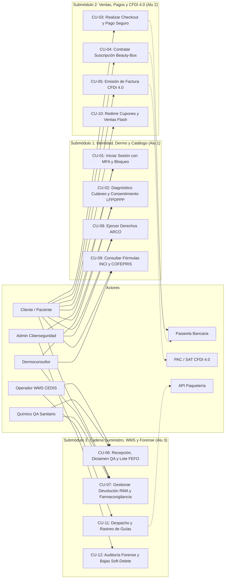

# MODELADO DE CASOS DE USO DEL SISTEMA (UML)
## PROYECTO INTEGRADOR V - TECNM / INSTITUTO TECNOLÓGICO SUPERIOR DE MONCLOVA
### ASIGNATURA: ANÁLISIS Y MODELADO DE SISTEMAS DE INFORMACIÓN (AMSI - IFE-1005)
**Sistema E-Commerce de Cuidado de la Salud, Belleza y Maquillaje**
**Autores:** Equipo de 3 Alumnos (Distribución Equitativa de Responsabilidades)

---

## 1. ACTORES DEL SISTEMA

| Actor | Tipo | Descripción y Alcance Operativo | Módulo Principal |
| :--- | :---: | :--- | :---: |
| **Cliente / Paciente Dermo** | Humano (Primario) | Usuario registrado que responde cuestionarios de piel, compra cosméticos, gestiona suscripciones Beauty-Box y solicita facturas o trámites ARCO. | Módulos 1 y 2 |
| **Dermoconsultor / Asesor** | Humano (Secundario) | Especialista en cuidado cutáneo que revisa diagnósticos clínicos, responde tickets de soporte y aprueba rutinas de belleza personalizadas. | Módulos 1 y 3 |
| **Administrador de Seguridad** | Humano (Primario) | Oficial de privacidad y ciberseguridad que supervisa roles RBAC, audita bitácoras forenses HMAC y gestiona solicitudes ARCO (LFPDPPP). | Módulos 1 y 3 |
| **Operador WMS / Almacenista** | Humano (Primario) | Personal del CEDIS que realiza recepción de tarimas, conteos cíclicos, surtido por algoritmo FEFO y embalaje con guías logísticas. | Módulo 3 |
| **Químico Farmacéutico QA** | Humano (Primario) | Responsable sanitario ante COFEPRIS que emite dictámenes de inspección técnica en recepción y reportes de farmacovigilancia. | Módulos 1 y 3 |
| **Pasarela de Pago (Stripe/MP)** | Sistema Externo | Servicio bancario que procesa cobros tokenizados, valida autenticación 3D-Secure y notifica liquidaciones vía Webhooks. | Módulo 2 |
| **PAC / Servidor SAT CFDI 4.0** | Sistema Externo | Proveedor Autorizado de Certificación que valida y timbra comprobantes fiscales digitales por internet asignando UUID oficial. | Módulo 2 |
| **API Paquetería (DHL/FedEx)** | Sistema Externo | Plataforma logística que genera guías de rastreo, calcula tarifas postales y reporta eventos de tránsito físico en tiempo real. | Módulo 3 |

---

## 2. DIAGRAMA GENERAL DE CASOS DE USO DEL SISTEMA

---

## 3. ESPECIFICACIÓN EXPANDIDA DE CASOS DE USO CRÍTICOS

A continuación se presentan las fichas formales estructuradas de los 7 casos de uso principales requeridos por el estándar de desarrollo de software del TecNM:

---

### FICHA CU-01: Iniciar Sesión Seguro con MFA y Bloqueo de Cuenta por Fuerza Bruta
- **Autor Responsable:** Integrante 1 (Submódulo de Seguridad y Acceso)
- **Actores:** Cliente / Usuario del Sistema (Primario), Administrador de Seguridad (Secundario).
- **Propósito:** Autenticar al usuario validando identidad mediante verificación de dos factores y mitigando ataques automatizados de diccionario o fuerza bruta.
- **Precondiciones:** La cuenta de usuario debe existir en `seguridad.usuarios` con `activo = 1` y no encontrarse bloqueada (`cuenta_bloqueada = 0`).

| Paso | Acción del Actor | Respuesta del Sistema |
| :---: | :--- | :--- |
| 1 | El usuario ingresa su correo electrónico y contraseña en la interfaz web o móvil. | El sistema sanitiza las entradas y busca la cuenta en `seguridad.usuarios`. |
| 2 | - | El sistema verifica el hash de la contraseña ingresada utilizando el algoritmo Argon2id con el salt almacenado. |
| 3 | [Flujo Exitoso]: Las credenciales coinciden y el usuario tiene `mfa_habilitado = 1`. | El sistema solicita el código dinámico de 6 dígitos de doble factor (TOTP). |
| 4 | El usuario ingresa el token numérico generado por su aplicación móvil de autenticación. | El sistema valida el token criptográfico contra el secreto TOTP con una tolerancia de ±30 segundos. |
| 5 | - | El sistema resetea `intentos_fallidos_consecutivos = 0`, genera token de sesión JWT firmado con clave asimétrica RSA-256, crea el registro en `seguridad.sesiones_activas` y permite el acceso al dashboard. |

#### Flujos Alternativos y Excepciones:
- **3a. Contraseña Incorrecta:**
  1. El sistema incrementa `intentos_fallidos_consecutivos = intentos_fallidos_consecutivos + 1`.
  2. Inserta un registro forense en `seguridad.intentos_login` con la IP, fecha, hora y user agent.
  3. Si `intentos_fallidos_consecutivos >= 5`:
     - El sistema actualiza `cuenta_bloqueada = 1` y `fecha_bloqueo = SYSDATETIME()`.
     - Envía notificación transaccional de seguridad al correo del usuario alertando del intento de vulneración.
     - Registra evento de severidad 'CRITICO_SEGURIDAD' en `auditoria.bitacora_seguridad_global` con firma HMAC-SHA256.
     - Notifica al usuario que la cuenta ha sido suspendida preventivamente durante 15 minutos.
- **4a. Código MFA Inválido o Desincronizado:**
  1. El sistema rechaza el acceso, incrementa el contador de fallos y permite 2 intentos adicionales antes de invalidar la sesión.

---

### FICHA CU-02: Diagnóstico Clínico Cutáneo y Consentimiento de Salud LFPDPPP
- **Autor Responsable:** Integrante 1 (Submódulo de Salud y Perfil Dermo)
- **Actores:** Cliente / Paciente (Primario), Dermoconsultor (Secundario).
- **Propósito:** Capturar las características fisiológicas de la piel del cliente de forma interactiva y obtener la manifestación de voluntad expresa y legal para el tratamiento de datos personales sensibles de salud (LFPDPPP).
- **Precondiciones:** El cliente debe haber iniciado sesión en la plataforma.

| Paso | Acción del Actor | Respuesta del Sistema |
| :---: | :--- | :--- |
| 1 | El cliente selecciona la opción "Iniciar Test Dermatológico de Piel". | El sistema despliega el Aviso de Privacidad Integral con cláusula específica de consentimiento para datos sensibles de salud. |
| 2 | El cliente lee y marca la casilla obligatoria de consentimiento expreso y firma digitalmente. | El sistema registra en `clientes.consentimientos_privacidad` el consentimiento con IP, user agent, fecha, hora y huella hash del texto legal. |
| 3 | El cliente responde a los reactivos clínicos (oleosidad, reactividad solar, poros, brotes). | El sistema recupera las preguntas y opciones de `clientes.preguntas_diagnostico` y `clientes.opciones_pregunta`. |
| 4 | El cliente presiona "Calcular Mi Diagnóstico de Piel". | El motor calcula el puntaje ponderado, determina el fototipo de Fitzpatrick y clasifica el biotipo cutáneo (Grasa, Seca, Mixta, Sensible). |
| 5 | - | El sistema almacena la ficha clínica en `clientes.perfil_cutaneo` y mapea las afecciones activas en `clientes.cliente_condiciones`. |
| 6 | - | El sistema despliega al cliente su rutina matutina y nocturna personalizada filtrando productos con alérgenos contraindicados. |

#### Flujos Alternativos y Excepciones:
- **2a. El Cliente Rechaza el Consentimiento de Salud:**
  1. El sistema informa que, conforme a la LFPDPPP, no es posible almacenar su perfil cutáneo ni personalizar tratamientos médicos sin consentimiento.
  2. Permite al cliente navegar exclusivamente por el catálogo público general sin almacenar datos clínicos.

---

### FICHA CU-03: Realizar Checkout y Pago Seguro con Split de Almacén
- **Autor Responsable:** Integrante 2 (Submódulo Comercial y Pagos)
- **Actores:** Cliente (Primario), Pasarela de Pago Bancaria (Secundario/Externo), Operador WMS (Secundario).
- **Propósito:** Consolidar los artículos del carrito, reservar stock en tiempo real, procesar el cobro bancario tokenizado y fragmentar la orden en sub-splits si los productos provienen de diferentes CEDIS.
- **Precondiciones:** El carrito de compras debe tener al menos 1 producto activo y con existencia física en inventario.

| Paso | Acción del Actor | Respuesta del Sistema |
| :---: | :--- | :--- |
| 1 | El cliente revisa su carrito y pulsa el botón "Proceder al Pago". | El sistema bloquea temporalmente el inventario de las variantes en `ventas.reservas_temporales_stock` por 15 minutos. |
| 2 | El cliente selecciona la dirección de entrega y el método de pago (Tarjeta Tokenizada, SPEI, Saldo Billetera). | El sistema calcula costo de envío, descuentos de cupones y desglose de IVA (16%) en `ventas.ordenes_impuestos`. |
| 3 | El cliente confirma el pago ingresando su criptograma CVV en el formulario seguro alojado por Stripe/Mercado Pago. | La pasarela genera un token criptográfico efímero de cobro y lo transfiere al backend del e-commerce. |
| 4 | - | El motor antifraude evalúa el riesgo en `pagos.evaluaciones_antifraude`. Si el score es óptimo (<65), solicita el cobro a la pasarela bancaria. |
| 5 | La pasarela bancaria retorna código HTTP 200 y número de autorización bancaria. | El sistema genera la orden formal en `ventas.ordenes`, marca `ventas.transacciones` en estado 'APROBADA' y libera la reserva convirtiéndola en stock vendido. |
| 6 | - | El sistema evalúa el origen geográfico de los productos: al detectar que un producto está en CEDIS Monterrey y otro en CEDIS CDMX, crea automáticamente dos splits en `ventas.ordenes_splits_almacen`. |
| 7 | - | Envía confirmación de orden y recibo digital al correo del cliente. |

#### Flujos Alternativos y Excepciones:
- **4a. Detección de Riesgo Alto / Reto 3D-Secure:**
  1. El sistema redirige al cliente a la interfaz bancaria 3DS para validación de OTP en su aplicación móvil bancaria.
  2. Si el reto es superado, continúa en el Paso 5. Si es declinado, marca la orden como 'CANCELADA_POR_FRAUDE' y libera el stock.
- **5a. Fondos Insuficientes / Declinación Bancaria:**
  1. La pasarela retorna error HTTP 402. El sistema almacena el intento fallido en `pagos.intentos_cobro`, mantiene la reserva activa durante los 15 minutos de gracia y solicita un método de pago alternativo.

---

### FICHA CU-04: Contratar Suscripción Beauty-Box con Cobro Recurrente
- **Autor Responsable:** Integrante 2 (Submódulo Comercial y Suscripciones)
- **Actores:** Cliente (Primario), Pasarela de Pagos (Secundario).
- **Propósito:** Permitir al usuario suscribirse a una caja periódica de productos dermocosméticos curados con cobro recurrente automatizado y beneficios exclusivos de descuento.
- **Precondiciones:** El cliente debe tener registrado un método de pago tokenizado vigente en `clientes.metodos_pago_tokenizados`.

| Paso | Acción del Actor | Respuesta del Sistema |
| :---: | :--- | :--- |
| 1 | El cliente navega a la sección "Suscripciones Beauty-Box" y elige el plan deseado (e.g., *Beauty Box Dermo Esencial*). | El sistema despliega el precio recurrente, productos incluidos y el porcentaje de descuento congelado. |
| 2 | El cliente selecciona la frecuencia de despacho (Quincenal, Mensual, Bimestral) y el domicilio de entrega. | El sistema valida la cobertura logística del código postal y presenta el calendario de próximas 3 entregas. |
| 3 | El cliente autoriza la domiciliación bancaria recurrente y pulsa "Activar Mi Suscripción". | El sistema tokeniza la instrucción de cargo periódico en la pasarela de pagos. |
| 4 | - | Se ejecuta el cobro de la primera entrega. Al autorizarse, el sistema inserta el registro en `ventas.suscripciones_cliente` con estado 'ACTIVA'. |
| 5 | - | El sistema genera automáticamente el cronograma en `ventas.suscripciones_calendario_entregas` con las fechas futuras de cobro y despacho. |
| 6 | - | Envía correo de bienvenida al club de suscripción con fecha de envío de la primera caja. |

---

### FICHA CU-05: Emisión y Timbrado de Factura Electrónica CFDI 4.0
- **Autor Responsable:** Integrante 2 (Submódulo Fiscal SAT)
- **Actores:** Cliente (Primario), Servidor PAC / SAT (Secundario/Externo).
- **Propósito:** Generar, validar y timbrar legalmente el Comprobante Fiscal Digital por Internet (CFDI) versión 4.0 a partir de una orden de compra pagada.
- **Precondiciones:** La orden debe estar en estado 'PAGADA_CONFIRMADA' y el cliente debe tener capturados sus datos fiscales en `fiscal.datos_fiscales_cliente`.

| Paso | Acción del Actor | Respuesta del Sistema |
| :---: | :--- | :--- |
| 1 | El cliente pulsa "Solicitar Factura" desde el historial de su pedido o el checkout. | El sistema carga el RFC, Razón Social, Régimen Fiscal y Código Postal validado ante la lista LCO del SAT. |
| 2 | El cliente selecciona el Uso de CFDI correspondiente (e.g., 'G01 - Adquisición de mercancías' o 'G03 - Gastos en general'). | El sistema verifica la compatibilidad de la clave de uso contra el régimen fiscal del receptor según el catálogo SAT. |
| 3 | El cliente confirma la solicitud de timbrado. | El sistema genera la estructura XML bajo el estándar Anexo 20 CFDI 4.0, asignando la clave de producto/servicio `53131600` (Cosméticos). |
| 4 | - | El sistema sella digitalmente el XML con el Certificado de Sello Digital (CSD) del e-commerce y lo transmite al webservice del PAC. |
| 5 | El PAC valida el comprobante ante el SAT y retorna el complemento de timbre con el UUID fiscal oficial y fecha de timbrado. | El sistema almacena el registro en `fiscal.facturas_cfdi`, inserta las partidas en `fiscal.facturas_partidas` y guarda el XML y PDF en el almacenamiento seguro. |
| 6 | - | Envía automáticamente los archivos XML y PDF al correo fiscal del cliente registrado en `fiscal.datos_fiscales_cliente`. |

---

### FICHA CU-06: Recepción en CEDIS, Dictamen QA e Ingreso a WMS por Lote FEFO
- **Autor Responsable:** Integrante 3 (Submódulo de Cadena de Suministro y WMS)
- **Actores:** Operador de Almacén CEDIS (Primario), Químico Farmacéutico QA (Primario).
- **Propósito:** Registrar el ingreso físico de mercancía proveniente de laboratorios fabricantes, realizar el muestreo sanitario y dar de alta los lotes con caducidad para el algoritmo FEFO.
- **Precondiciones:** Debe existir una Orden de Compra previa en estado 'EMITIDA_A_PROVEEDOR'.

| Paso | Acción del Actor | Respuesta del Sistema |
| :---: | :--- | :--- |
| 1 | El transportista arriba al CEDIS. El almacenista ingresa el folio de OC y remisión del proveedor. | El sistema localiza la orden en `compras.ordenes_compra` y despliega la lista de SKUs y piezas esperadas. |
| 2 | El almacenista realiza el conteo ciego de cajas y tarimas, registrando piezas recibidas y dañadas. | El sistema genera el folio de recepción en `compras.recepciones_mercancia` y coloca el stock en 'CUARENTENA_QA'. |
| 3 | El Químico Farmacéutico QA toma muestras aleatorias del lote para inspección microbiológica, medición de pH y temperatura de arribo. | El sistema habilita la captura técnica en `compras.inspecciones_sanitarias_qa`. |
| 4 | El Químico QA carga el Certificado de Análisis (COA) del laboratorio y emite dictamen 'APROBADO'. | El sistema aprueba el lote y crea el registro oficial en `wms.lotes_fabricacion_sanitaria` con fecha de fabricación y fecha de caducidad. |
| 5 | El operador WMS traslada las tarimas a la zona asignada (e.g. Rack Refrigerado o Mezanine de Cosméticos). | El sistema asigna las coordenadas físicas en `wms.pasillos_ubicaciones` y actualiza el saldo disponible en `wms.inventario_lotes_ubicacion`. |
| 6 | - | El sistema genera el asiento contable de entrada positiva en `wms.kardex_movimientos` y habilita el lote para el algoritmo de despacho FEFO. |

---

### FICHA CU-07: Gestión de Devolución RMA y Notificación de Farmacovigilancia COFEPRIS
- **Autor Responsable:** Integrante 3 (Submódulo de Postventa y Auditoría)
- **Actores:** Cliente (Primario), Químico QA / Responsable Sanitario (Primario), Administrador (Secundario).
- **Propósito:** Atender una reclamación formal de retorno de producto cosmético por reacción alérgica o defecto, realizar la inspección higiénica de cuarentena y notificar a la autoridad sanitaria COFEPRIS.
- **Precondiciones:** La orden de compra debe encontrarse en estado 'ENTREGADA_EXITOSA'.

| Paso | Acción del Actor | Respuesta del Sistema |
| :---: | :--- | :--- |
| 1 | El cliente ingresa a "Mis Pedidos" y selecciona "Solicitar Devolución / Reporte de Reacción Alérgica". | El sistema despliega el formulario de RMA solicitando seleccionar motivo, fotografías de evidencia y síntomas. |
| 2 | El cliente selecciona 'RMA_ALERGIA_CUTANEA', adjunta fotografías del enrojecimiento cutáneo y describe el cuadro clínico. | El sistema crea el ticket en `postventa.solicitudes_rma` y clasifica el caso con prioridad 'ALTA'. |
| 3 | El sistema genera una guía de paquetería de retorno prepagada para recolección del producto sospechoso. | La guía de logística inversa se emite mediante la API del transportista y se envía al cliente. |
| 4 | El producto arriba al laboratorio de control del CEDIS. El Químico QA inspecciona el envase. | Se genera el dictamen en `postventa.inspeccion_sanitaria_retorno`. Por norma higiénica, se decreta `destino_sanitario_autorizado = 'DESTRUCCION_INMEDIATA_RESIDUOS'`. |
| 5 | - | El sistema activa el protocolo de Farmacovigilancia Sanitaria: inserta el expediente en `postventa.reportes_farmacovigilancia` cruzando la fórmula INCI, lote y caducidad. |
| 6 | El Químico QA valida la ficha de farmacovigilancia y genera el informe oficial para COFEPRIS. | El sistema sella el documento, actualiza `notificado_a_cofepris = 1` y autoriza el reembolso monetario en `pagos.reembolsos_transaccion`. |
| 7 | - | La pasarela bancaria reintegra los fondos al cliente y el inventario del lote entra en revisión preventiva. |
