# CAPÍTULO II: ANÁLISIS Y MODELADO DE SISTEMAS DE INFORMACIÓN (AMSI - IFE-1005)
## Entregable 2.3: Arquitectura del Dominio y Diagrama General de Clases UML

---

### 1. Marco Conceptual y Especificación Arquitectónica

El presente diagrama de clases modela la arquitectura orientada a objetos del sistema integral de comercio electrónico dermatológico y cosmético, integrando el paradigma de persistencia con el diseño de software empresarial. 

Para garantizar el cumplimiento estricto del estándar de auditoría exigido por el Tecnológico Nacional de México (TecNM) y la trazabilidad requerida por la normativa de salud (COFEPRIS) y protección de datos (LFPDPPP), la jerarquía del dominio se fundamenta en el patrón **Layer Supertype** mediante la clase base abstracta `EntidadAuditable`.

#### 1.1 Jerarquía Base: `EntidadAuditable`
Todas las clases de entidad del dominio heredan de `EntidadAuditable`, la cual encapsula los 7 atributos obligatorios de auditoría y borrado lógico (*soft delete*), garantizando que ningún registro del sistema sea purgado físicamente:
- `id: Long` (Identificador único incremental / Surrogate Primary Key).
- `activo: Boolean` (Estado lógico de la entidad; 1 = Vigente, 0 = Baja lógica).
- `fechaCreacion: DateTime` (Timestamp UTC de persistencia inicial).
- `creadoPor: Long` (ID del usuario o servicio que originó el registro).
- `fechaModificacion: DateTime?` (Timestamp UTC de la última mutación de estado).
- `modificadoPor: Long?` (ID del usuario o proceso que autorizó la modificación).
- `fechaBaja: DateTime?` (Timestamp UTC en que se ejecutó el soft delete).
- `eliminadoPor: Long?` (ID del operador que ordenó la revocación/baja).

Los métodos polimórficos de la clase abstracta `EntidadAuditable` aseguran la invariancia del estado:
- `+activar(): Void`
- `+desactivar(idOperador: Long, motivo: String): Void`
- `+auditarCambio(idOperador: Long): Void`
- `+estaActivo(): Boolean`

---

### 2. Diagrama de Clases UML del Dominio (Mermaid)

El siguiente modelo ilustra las clases nodales del sistema divididas en los tres grandes subsistemas de autoría equitativa (50 tablas por integrante, 150 en total):
1. **Subsistema de Identidad, Seguridad y Diagnóstico Cutáneo (Alumno 1)**
2. **Subsistema Comercial, Suscripciones Beauty-Box y Facturación Fiscal CFDI 4.0 (Alumno 2)**
3. **Subsistema Logístico Multialmacén, Trazabilidad FEFO y Cadena de Frío IoT (Alumno 3)**

```mermaid
classDiagram
    %% Clase Base de Auditoría
    class EntidadAuditable {
        <<Abstract>>
        -Long id
        -Boolean activo
        -DateTime fechaCreacion
        -Long creadoPor
        -DateTime fechaModificacion
        -Long modificadoPor
        -DateTime fechaBaja
        -Long eliminadoPor
        +activar() void
        +desactivar(Long idOperador, String motivo) void
        +auditarCambio(Long idOperador) void
        +estaActivo() Boolean
    }

    %% ==========================================
    %% SUBSISTEMA 1: SEGURIDAD, CLIENTES Y DIAGNÓSTICO (Alumno 1)
    %% ==========================================
    class Usuario {
        -String username
        -String email
        -String passwordHash
        -String saltCriptografico
        -Boolean mfaHabilitado
        -String secretTotp
        -Int intentosFallidos
        -Boolean cuentaBloqueada
        -DateTime fechaUltimoLogin
        +autenticar(String passPlano) Boolean
        +verificarTotp(String token) Boolean
        +bloquearAcceso() void
        +reiniciarIntentos() void
    }

    class Rol {
        -String codigoRol
        -String nombreRol
        -String nivelJerarquico
        +asignarPermiso(Permiso p) void
        +revocarPermiso(Permiso p) void
    }

    class Permiso {
        -String clavePermiso
        -String recurso
        -String accionPermitida
        +validarAcceso(String accion) Boolean
    }

    class BitacoraAcceso {
        -Long idUsuario
        -String direccionIp
        -String userAgent
        -String resultadoIntento
        -String motivoFallo
        +registrarEvento() void
    }

    class Cliente {
        -String rfcCurp
        -String nombreCompleto
        -String telefonoMovil
        -Boolean perfilDermatologicoCompletado
        -Boolean consentimientoDatosSensibles
        -DateTime fechaConsentimientoLFPDPPP
        +firmarAvisoPrivacidad() void
        +solicitarDerechoARCO(String tipo) void
    }

    class PerfilCutaneo {
        -String fototipoFitzpatrick
        -String biotipoCutaneo
        -Boolean tendenciaAcneica
        -Boolean barreraComprometida
        -String nivelSensibilidad
        -List~String~ alergiasConocidas
        +evaluarCompatibilidad(FormulaClinica formula) Double
        +actualizarDiagnostico() void
    }

    class DiagnosticoDermatologico {
        -DateTime fechaEvaluacion
        -String dictamenDermatologico
        -String recomendacionRutina
        -Double scoreSaludCutanea
        -String folioFirmaMedico
        +generarPrescripcion() void
    }

    class ProductoCosmetico {
        -String sku
        -String nombreComercial
        -String denominacionGenerica
        -String registroCofepris
        -Boolean requierePrescripcion
        -Boolean requiereCadenaFrio
        -Decimal phFormula
        -Decimal precioVentaPublico
        +validarAprobacionSanitaria() Boolean
        +esCompatibleConPerfil(PerfilCutaneo p) Boolean
    }

    class IngredienteActivo {
        -String nombreInci
        -String numeroCas
        -Decimal concentracionPorcentaje
        -String nivelToxicidad
        -Boolean esFotosensibilizante
        +validarLimiteRegulatorio() Boolean
    }

    %% ==========================================
    %% SUBSISTEMA 2: COMERCIAL, SUSCRIPCIONES Y FISCAL (Alumno 2)
    %% ==========================================
    class OrdenCompra {
        -String numeroOrden
        -DateTime fechaEmision
        -Decimal subtotalBruto
        -Decimal descuentoTotal
        -Decimal ivaTrasladado
        -Decimal importeTotalNeto
        -String estadoOrden
        +calcularTotales() void
        +procesarSplitAlmacenes() List~OrdenSplitAlmacen~
        +cancelarOrden(String motivo) void
    }

    class OrdenDetalle {
        -Int cantidadUnidades
        -Decimal precioUnitarioPactado
        -Decimal porcentajeDescuento
        -Decimal subtotalLinea
        +calcularSubtotalLinea() Decimal
    }

    class TransaccionPago {
        -String pasarelaPago
        -String idTransaccionGateway
        -String tokenTarjetaMask
        -String metodoPago
        -Decimal montoProcesado
        -String codigoAprobacion
        -String estatusTransaccion
        -String hmacIntegridad
        +solicitarTokenizacion() String
        +ejecutarCobro() Boolean
        +procesarReembolso(Decimal monto) Boolean
    }

    class SuscripcionBeautyBox {
        -String codigoSuscripcion
        -String frecuenciaEntrega
        -DateTime fechaProximoCobro
        -Decimal cuotaPeriodica
        -String estadoSuscripcion
        -String tokenCobroRecurrente
        +ejecutarCobroRecurrente() Boolean
        +suspenderSuscripcion() void
        +personalizarCaja(PerfilCutaneo perfil) void
    }

    class FacturaCFDI {
        -String uuidFiscalSat
        -String serieFolio
        -String versionCfdi
        -String regimenFiscalReceptor
        -String usoCfdi
        -String selloDigitalEmisor
        -String certificadoSat
        -String cadenaOriginalTfd
        -String estadoTimbrado
        +generarXmlCfdi() String
        +timbrarConPac() Boolean
        +generarRepresentacionPdf() Byte[]
    }

    %% ==========================================
    %% SUBSISTEMA 3: LOGÍSTICA, WMS Y CADENA DE FRÍO (Alumno 3)
    %% ==========================================
    class AlmacenCEDIS {
        -String claveAlmacen
        -String nombreCedis
        -String ubicacionGeografica
        -Boolean tieneCamaraRefrigerada
        -Int capacidadTotalUbicaciones
        +verificarCapacidadDisponible() Int
    }

    class LoteProduccion {
        -String codigoLote
        -DateTime fechaFabricacion
        -DateTime fechaCaducidad
        -String certificadoCalidadCofepris
        -String estadoCuarentena
        -Int unidadesFabricadas
        -Int unidadesDisponibles
        +evaluarReglaFefo() Boolean
        +liberarDeCuarentena() void
    }

    class SensorIoTCadenaFrio {
        -String macSensor
        -String uuidDispositivo
        -Decimal temperaturaActual
        -Decimal limiteInferiorPermitido
        -Decimal limiteSuperiorPermitido
        -DateTime fechaUltimaLectura
        +registrarTelemetria(Decimal temp, Decimal hum) void
        +dispararAlarmaExcursionTermica() void
    }

    class DevolucionRMA {
        -String folioRma
        -String motivoDevolucion
        -Boolean reporteReaccionAdversaCutanea
        -String severidadSintoma
        -String dictamenTecnico
        -String estatusRma
        +autorizarRetornoMercancia() void
        +escalarFarmacovigilanciaCofepris() void
    }

    %% ==========================================
    %% RELACIONES DE HERENCIA (Layer Supertype)
    %% ==========================================
    EntidadAuditable <|-- Usuario
    EntidadAuditable <|-- Rol
    EntidadAuditable <|-- Permiso
    EntidadAuditable <|-- BitacoraAcceso
    EntidadAuditable <|-- Cliente
    EntidadAuditable <|-- PerfilCutaneo
    EntidadAuditable <|-- DiagnosticoDermatologico
    EntidadAuditable <|-- ProductoCosmetico
    EntidadAuditable <|-- IngredienteActivo
    EntidadAuditable <|-- OrdenCompra
    EntidadAuditable <|-- OrdenDetalle
    EntidadAuditable <|-- TransaccionPago
    EntidadAuditable <|-- SuscripcionBeautyBox
    EntidadAuditable <|-- FacturaCFDI
    EntidadAuditable <|-- AlmacenCEDIS
    EntidadAuditable <|-- LoteProduccion
    EntidadAuditable <|-- SensorIoTCadenaFrio
    EntidadAuditable <|-- DevolucionRMA

    %% ==========================================
    %% RELACIONES ESTRUCTURALES Y ASOCIACIONES
    %% ==========================================
    Usuario "1" o-- "1..*" Rol : posee
    Rol "1..*" o-- "1..*" Permiso : incluye
    Usuario "1" *-- "0..*" BitacoraAcceso : genera
    Usuario "1" -- "0..1" Cliente : vinculado_a

    Cliente "1" *-- "1" PerfilCutaneo : define
    Cliente "1" o-- "0..*" DiagnosticoDermatologico : consulta
    ProductoCosmetico "1..*" o-- "1..*" IngredienteActivo : formulado_con

    Cliente "1" --> "0..*" OrdenCompra : realiza
    OrdenCompra "1" *-- "1..*" OrdenDetalle : contiene
    OrdenDetalle "0..*" --> "1" ProductoCosmetico : referencia
    OrdenCompra "1" *-- "1..*" TransaccionPago : procesada_por
    OrdenCompra "1" -- "0..1" FacturaCFDI : timbrada_como

    Cliente "1" --> "0..*" SuscripcionBeautyBox : contrata
    SuscripcionBeautyBox "1" --> "1..*" ProductoCosmetico : surte_mensualmente

    AlmacenCEDIS "1" *-- "1..*" LoteProduccion : resguarda
    LoteProduccion "0..*" --> "1" ProductoCosmetico : lote_de
    AlmacenCEDIS "1" *-- "0..*" SensorIoTCadenaFrio : monitoreado_por
    OrdenDetalle "1" --> "1" LoteProduccion : asignado_segun_FEFO

    DevolucionRMA "0..*" --> "1" OrdenDetalle : aplica_sobre
    DevolucionRMA "0..*" --> "1" Cliente : promovida_por
```

---

### 3. Matriz Técnica de Navegabilidad, Tipificación y Multiplicidades

| Origen | Cardinalidad | Destino | Tipo de Asociación | Justificación Técnica de Negocio |
| :--- | :---: | :--- | :---: | :--- |
| `Usuario` | `1` $\rightarrow$ `1..*` | `Rol` | Agregación compartida | Control de Acceso Basado en Roles (RBAC). Un usuario puede poseer múltiples roles simultáneos. |
| `Rol` | `1..*` $\rightarrow$ `1..*` | `Permiso` | Agregación compartida | Mapeo granular de capacidades operativas conforme a la matriz de privilegios de seguridad. |
| `Cliente` | `1` $\rightarrow$ `1` | `PerfilCutaneo` | Composición fuerte | Cumplimiento del Art. 16 Constitucional. El perfil cutáneo es propiedad del titular de los datos. |
| `OrdenCompra` | `1` $\rightarrow$ `1..*` | `OrdenDetalle` | Composición fuerte | Integridad transaccional: una orden de compra no puede subsistir sin sus líneas de detalle. |
| `OrdenCompra` | `1` $\rightarrow$ `1..*` | `TransaccionPago` | Composición | Admite pagos divididos (*split payments*) y múltiples intentos de tokenización bancaria. |
| `OrdenCompra` | `1` $\rightarrow$ `0..1` | `FacturaCFDI` | Asociación navegable | Emisión fiscal opcional o bajo demanda bajo el estándar CFDI 4.0 del SAT. |
| `AlmacenCEDIS` | `1` $\rightarrow$ `1..*` | `LoteProduccion` | Agregación | Control físico y fiscal de existencias en almacenes centrales y regionales. |
| `LoteProduccion` | `1` $\rightarrow$ `1` | `ProductoCosmetico` | Asociación reflexiva | Implementación de política FEFO (*First Expired, First Out*) exigida por COFEPRIS. |
| `AlmacenCEDIS` | `1` $\rightarrow$ `0..*` | `SensorIoTCadenaFrio`| Composición | Telemetría continua de biológicos y sérums termolábiles en cámaras frigoríficas (2°C - 8°C). |
| `DevolucionRMA` | `0..*` $\rightarrow$ `1` | `OrdenDetalle` | Asociación | Trazabilidad médica ante reacciones adversas dermatológicas y farmacovigilancia. |

---

### 4. Implementación del Patrón de Diseño y Acoplamiento

1. **Patrón Layer Supertype:** Centraliza el comportamiento de auditoría y borrado lógico, desacoplando a las clases concretas de la lógica de persistencia y facilitando la interoperabilidad con los ORMs (como Entity Framework Core o Hibernate) y drivers SQL Server y PostgreSQL.
2. **Alta Cohesión y Bajo Acoplamiento:** Los tres subsistemas interactúan mediante interfaces bien definidas (`IPaymentGateway`, `ITaxStampingPAC`, `IFefoAllocationService`), previniendo dependencias circulares y asegurando la modularidad del código fuente ante auditorías de calidad de software IEEE 12207.
