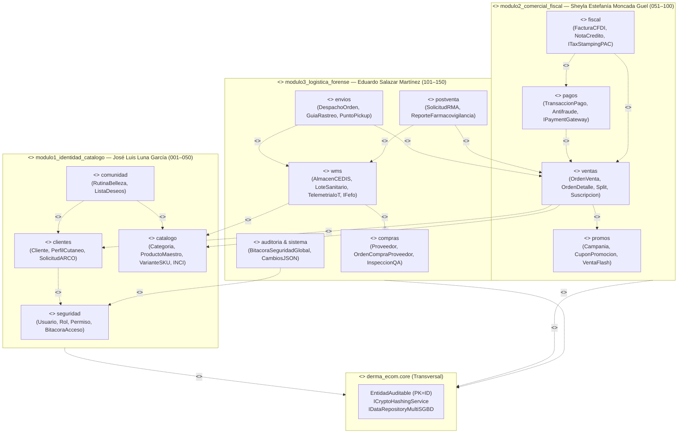
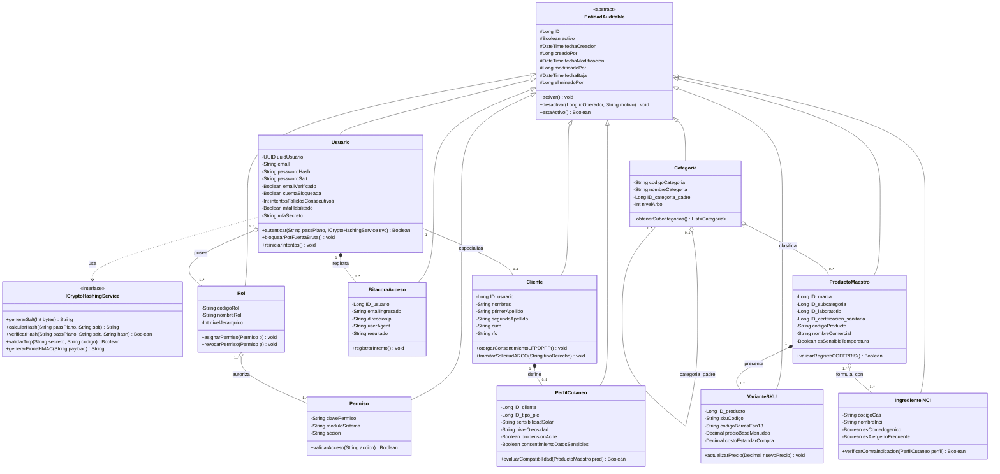
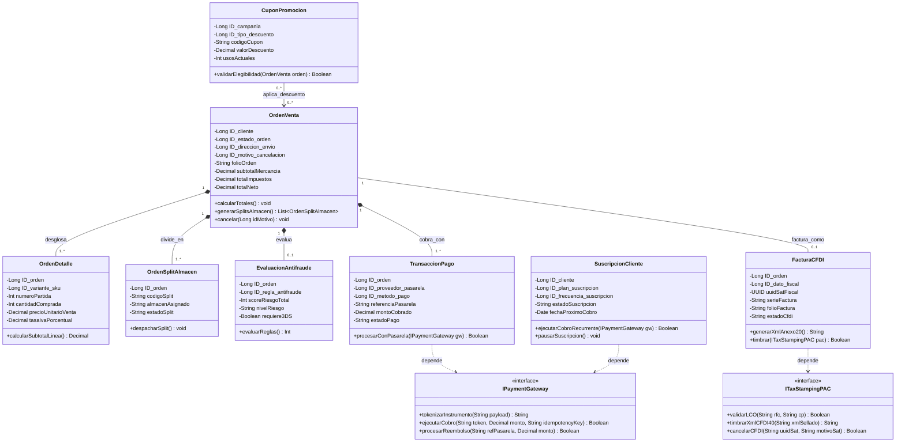
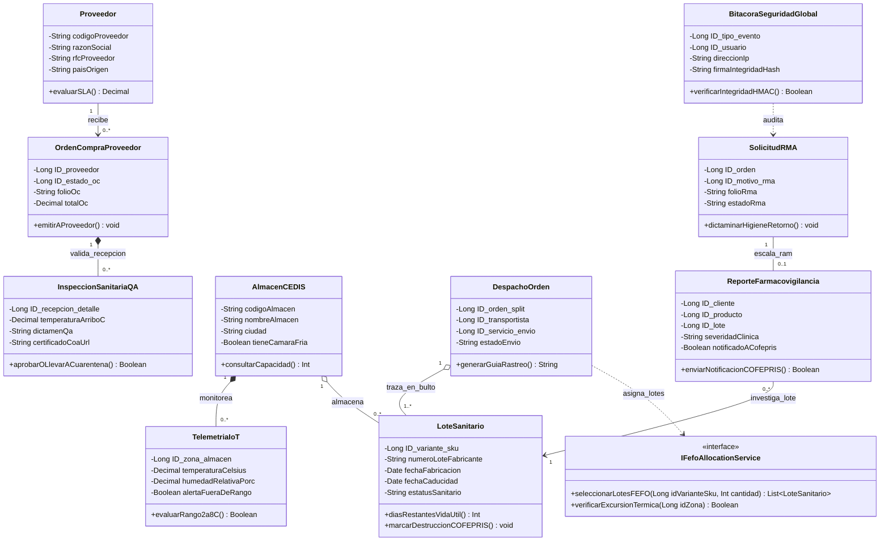

# ARQUITECTURA DEL DOMINIO Y DIAGRAMA DE CLASES UML 2.5
## PROYECTO INTEGRADOR V — TECNM / INSTITUTO TECNOLÓGICO SUPERIOR DE MONCLOVA
### ASIGNATURA: ANÁLISIS Y MODELADO DE SISTEMAS DE INFORMACIÓN (AMSI — IFE-1005) — CRITERIO 1.4 (30%)
**Sistema:** DERMA-ECOM (E-Commerce de Salud Cutánea, Belleza y Maquillaje con Trazabilidad FEFO y Cadena de Frío)  
**Autores y Distribución Equitativa:**
- **Submódulo 1 (`seguridad`, `clientes`, `catalogo`, `comunidad` · Tablas `001–050`):** José Luis Luna García
- **Submódulo 2 (`ventas`, `pagos`, `fiscal`, `promos` · Tablas `051–100`):** Sheyla Estefanía Moncada Guel
- **Submódulo 3 (`compras`, `wms`, `envios`, `postventa`, `auditoria`, `sistema` · Tablas `101–150`):** Eduardo Salazar Martínez

> [!IMPORTANT]
> **Diagramas de Clases UML 2.5 Visuales Editables (Clases en 3 compartimentos, `<<abstract>>`, `<<interface>>`, Herencia, Realización, Composición, Agregación, Asociación y Dependencia):**
> - Editable `.drawio` (4 pestañas: Capa Base/Interfaces + SM1 + SM2 + SM3): [`03a_diagrama_clases_UML.drawio`](./03a_diagrama_clases_UML.drawio)
> - Visor Interactivo HTML/SVG (con pestañas, zoom y exportación SVG): [`03b_visor_interactivo_clases_UML.html`](./03b_visor_interactivo_clases_UML.html)

---

## 1. MARCO ARQUITECTÓNICO Y PATRÓN *LAYER SUPERTYPE*

La arquitectura orientada a objetos de **DERMA-ECOM** desacopla el modelo de dominio de la persistencia multi-SGBD (Microsoft SQL Server / PostgreSQL) y garantiza la trazabilidad legal (LFPDPPP, CFF, COFEPRIS, CPF Arts. 211 bis 1–7) mediante la clase base abstracta **`EntidadAuditable`**, de la cual heredan las entidades correspondientes a las **150 tablas** de `EcommerceSaludBellezaDB`.

### 1.1 Clase Base Abstracta `EntidadAuditable` (`PK = ID` + 7 Columnas de Auditoría / Soft-Delete)
- `#ID: Long` — Llave primaria subrogada autoincrementable (`BIGINT IDENTITY` / `GENERATED ALWAYS AS IDENTITY`).
- `#activo: Boolean` — Estado lógico (`1` = vigente, `0` = baja lógica *Soft-Delete*).
- `#fechaCreacion: DateTime` · `#creadoPor: Long`
- `#fechaModificacion: DateTime?` · `#modificadoPor: Long?`
- `#fechaBaja: DateTime?` · `#eliminadoPor: Long?`
- Métodos polimórficos: `+activar(): void`, `+desactivar(idOperador: Long, motivo: String): void`, `+auditarCambio(idOperador: Long): void`, `+estaActivo(): Boolean`.

---

## 1.2 DIAGRAMA DE PAQUETES DEL SISTEMA (UML 2.5 — 3 SUBMÓDULOS Y 14 PAQUETES)

El **Diagrama de Paquetes** organiza las clases del dominio, interfaces de servicio y repositorios en los 3 submódulos de autoría equitativa y sus 14 paquetes lógicos (correspondientes 1:1 a los 14 esquemas SQL de `EcommerceSaludBellezaDB`), mostrando las dependencias `«import»` / `«access»` sin ciclos.

---

## 2. DIAGRAMA DE CLASES DEL SUBMÓDULO 1: SEGURIDAD, IDENTIDAD, PERFIL CLÍNICO Y CATÁLOGO INCI
**Autor Responsable:** José Luis Luna García (`Tablas 001–050`)  
Incluye obligatoriamente las **4 entidades de seguridad** exigidas por la rúbrica (`Usuario`, `Rol`, `Permiso`, `BitacoraAcceso`), el servicio criptográfico `ICryptoHashingService`, el expediente dermatológico LFPDPPP y la asociación reflexiva en `Categoria` (`ID_categoria_padre`).

---

## 3. DIAGRAMA DE CLASES DEL SUBMÓDULO 2: VENTAS, SUSCRIPCIONES, PAGOS, ANTIFRAUDE Y CFDI 4.0
**Autor Responsable:** Sheyla Estefanía Moncada Guel (`Tablas 051–100`)  
Modela la separación limpia entre `OrdenVenta` (`ventas.ordenes`), sus líneas débiles (`OrdenDetalle`), los splits logísticos (`OrdenSplitAlmacen`), la evaluación antifraude (`EvaluacionAntifraude`), los pagos tokenizados (`TransaccionPago`), la facturación SAT (`FacturaCFDI`) y las interfaces externas (`IPaymentGateway`, `ITaxStampingPAC`).

---

## 4. DIAGRAMA DE CLASES DEL SUBMÓDULO 3: COMPRAS, WMS FEFO, IOT FRÍO, ENVÍOS, RMA Y FORENSE
**Autor Responsable:** Eduardo Salazar Martínez (`Tablas 101–150`)  
Modela el flujo físico de abastecimiento (`Proveedor`, `OrdenCompraProveedor`), control de calidad (`InspeccionSanitariaQA`), gestión multialmacén (`AlmacenCEDIS`, `LoteSanitario`, `TelemetriaIoT`), última milla (`DespachoOrden`, `PuntoPickup`), postventa sanitaria (`SolicitudRMA`, `ReporteFarmacovigilancia`) y auditoría forense (`BitacoraSeguridadGlobal`).

---

## 5. MATRIZ TÉCNICA DE RELACIONES UML, MULTIPLICIDADES Y TRAZABILIDAD A BD

| Origen | Multiplicidad | Destino | Relación UML | Tabla(s) Físicas en BD (`PK = ID`, `FK = ID_*`) | Justificación de Diseño |
| :--- | :---: | :--- | :---: | :--- | :--- |
| `EntidadAuditable` | `—` | Todas las entidades | **Herencia (`<\|--`)** | 150 tablas (`ID` + 7 cols auditoría) | Patrón *Layer Supertype*: estandariza `PK = ID` y baja lógica *Soft-Delete*. |
| `Usuario` | `1..*` ↔ `1..*` | `Rol` | **Agregación (`o--`)** | `seguridad.usuarios_roles` (`ID_usuario`, `ID_rol`) | RBAC flexible: un usuario puede acumular varios roles sin destruir el catálogo de roles. |
| `Rol` | `1..*` ↔ `1..*` | `Permiso` | **Agregación (`o--`)** | `seguridad.roles_permisos` (`ID_rol`, `ID_permiso`) | Matriz de privilegios atómicos reutilizable entre roles. |
| `Usuario` | `1` → `0..*` | `BitacoraAcceso` | **Composición (`*--`)** | `seguridad.intentos_login` (`ID_usuario`) | Registro forense ligado al ciclo de vida de la cuenta autenticada. |
| `Cliente` | `1` → `0..1` | `PerfilCutaneo` | **Composición (`*--`)** | `clientes.perfil_cutaneo` (`ID_cliente UQ`) | Expediente clínico sensible dependiente existencialmente del cliente (LFPDPPP). |
| `Categoria` | `0..1` → `0..*` | `Categoria` | **Asociación Reflexiva** | `catalogo.categorias` (`ID_categoria_padre`) | Árbol jerárquico multinivel de categorías cosméticas. |
| `ProductoMaestro` | `1` → `1..*` | `VarianteSKU` | **Composición (`*--`)** | `catalogo.variantes_sku` (`ID_producto`) | Una variante SKU no existe sin su producto maestro COFEPRIS. |
| `OrdenVenta` | `1` → `1..*` | `OrdenDetalle` | **Composición (`*--`)** | `ventas.ordenes_detalles` (`ID_orden`) | Entidad débil: las partidas dependen existencialmente de la orden. |
| `OrdenVenta` | `1` → `1..*` | `OrdenSplitAlmacen` | **Composición (`*--`)** | `ventas.ordenes_splits_almacen` (`ID_orden`) | Fragmentación logística por CEDIS Monterrey / CDMX. |
| `OrdenVenta` | `1` → `1..*` | `TransaccionPago` | **Composición (`*--`)** | `pagos.transacciones` (`ID_orden`) | Soporta pagos divididos (`split_multipagos`) y reintentos idempotentes. |
| `OrdenVenta` | `1` → `0..1` | `FacturaCFDI` | **Asociación (`--`)** | `fiscal.facturas_cfdi` (`ID_orden`) | Facturación electrónica CFDI 4.0 bajo demanda ante el PAC/SAT. |
| `AlmacenCEDIS` | `1` → `0..*` | `LoteSanitario` | **Agregación (`o--`)** | `wms.inventario_lotes_ubicacion` (`ID_lote`, `ID_ubicacion`) | Un lote puede transferirse entre CEDIS (`wms.transferencias_almacenes`) sin destruirse. |
| `AlmacenCEDIS` | `1` → `0..*` | `TelemetriaIoT` | **Composición (`*--`)** | `wms.monitoreo_temperatura_humedad` (`ID_zona_almacen`) | Lecturas térmicas 2–8 °C vinculadas a la infraestructura física del almacén. |
| `TransaccionPago` | `—` | `IPaymentGateway` | **Dependencia (`..>`)** | `pagos.proveedores_pasarela` | Desacoplamiento PCI-DSS respecto a Stripe / Mercado Pago. |
| `FacturaCFDI` | `—` | `ITaxStampingPAC` | **Dependencia (`..>`)** | `fiscal.facturas_cfdi` | Desacoplamiento de timbrado XML Anexo 20 frente al PAC autorizado. |
