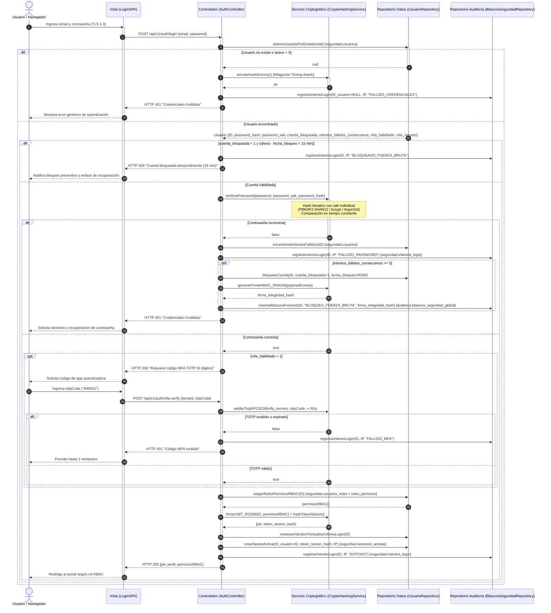
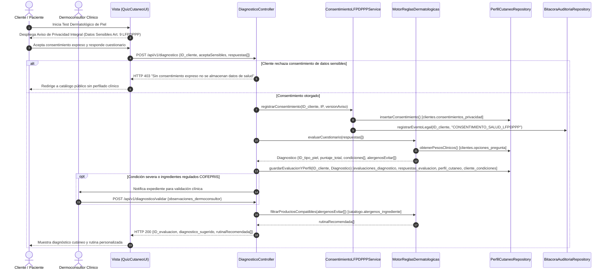
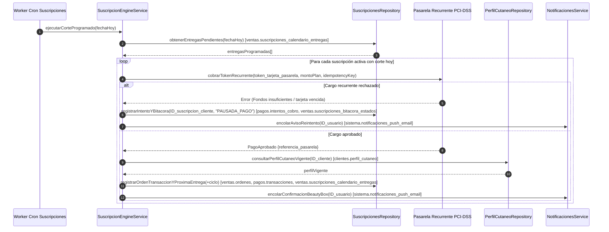
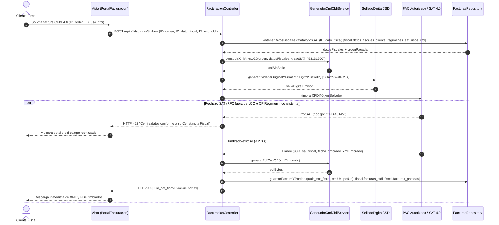
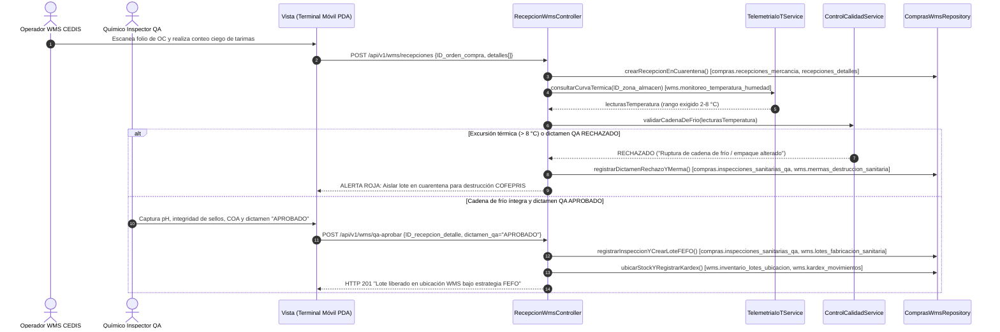
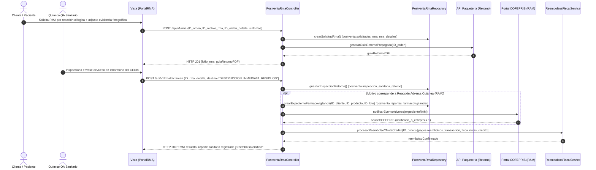
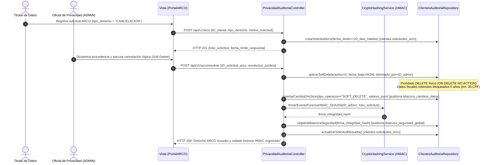

# MODELADO DE INTERACCIÓN Y DIAGRAMAS DE SECUENCIA CRIPTOGRÁFICA Y TRANSACCIONAL (UML 2.5)
## PROYECTO INTEGRADOR V — TECNM / INSTITUTO TECNOLÓGICO SUPERIOR DE MONCLOVA
### ASIGNATURA: ANÁLISIS Y MODELADO DE SISTEMAS DE INFORMACIÓN (AMSI — IFE-1005) — CRITERIO 1.3 (25%)
**Sistema:** DERMA-ECOM (E-Commerce de Salud Cutánea, Belleza y Maquillaje con Trazabilidad FEFO y Cadena de Frío)  
**Autores y Distribución Equitativa:**
- **Submódulo 1 (`DS-01`, `DS-02`, `DS-08` · Tablas `001–050`):** José Luis Luna García
- **Submódulo 2 (`DS-03`, `DS-04`, `DS-05` · Tablas `051–100`):** Sheyla Estefanía Moncada Guel
- **Submódulo 3 (`DS-06`, `DS-07`, `DS-08` · Tablas `101–150`):** Eduardo Salazar Martínez

> [!IMPORTANT]
> **Diagramas de Secuencia UML 2.5 Visuales Editables (Líneas de vida, barras de activación, fragmentos `alt`/`opt` y mensajes síncronos/retorno):**
> - Editable `.drawio` (3 pestañas: Login Criptográfico, Checkout/Antifraude/Split y Recepción QA/IoT/FEFO): [`04a_diagrama_secuencia_UML.drawio`](./04a_diagrama_secuencia_UML.drawio)
> - Visor Interactivo HTML/SVG (con zoom y exportación SVG): [`04b_visor_interactivo_secuencias_UML.html`](./04b_visor_interactivo_secuencias_UML.html)

---

## 1. ARQUITECTURA DE CAPAS DE INTERACCIÓN

Conforme al **Criterio 1.3 (25%)** de la rúbrica oficial del TecNM, cada diagrama de secuencia modela rigurosamente la separación de responsabilidades por capas y su persistencia real en `EcommerceSaludBellezaDB` (`150` tablas, `PK = ID`, `FK = ID_*`):

1. **Capa de Presentación / Vista:** Interfaz SPA Web / Terminal Móvil WMS (`LoginSPA`, `QuizUI`, `CheckoutUI`, `PortalFiscal`, `TerminalPDA`).
2. **Capa de Control y Orquestación:** Controladores REST y middleware (`AuthController`, `SecurityMiddleware`, `DiagnosticoController`, `OrdenesController`, `FacturacionController`, `RecepcionWmsController`, `FarmacovigilanciaController`).
3. **Capa de Servicios de Dominio y Criptografía:** `CryptoHashingService` (PBKDF2-SHA512 / bcrypt / Argon2id + TOTP RFC 6238 + JWT RS256 + HMAC-SHA256), `AntifraudeService`, `MultiCedisSplitService`, `GeneradorXmlCfdiService`, `ControlCalidadService`.
4. **Capa de Repositorios de Datos (Multi-SGBD SQL Server / PostgreSQL):** `UsuarioRepository`, `BitacoraSeguridadRepository`, `PerfilCutaneoRepository`, `OrdenesVentaRepository`, `InventarioLotesRepository`, `FacturasRepository`, `DevolucionesRmaRepository`.
5. **Sistemas Externos Regulados:** Pasarela PCI-DSS (Stripe/Mercado Pago), PAC/SAT CFDI 4.0, API Paquetería, Sensores IoT 2–8 °C y Portal COFEPRIS.

---

## 2. DS-01: AUTENTICACIÓN SEGURA DE USUARIO (LOGIN CRIPTOGRÁFICO, MFA TOTP Y BLOQUEO POR FUERZA BRUTA) — CU-01 *(OBLIGATORIO)*
**Autor Responsable:** José Luis Luna García (Submódulo 1)  
**Tablas BD:** `seguridad.usuarios`, `seguridad.usuarios_roles`, `seguridad.roles_permisos`, `seguridad.intentos_login`, `seguridad.sesiones_activas`, `auditoria.bitacora_seguridad_global`, `sistema.notificaciones_push_email`.



---

## 3. DS-02: DIAGNÓSTICO CLÍNICO CUTÁNEO Y CONSENTIMIENTO EXPRESO LFPDPPP — CU-02
**Autor Responsable:** José Luis Luna García (Submódulo 1)  
**Tablas BD:** `clientes.consentimientos_privacidad`, `clientes.cuestionarios_diagnostico`, `clientes.preguntas_diagnostico`, `clientes.opciones_pregunta`, `clientes.evaluaciones_diagnostico`, `clientes.respuestas_evaluacion`, `clientes.perfil_cutaneo`, `clientes.cliente_condiciones`, `catalogo.alergenos_ingrediente`.



---

## 4. DS-03: CHECKOUT SEGURO, RESERVA 15 MIN, ANTIFRAUDE, PAGO PCI-DSS Y SPLIT MULTIALMACÉN — CU-03
**Autor Responsable:** Sheyla Estefanía Moncada Guel (Submódulo 2)  
**Tablas BD:** `ventas.carritos`, `ventas.reservas_temporales_stock`, `ventas.ordenes`, `ventas.ordenes_detalles`, `ventas.ordenes_impuestos`, `ventas.ordenes_descuentos`, `ventas.ordenes_splits_almacen`, `pagos.reglas_antifraude`, `pagos.evaluaciones_antifraude`, `pagos.transacciones`, `pagos.intentos_cobro`, `wms.inventario_lotes_ubicacion`.

```mermaid
sequenceDiagram
    autonumber
    actor Cliente as Cliente Comprador
    participant WebUI as Vista (CheckoutUI)
    participant GateSDK as Pasarela SDK (PCI-DSS)
    participant OrderCtrl as OrdenesController
    participant FraudSvc as AntifraudeService
    participant SplitSvc as MultiCedisSplitService
    participant WmsRepo as InventarioLotesRepository
    participant OrderRepo as OrdenesVentaRepository

    Cliente->>WebUI: Pulsa "Proceder al Pago"
    WebUI->>OrderCtrl: POST /api/v1/checkout/reservar {ID_carrito}
    OrderCtrl->>WmsRepo: reservarStock15Min(items) [ventas.reservas_temporales_stock]
    WmsRepo-->>OrderCtrl: reservaActiva (expira +15 min)
    OrderCtrl-->>WebUI: HTTP 200 {totales, IVA_16, descuentos}

    Cliente->>WebUI: Selecciona dirección y captura datos de pago en iframe PCI-DSS
    WebUI->>GateSDK: tokenizarTarjeta(PAN, CVV, vigencia)
    GateSDK-->>WebUI: tokenEfimero ("tok_pci_9a8f") [Sin PAN/CVV en BD]
    WebUI->>OrderCtrl: POST /api/v1/ordenes/confirmar {ID_carrito, ID_direccion_envio, tokenEfimero, idempotencyKey}

    OrderCtrl->>FraudSvc: evaluarRiesgo(ID_cliente, monto, IP, reglas) [pagos.reglas_antifraude]
    FraudSvc-->>OrderCtrl: Evaluacion {score_riesgo_total, nivel_riesgo}
    OrderCtrl->>OrderRepo: guardarEvaluacionAntifraude() [pagos.evaluaciones_antifraude]

    alt Score >= 85 (Alto Riesgo / Fraude)
        OrderCtrl->>WmsRepo: liberarReservaStock(ID_carrito)
        OrderCtrl-->>WebUI: HTTP 403 "Operación rechazada por seguridad antifraude"
    else Score < 85 (Continuar; 3DS si >= 65)
        opt score_riesgo_total >= 65
            OrderCtrl->>GateSDK: iniciarReto3DSecure(tokenEfimero)
            GateSDK-->>OrderCtrl: 3DS_VERIFICADO
        end
        OrderCtrl->>GateSDK: ejecutarCobro(tokenEfimero, monto, MXN, idempotencyKey)
        alt Cobro declinado por banco
            GateSDK-->>OrderCtrl: HTTP 402 Declinado
            OrderCtrl->>OrderRepo: registrarIntentoFallido() [pagos.intentos_cobro]
            OrderCtrl-->>WebUI: HTTP 402 "Pago declinado; puede elegir otro método o Split Multipago"
        else Cobro aprobado
            GateSDK-->>OrderCtrl: Aprobado {referencia_pasarela, codigo_autorizacion}
            OrderCtrl->>SplitSvc: calcularSplitsPorCEDIS(items, ID_direccion_envio) [wms.inventario_lotes_ubicacion]
            SplitSvc-->>OrderCtrl: splits[] (ej. CEDIS MTY + CEDIS CDMX)
            OrderCtrl->>OrderRepo: guardarOrdenDetallesSplitsYPago() [ventas.ordenes, ordenes_detalles, ordenes_splits_almacen, pagos.transacciones]
            OrderCtrl->>WmsRepo: confirmarReservaComoVendido(ID_carrito)
            OrderCtrl-->>WebUI: HTTP 201 {ID_orden, folio_orden, splits}
            WebUI-->>Cliente: Confirmación de compra y seguimiento por almacén
        end
    end
```

---

## 5. DS-04: COBRO RECURRENTE Y PROGRAMACIÓN DE SUSCRIPCIÓN BEAUTY-BOX — CU-04
**Autor Responsable:** Sheyla Estefanía Moncada Guel (Submódulo 2)  
**Tablas BD:** `ventas.suscripciones_cliente`, `ventas.suscripciones_items`, `ventas.suscripciones_calendario_entregas`, `ventas.suscripciones_bitacora_estados`, `clientes.metodos_pago_tokenizados`, `pagos.transacciones`, `pagos.intentos_cobro`.



---

## 6. DS-05: EMISIÓN, SELLADO CSD Y TIMBRADO DE FACTURA ELECTRÓNICA CFDI 4.0 — CU-05
**Autor Responsable:** Sheyla Estefanía Moncada Guel (Submódulo 2)  
**Tablas BD:** `fiscal.datos_fiscales_cliente`, `fiscal.regimenes_sat`, `fiscal.usos_cfdi`, `fiscal.facturas_cfdi`, `fiscal.facturas_partidas`, `fiscal.cancelaciones_cfdi`, `fiscal.notas_credito`.



---

## 7. DS-06: RECEPCIÓN EN CEDIS, TELEMETRÍA IOT, DICTAMEN QA Y ALTA DE LOTE FEFO — CU-06
**Autor Responsable:** Eduardo Salazar Martínez (Submódulo 3)  
**Tablas BD:** `compras.ordenes_compra`, `compras.recepciones_mercancia`, `compras.recepciones_detalles`, `compras.inspecciones_sanitarias_qa`, `wms.monitoreo_temperatura_humedad`, `wms.lotes_fabricacion_sanitaria`, `wms.inventario_lotes_ubicacion`, `wms.kardex_movimientos`, `wms.mermas_destruccion_sanitaria`.



---

## 8. DS-07: DEVOLUCIÓN RMA, INSPECCIÓN HIGIÉNICA Y FARMACOVIGILANCIA COFEPRIS — CU-07
**Autor Responsable:** Eduardo Salazar Martínez (Submódulo 3)  
**Tablas BD:** `postventa.solicitudes_rma`, `postventa.rma_detalles`, `postventa.inspeccion_sanitaria_retorno`, `postventa.reportes_farmacovigilancia`, `pagos.reembolsos_transaccion`, `fiscal.notas_credito`.



---

## 9. DS-08: EJERCICIO DE DERECHOS ARCO Y AUDITORÍA FORENSE CON SOFT-DELETE JSON — CU-08 / CU-12
**Autores Responsables:** José Luis Luna García (SM1) y Eduardo Salazar Martínez (SM3)  
**Tablas BD:** `clientes.solicitudes_arco`, `auditoria.bitacora_cambios_datos`, `auditoria.bitacora_seguridad_global`, `sistema.notificaciones_push_email`.



---

## 10. MATRIZ DE CUMPLIMIENTO DEL CRITERIO 1.3 (RÚBRICA AMSI)

| Diagrama | Caso de Uso | Capas Modeladas | Autor Responsable | Evidencia Técnica Verificada |
| :---: | :---: | :--- | :--- | :--- |
| **DS-01** *(Obligatorio)* | CU-01 (Login) | Vista → Controlador → Servicio Criptográfico → Repositorio Datos/Auditoría | José Luis Luna García | Hashing + salt, timing-attack mitigation, MFA TOTP RFC 6238, bloqueo 5 intentos + HMAC-SHA256 |
| **DS-02** | CU-02 (Dermo) | Vista → Controlador → Servicio Legal LFPDPPP → Motor Reglas → Repositorio | José Luis Luna García | Consentimiento expreso Art. 9 LFPDPPP antes de persistir datos sensibles |
| **DS-03** | CU-03 (Checkout) | Vista → SDK PCI-DSS → Controlador → Antifraude → Split CEDIS → Repositorios | Sheyla Estefanía Moncada Guel | Reserva 15 min, Antifraude/3DS, Tokenización sin PAN/CVV, Split multialmacén |
| **DS-04** | CU-04 (Beauty-Box) | Worker Cron → Motor Suscripciones → Pasarela Recurrente → Repositorios | Sheyla Estefanía Moncada Guel | Cobro recurrente idempotente, manejo de fallos y curaduría cutánea |
| **DS-05** | CU-05 (CFDI 4.0) | Portal → Controlador → XML Anexo 20 → Sellado CSD → PAC SAT → Repositorio | Sheyla Estefanía Moncada Guel | Validación LCO/Régimen, sellado SHA256withRSA y timbrado UUID < 2 s |
| **DS-06** | CU-06 (WMS/QA) | Terminal PDA → Controlador → Telemetría IoT → Servicio QA → Repositorio | Eduardo Salazar Martínez | Cadena de frío 2–8 °C, dictamen QA/COA, cuarentena/destrucción y alta FEFO |
| **DS-07** | CU-07 (RMA/RAM) | Portal → Controlador → API Retorno → QA → Portal COFEPRIS → Reembolso | Eduardo Salazar Martínez | Inspección higiénica, notificación farmacovigilancia COFEPRIS y Nota de Crédito |
| **DS-08** | CU-08 / CU-12 | Portal ARCO → Controlador → Servicio HMAC → Repositorio Auditoría | J. L. Luna / E. Salazar | Plazo 20 días LFPDPPP, Soft-Delete JSON válido y firma HMAC (Arts. 211 bis CPF) |
