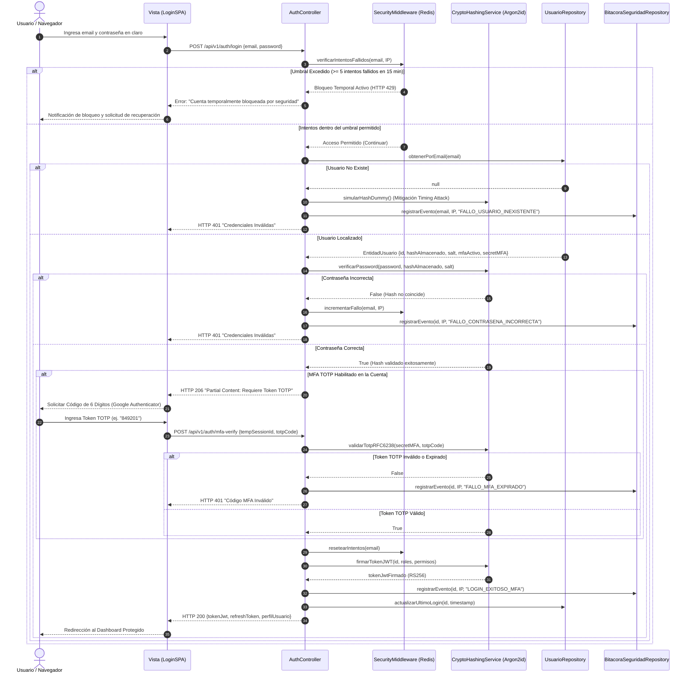
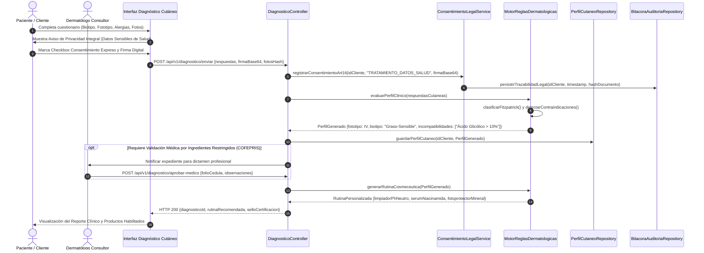
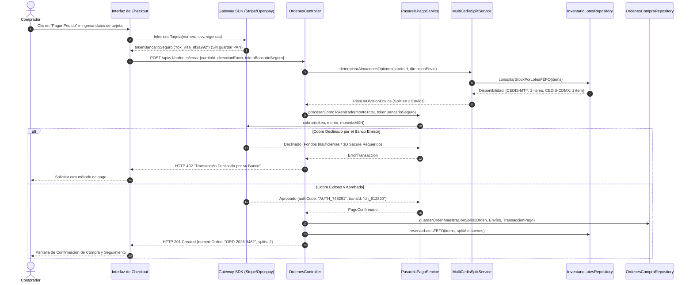
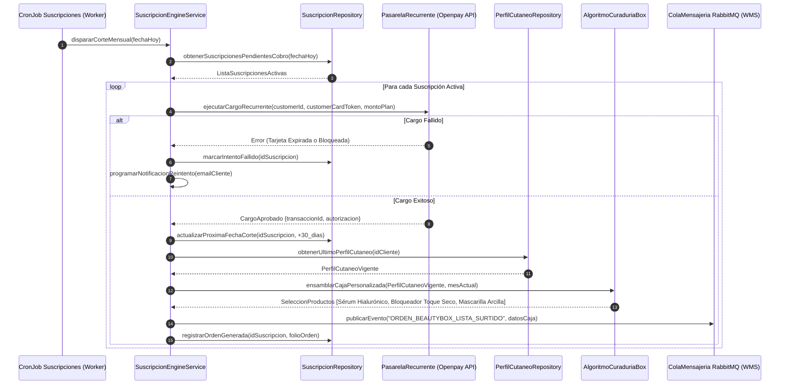
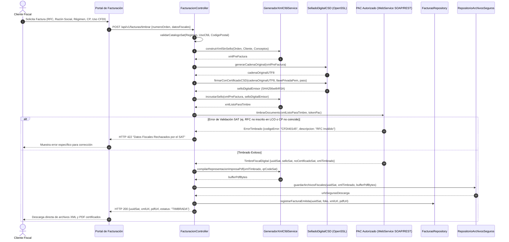
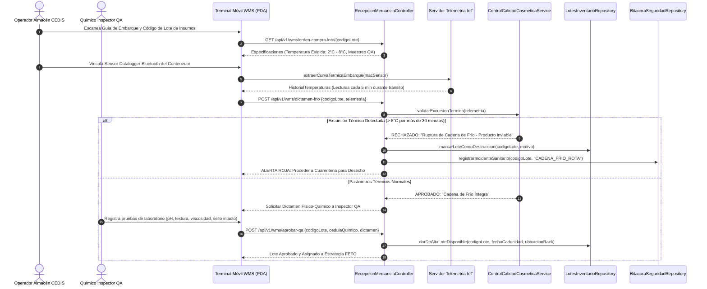
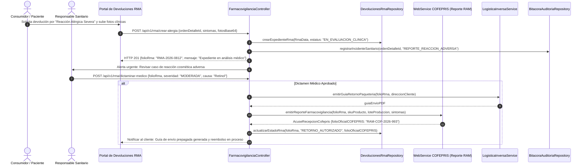

# CAPÍTULO II: ANÁLISIS Y MODELADO DE SISTEMAS DE INFORMACIÓN (AMSI - IFE-1005)
## Entregable 2.4: Modelado de Interacción y Diagramas de Secuencia Criptográfica y Transaccional

---

### 1. Introducción y Arquitectura de Capas de Interacción

Conforme a las directrices de la rúbrica oficial del Tecnológico Nacional de México (TecNM) para la asignatura **Análisis y Modelado de Sistemas de Información (IFE-1005)**, se modela el comportamiento dinámico del sistema a través de diagramas de secuencia UML en notación Mermaid. 

Cada diagrama formaliza el flujo de mensajes sincrónicos y asincrónicos, llamadas de métodos, validaciones criptográficas y delimitación estricta de responsabilidades entre capas:
- **Capa de Presentación / Vista (UI / Frontend SPA)**
- **Capa de Control y Orquestación (API Controller / Middleware)**
- **Capa de Lógica de Negocio y Servicios Criptográficos (Domain & Security Services)**
- **Capa de Persistencia y Acceso a Datos (Data Repositories / Cache Layer)**
- **Entidades Externas Reguladas (Gateways Bancarios, PAC SAT, Sensores IoT, COFEPRIS)**

---

### 2. Diagrama de Secuencia 1: Autenticación Criptográfica con MFA TOTP y Bloqueo por Fuerza Bruta (CU-01)

Este diagrama satisface con rigor máximo el Criterio 1.3 de la rúbrica, demostrando el hashing de contraseñas mediante derivación de claves Argon2id/bcrypt, verificación temporal de contraseñas de un solo uso (TOTP RFC 6238), mitigación de ataques de diccionario mediante rate-limiting en Redis y registro inmutable en bitácora de auditoría.

---

### 3. Diagrama de Secuencia 2: Diagnóstico Clínico Cutáneo y Consentimiento LFPDPPP (CU-02)

Representa la recolección de datos de salud y dermatología protegidos por el Art. 16 Constitucional y la LFPDPPP, con captura de consentimiento firmado digitalmente y formulación de rutinas cosmecéuticas compatibles.

---

### 4. Diagrama de Secuencia 3: Checkout Seguro, Tokenización Bancaria y Split Multialmacén (CU-03)

Ilustra la adquisición transaccional de productos cosméticos con segregación de inventario en múltiples CEDIS (Monterrey / CDMX) y tokenización sin almacenar números de tarjeta en la base de datos (cumplimiento PCI-DSS).

---

### 5. Diagrama de Secuencia 4: Cobro Recurrente y Personalización de Beauty-Box (CU-04)

Muestra la orquestación asincrónica de suscripciones automatizadas, donde un proceso por lotes (*cron job*) ejecuta el cobro periódico y ensambla una caja personalizada de productos de acuerdo al estado evolutivo del perfil cutáneo.

---

### 6. Diagrama de Secuencia 5: Emisión y Timbrado SAT de Factura CFDI 4.0 (CU-05)

Modelado de la integración fiscal obligatoria en México con Proveedor Autorizado de Certificación (PAC), validación de sello digital mediante CSD y generación de XML/PDF con UUID fiscal.

---

### 7. Diagrama de Secuencia 6: Recepción en Andén, Dictamen QA y Alta de Lote FEFO (CU-06)

Representa la verificación física de insumos y cosméticos en almacén, validando la cadena de frío mediante telemetría IoT antes de ingresar productos al stock comercializable.

---

### 8. Diagrama de Secuencia 7: Devolución RMA por Alergia Cutánea y Farmacovigilancia COFEPRIS (CU-07)

Modelado del flujo médico-legal de devoluciones de productos cosméticos ante reacciones cutáneas adversas, activando el reporte obligatorio ante las autoridades sanitarias.

