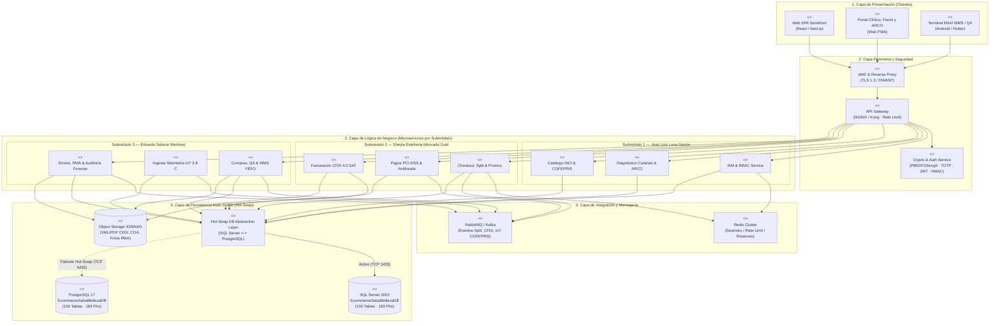

# MODELO DE IMPLEMENTACIÓN: DIAGRAMA DE COMPONENTES (UML 2.5)
## PROYECTO INTEGRADOR V — TECNM / INSTITUTO TECNOLÓGICO SUPERIOR DE MONCLOVA
### ASIGNATURA: ANÁLISIS Y MODELADO DE SISTEMAS DE INFORMACIÓN (AMSI — IFE-1005) — CRITERIO 1.4 (30%)
**Sistema:** DERMA-ECOM (E-Commerce de Salud Cutánea, Belleza y Maquillaje con Trazabilidad FEFO y Cadena de Frío)  
**Autores y Distribución Equitativa:**
- **Submódulo 1 (Componentes IAM/Criptografía, Diagnóstico Cutáneo, Catálogo INCI):** José Luis Luna García
- **Submódulo 2 (Componentes Checkout/Split, Pagos PCI-DSS, Antifraude, CFDI 4.0, Promos):** Sheyla Estefanía Moncada Guel
- **Submódulo 3 (Componentes Compras/QA, WMS FEFO, Telemetría IoT, Envíos, RMA, Auditoría Forense y Hot-Swap):** Eduardo Salazar Martínez

> [!IMPORTANT]
> **Diagrama de Componentes UML 2.5 Visual Editable (`<<component>>`, `<<interface>>`, `<<database>>`):**
> - Editable `.drawio`: [`05a_diagrama_componentes_UML.drawio`](./05a_diagrama_componentes_UML.drawio)
> - Visor Interactivo HTML/SVG (con zoom, paneo y exportación SVG): [`05b_visor_interactivo_componentes_UML.html`](./05b_visor_interactivo_componentes_UML.html)

---

## 1. DIAGRAMA DE COMPONENTES DE SOFTWARE (ARQUITECTURA POR CAPAS)

El sistema **DERMA-ECOM** se estructura en **5 capas desacopladas** mediante interfaces formales (`ICryptoHashingService`, `IPaymentGateway`, `ITaxStampingPAC`, `IFefoAllocationService`, `IDataRepositoryMultiSGBD`), garantizando interoperabilidad **Hot-Swap** entre **Microsoft SQL Server 2022** y **PostgreSQL 17** sobre las **150 tablas** normalizadas (`PK = ID`, `FK = ID_*`).

---

## 2. ESPECIFICACIÓN TÉCNICA DE COMPONENTES E INTERFACES

| Componente | Submódulo / Autor | Tecnología | Interfaz / Contrato | Esquemas BD Asociados |
| :--- | :--- | :--- | :--- | :--- |
| **API Gateway & WAF** | Transversal | NGINX / Kong + TLS 1.3 | `REST/HTTPS :443` | `seguridad.sesiones_activas` |
| **Crypto & Auth Service** | SM1 · José Luis Luna García | .NET 8 / Node.js + TOTP | `ICryptoHashingService` | `seguridad.*` (10 tablas) |
| **Diagnóstico & ARCO Service** | SM1 · José Luis Luna García | Python FastAPI | `IDermoDiagnosisService` | `clientes.*` (15 tablas) |
| **Catálogo INCI & COFEPRIS** | SM1 · José Luis Luna García | .NET 8 / REST | `ICatalogoSanitarioService` | `catalogo.*`, `comunidad.*` (25 tablas) |
| **Checkout, Split & Promos** | SM2 · Sheyla E. Moncada Guel | Go / .NET 8 | `ICheckoutSplitService` | `ventas.*`, `promos.*` (29 tablas) |
| **Pagos PCI-DSS & Antifraude** | SM2 · Sheyla E. Moncada Guel | .NET 8 + Stripe/MP SDK | `IPaymentGateway` | `pagos.*` (13 tablas) |
| **Facturación CFDI 4.0 SAT** | SM2 · Sheyla E. Moncada Guel | .NET 8 + OpenSSL CSD | `ITaxStampingPAC` | `fiscal.*` (8 tablas) |
| **Compras, QA & WMS FEFO** | SM3 · Eduardo Salazar Martínez | .NET 8 / Go | `IFefoAllocationService` | `compras.*`, `wms.*` (26 tablas) |
| **Ingesta Telemetría IoT** | SM3 · Eduardo Salazar Martínez | Rust / MQTT Broker | `IIoTTelemetryIngest` | `wms.monitoreo_temperatura_humedad` |
| **Envíos, RMA & Forense** | SM3 · Eduardo Salazar Martínez | .NET 8 + Webhooks | `IForensicAuditService` | `envios.*`, `postventa.*`, `auditoria.*`, `sistema.*` (24 tablas) |
| **Hot-Swap DB Abstraction** | Transversal (FBD + AMSI) | Repository + `hotswap_db_manager` | `IDataRepositoryMultiSGBD` | 150 tablas en SQL Server 2022 y PostgreSQL 17 |
