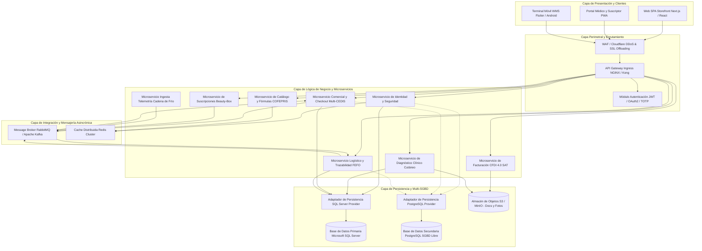
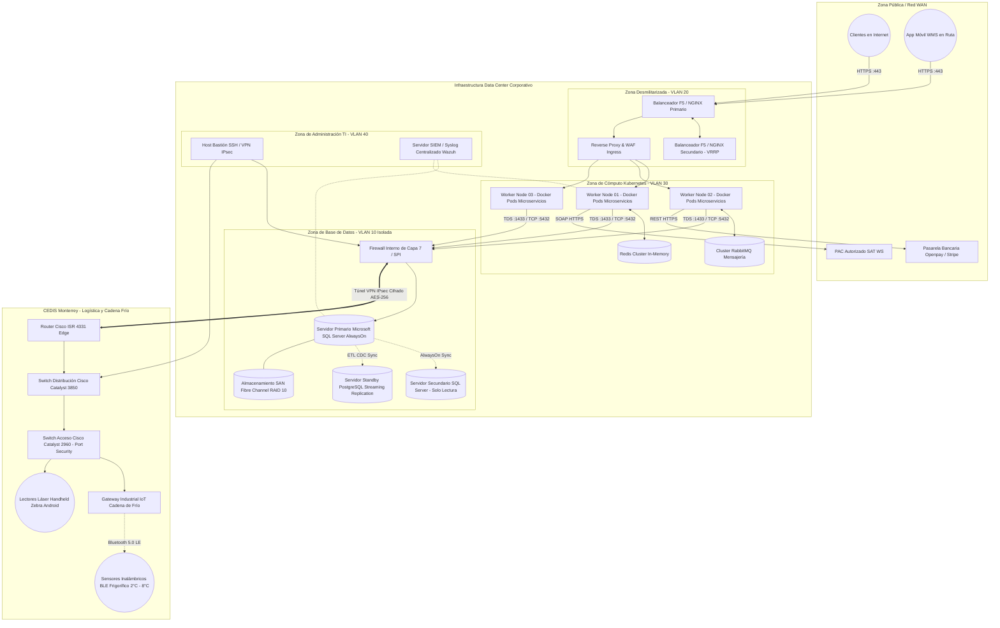

# CAPÍTULO II: ANÁLISIS Y MODELADO DE SISTEMAS DE INFORMACIÓN (AMSI - IFE-1005)
## Entregable 2.5: Modelos de Implementación y Arquitectura (Componentes y Despliegue Físico/Lógico)

---

### 1. Modelo y Diagrama de Componentes de Software

El sistema integral de comercio electrónico de cosmecéutica y dermatología se estructura bajo un patrón arquitectónico de **Microservicios Modulares desacoplados por Dominio (Domain-Driven Design)**, orquestados mediante un API Gateway centralizado y comunicados asincrónicamente mediante un Message Broker distribuido.

---

### 2. Especificación Técnica de Componentes

| Componente | Tecnología | Responsabilidad Primaria |
| :--- | :--- | :--- |
| **API Gateway & Ingress** | NGINX / Kong Enterprise | Balanceo de carga L7, terminación TLS 1.3, rate limiting y enrutamiento reverso hacia microservicios. |
| **Security & Auth Module** | Node.js / NestJS + Passport | Validación de firmas JWT RS256, autenticación MFA RFC 6238, y hashing Argon2id. |
| **Dermatology Engine** | Python / FastAPI + Scikit-Learn | Análisis de respuestas del test cutáneo, cálculo de fototipo Fitzpatrick y reglas clínicas COFEPRIS. |
| **Split Multi-CEDIS Engine** | Go (Golang) / High-Concurrency | Algoritmo determinístico de enrutamiento y partición de órdenes de compra según proximidad geográfica y stock FEFO. |
| **SAT Tax Invoicing Adapter** | C# .NET 8 / WCF SOAP Client | Consumo de WebServices de PAC autorizado, sellado digital SHA256 con llave CSD y generación de timbre fiscal. |
| **IoT Telemetry Ingest** | Rust / MQTT Broker | Ingesta masiva y procesamiento de bajo consumo de sensores térmicos Bluetooth/Zigbee en andenes y transportes. |
| **Multi-SGBD Abstraction** | TypeORM / Dapper Repository | Capa de abstracción que implementa el soporte dual: Microsoft SQL Server (producción corporativa) y PostgreSQL (entorno libre de contingencia). |

---

### 3. Diagrama de Despliegue Físico y de Infraestructura de Red

El despliegue de infraestructura garantiza alta disponibilidad ($99.9\%$), redundancia geográfica entre el Centro de Datos Principal y los Centros de Distribución (CEDIS Monterrey y CEDIS CDMX), y aislamiento perimetral estricto de acuerdo con el modelo jerárquico de redes.

---

### 4. Matriz de Aislamiento de Red y Puertos de Despliegue

| Nodo Origen | Nodo Destino | Protocolo / Puerto | Propósito Técnico de Seguridad |
| :--- | :--- | :---: | :--- |
| Clientes Externos | DMZ (Balanceador NGINX) | `TCP 443 (HTTPS)` | Cifrado TLS 1.3 con certificados RSA 4096-bit o ECDSA P-384. |
| DMZ (Balanceador) | Pods Microservicios | `TCP 8080 / 8443` | Tráfico HTTP/2 balanceado internamente mediante Service Mesh. |
| Pods Microservicios | Redis Cluster | `TCP 6379` | Cache de sesiones, rate-limiting de IPs y tokens de refresco. |
| Pods Microservicios | RabbitMQ Broker | `TCP 5672 / 15672` | Colas de eventos de compras, splits y solicitudes de timbrado. |
| Pods Microservicios | SQL Server Cluster | `TCP 1433 (TDS)` | Consultas OLTP seguras con autenticación cifrada obligatoria. |
| Pods Microservicios | PostgreSQL Cluster | `TCP 5432` | Persistencia en SGBD libre para réplicas analíticas y contingencia. |
| Terminales WMS CEDIS | API Ingress | `TCP 443 (HTTPS)` | Sincronización de recepciones, empaquetado y lectura de códigos FEFO. |
| Sensores IoT Frigorífico | Gateway Edge CEDIS | `Bluetooth LE 2.4 GHz` | Telemetría continua de temperatura ($2^{\circ}\text{C}$ a $8^{\circ}\text{C}$) y humedad relativa. |
| Gateway Edge CEDIS | Router Corporativo | `IPsec ESP / UDP 500/4500`| Túnel VPN punto a punto con cifrado AES-GCM-256 entre sucursales. |
