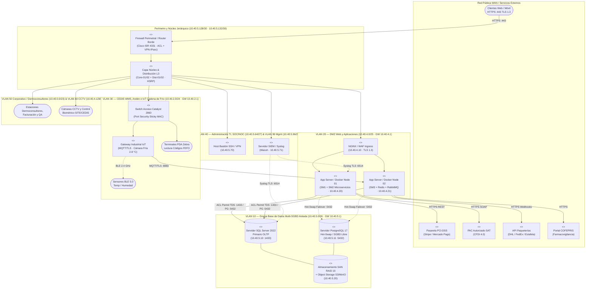

# MODELO DE IMPLEMENTACIÓN: DIAGRAMA DE DESPLIEGUE FÍSICO Y RED (UML 2.5)
## PROYECTO INTEGRADOR V — TECNM / INSTITUTO TECNOLÓGICO SUPERIOR DE MONCLOVA
### ASIGNATURA: ANÁLISIS Y MODELADO DE SISTEMAS DE INFORMACIÓN (AMSI — IFE-1005) — CRITERIO 1.4 (30%)
**Sistema:** DERMA-ECOM (E-Commerce de Salud Cutánea, Belleza y Maquillaje con Trazabilidad FEFO y Cadena de Frío)  
**Autores:** José Luis Luna García (SM1) · Sheyla Estefanía Moncada Guel (SM2) · Eduardo Salazar Martínez (SM3)

> [!IMPORTANT]
> **Diagrama de Despliegue UML 2.5 Visual Editable (`<<device>>`, `<<executionEnvironment>>`, `<<external>>`, alineado al plan VLSM `10.40.0.0/16`):**
> - Editable `.drawio`: [`06a_diagrama_despliegue_UML.drawio`](./06a_diagrama_despliegue_UML.drawio)
> - Visor Interactivo HTML/SVG (con zoom, paneo y exportación SVG): [`06b_visor_interactivo_despliegue_UML.html`](./06b_visor_interactivo_despliegue_UML.html)

---

## 1. DIAGRAMA DE DESPLIEGUE FÍSICO Y TOPOLOGÍA REAL DE RED (VLSM `10.40.0.0/16`)

El modelo de despliegue está **100% sincronizado** con el plan de direccionamiento **VLSM** y la arquitectura jerárquica de 3 capas de **Redes de Computadoras (RC — IFD-1020)** (`03_RC_Redes_Telecomunicaciones/02_esquema_direccionamiento_vlsm.md`), respetando exactamente cada VLAN, subred CIDR, nodo servidor y política de aislamiento perimetral.

---

## 2. MATRIZ DE AISLAMIENTO DE RED, SUBREDES VLSM Y PUERTOS DE DESPLIEGUE

| Segmento / VLAN | Subred VLSM (RC) | Nodo Origen → Destino | Protocolo / Puerto | Política de Seguridad (ACL / Cifrado) |
| :--- | :---: | :--- | :---: | :--- |
| **WAN → VLAN 20 (DMZ)** | `10.40.4.0/25` | Clientes → NGINX / WAF | `TCP 443 (HTTPS)` | TLS 1.3 obligatorio; bloqueo DDoS y OWASP Top 10. |
| **VLAN 20 → VLAN 10 (BD)** | `10.40.5.0/26` | App Nodes → SQL Server 2022 | `TCP 1433 (TDS)` | Permitido únicamente desde VLAN 20 vía ACL estricta; cifrado obligatorio. |
| **VLAN 20 → VLAN 10 (BD)** | `10.40.5.0/26` | App Nodes → PostgreSQL 17 | `TCP 5432 (SSL)` | Failover automático *Hot-Swap* (`hotswap_db_manager.ps1`). |
| **VLAN 30 → VLAN 20 (DMZ)** | `10.40.2.0/24` | Gateway IoT / PDA → App Node 02 | `TCP 8883 / 443` | MQTT/TLS y HTTPS con Port Security Sticky MAC en acceso L2. |
| **VLAN 50 → VLAN 20 (DMZ)** | `10.40.0.0/23` | Dermoconsultores / QA → Portal | `TCP 443 (HTTPS)` | Autenticación RBAC + MFA TOTP; sin acceso directo a VLAN 10 (BD). |
| **VLAN 40 → VLAN 10 / 20 / 99** | `10.40.5.64/27` | Bastión SOC/NOC → Servidores | `TCP 22 (SSH) / 6514` | Administración exclusiva por Host Bastión y recolección Syslog SIEM. |
| **VLAN 60 (CCTV / Biométrico)** | `10.40.4.128/25` | Cámaras / Accesos → NVR SITE | `TCP 554 / 443` | Red física dedicada para videovigilancia y control de acceso al SITE. |
| **VLAN 70 (Invitados)** | `10.40.3.0/24` | Proveedores Wi-Fi → Internet | `TCP 80 / 443` | Aislamiento total: `DENY` hacia todas las subredes `10.40.0.0/16`. |
