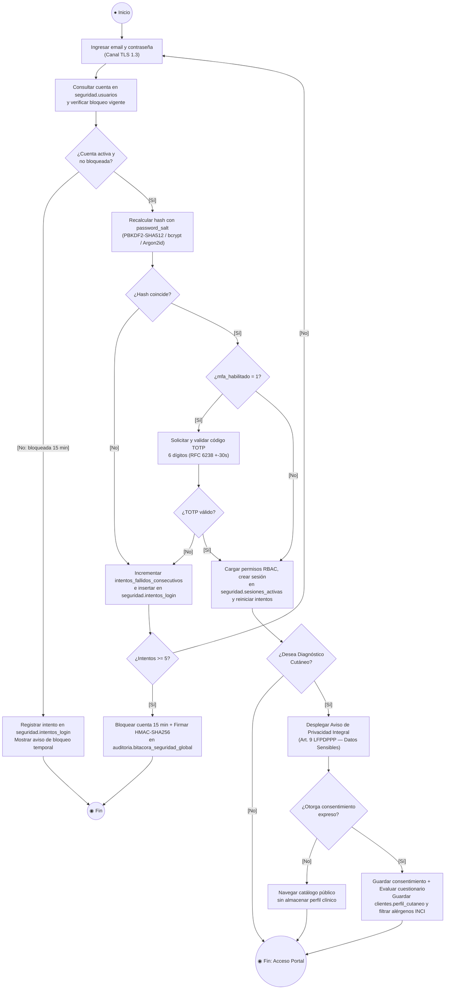
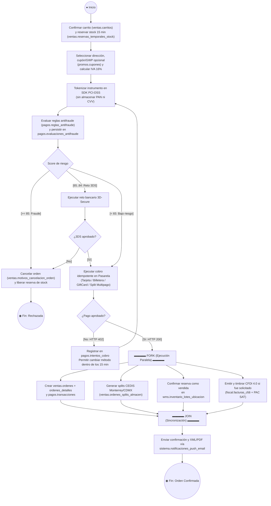
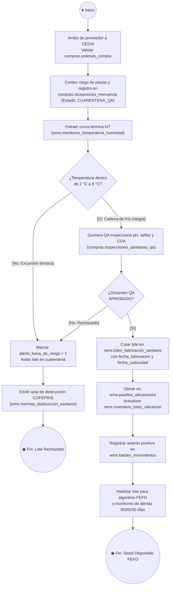
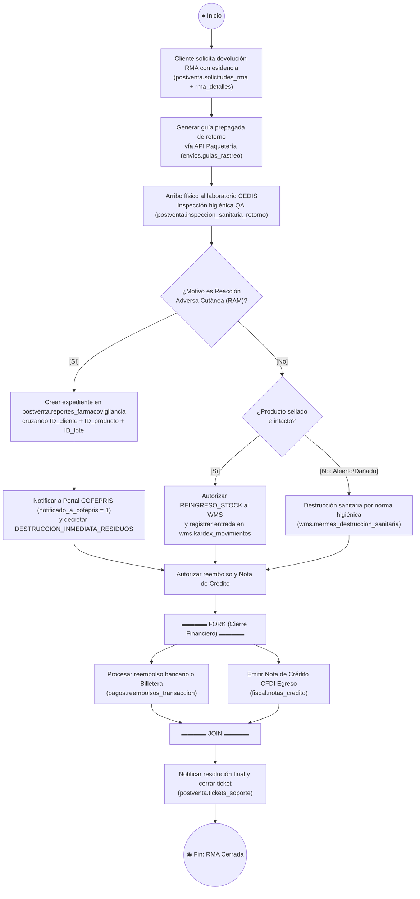

# MODELADO DE PROCESOS DE NEGOCIO: DIAGRAMAS DE ACTIVIDADES (UML 2.5)
## PROYECTO INTEGRADOR V — TECNM / INSTITUTO TECNOLÓGICO SUPERIOR DE MONCLOVA
### ASIGNATURA: ANÁLISIS Y MODELADO DE SISTEMAS DE INFORMACIÓN (AMSI — IFE-1005)
**Sistema:** DERMA-ECOM (E-Commerce de Salud Cutánea, Belleza y Maquillaje con Trazabilidad FEFO y Cadena de Frío)  
**Autores y Distribución Equitativa:**
- **Submódulo 1 (`DA-01` · Tablas `001–050`):** José Luis Luna García
- **Submódulo 2 (`DA-02` · Tablas `051–100`):** Sheyla Estefanía Moncada Guel
- **Submódulo 3 (`DA-03`, `DA-04` · Tablas `101–150`):** Eduardo Salazar Martínez

> [!IMPORTANT]
> **Diagramas de Actividades UML 2.5 Visuales Editables (Nodo Inicial `●`, Nodo Final `◉`, Carriles/*Swimlanes*, Rombos de Decisión `◇`, Barras Paralelas *Fork/Join* `▬`):**
> - Editable `.drawio` (4 pestañas: Login/Dermo, Checkout/CFDI, Recepción QA/FEFO y RMA/COFEPRIS): [`08a_diagrama_actividades_UML.drawio`](./08a_diagrama_actividades_UML.drawio)
> - Visor Interactivo HTML/SVG (con pestañas, zoom y exportación SVG): [`08b_visor_interactivo_actividades_UML.html`](./08b_visor_interactivo_actividades_UML.html)

---

## 1. DA-01: AUTENTICACIÓN SEGURA (LOGIN), MFA TOTP, BLOQUEO POR FUERZA BRUTA Y DIAGNÓSTICO LFPDPPP
**Autor Responsable:** José Luis Luna García (Submódulo 1 — `seguridad.*`, `clientes.*`, `auditoria.bitacora_seguridad_global`)

---

## 2. DA-02: CHECKOUT SEGURO, RESERVA 15 MIN, ANTIFRAUDE, PAGO PCI-DSS, SPLIT MULTIALMACÉN Y CFDI 4.0
**Autor Responsable:** Sheyla Estefanía Moncada Guel (Submódulo 2 — `ventas.*`, `pagos.*`, `fiscal.*`, `promos.*`)  
Incluye **bifurcación paralela (*Fork / Join*)** tras la autorización del cobro para ejecutar concurrentemente el Split Multialmacén, la liberación/confirmación de reserva, el timbrado CFDI 4.0 y la notificación al cliente.

---

## 3. DA-03: RECEPCIÓN EN CEDIS, TELEMETRÍA IOT (2–8 °C), DICTAMEN QA Y ALTA/DESPACHO FEFO
**Autor Responsable:** Eduardo Salazar Martínez (Submódulo 3 — `compras.*`, `wms.*`, `envios.*`)

---

## 4. DA-04: DEVOLUCIÓN RMA, INSPECCIÓN HIGIÉNICA, FARMACOVIGILANCIA COFEPRIS Y REEMBOLSO
**Autores Responsables:** Eduardo Salazar Martínez (SM3) y Sheyla Estefanía Moncada Guel (SM2)

---

## 5. MATRIZ DE TRAZABILIDAD DE ACTIVIDADES ↔ CASOS DE USO ↔ BASE DE DATOS

| Diagrama | Submódulo / Autor | Casos de Uso | Constructos UML 2.5 Aplicados | Tablas BD Impactadas (`PK = ID`, `FK = ID_*`) |
| :---: | :--- | :---: | :--- | :--- |
| **DA-01** | SM1 · José Luis Luna García | CU-01, CU-02 | Inicio/Fin, 7 Decisiones con guardas, ciclo de reintento | `seguridad.usuarios`, `intentos_login`, `sesiones_activas`, `clientes.consentimientos_privacidad`, `perfil_cutaneo`, `auditoria.bitacora_seguridad_global` |
| **DA-02** | SM2 · Sheyla E. Moncada Guel | CU-03, CU-05, CU-10 | Decisiones antifraude/3DS, **Fork/Join paralelo** (4 ramas) | `ventas.carritos`, `reservas_temporales_stock`, `ordenes`, `ordenes_splits_almacen`, `pagos.evaluaciones_antifraude`, `transacciones`, `fiscal.facturas_cfdi` |
| **DA-03** | SM3 · Eduardo Salazar Martínez | CU-06, CU-15 | Decisiones térmicas IoT y QA, cuarentena/destrucción vs FEFO | `compras.ordenes_compra`, `recepciones_mercancia`, `inspecciones_sanitarias_qa`, `wms.monitoreo_temperatura_humedad`, `lotes_fabricacion_sanitaria`, `kardex_movimientos`, `mermas_destruccion_sanitaria` |
| **DA-04** | SM3 + SM2 · E. Salazar / S. Moncada | CU-07, CU-05 | Decisiones RAM/higiene, **Fork/Join paralelo** (Reembolso + CFDI Egreso) | `postventa.solicitudes_rma`, `inspeccion_sanitaria_retorno`, `reportes_farmacovigilancia`, `pagos.reembolsos_transaccion`, `fiscal.notas_credito` |
