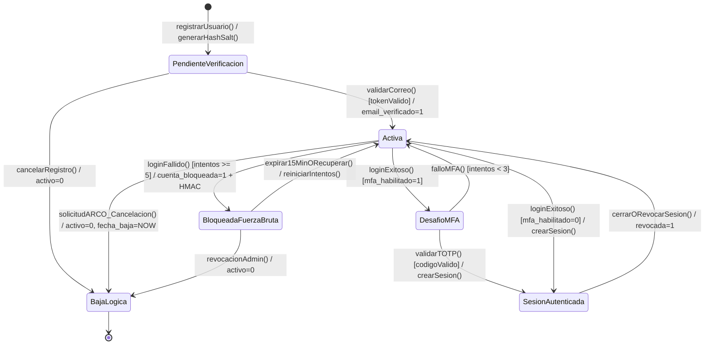
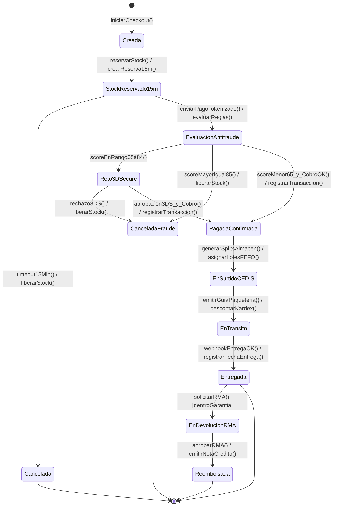
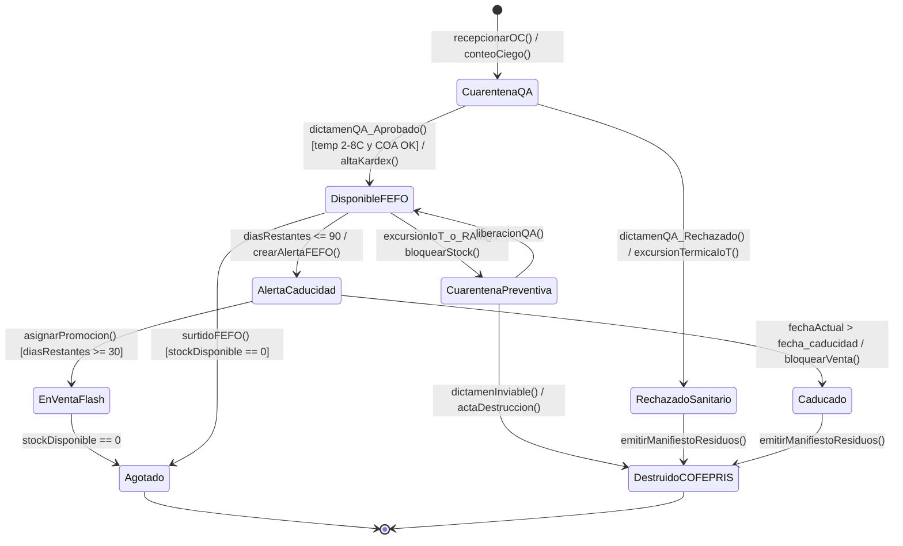
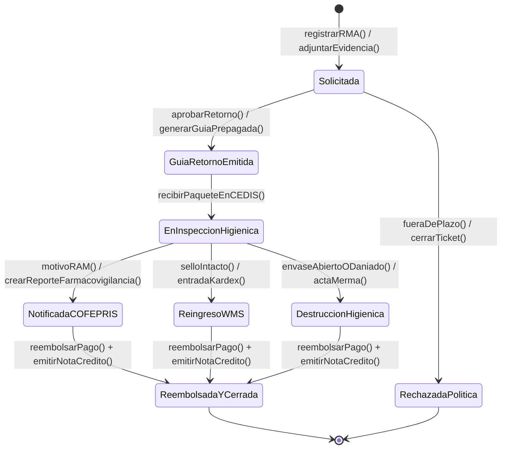

# MODELADO DE COMPORTAMIENTO: DIAGRAMAS DE ESTADOS (UML 2.5)
## PROYECTO INTEGRADOR V — TECNM / INSTITUTO TECNOLÓGICO SUPERIOR DE MONCLOVA
### ASIGNATURA: ANÁLISIS Y MODELADO DE SISTEMAS DE INFORMACIÓN (AMSI — IFE-1005)
**Sistema:** DERMA-ECOM (E-Commerce de Salud Cutánea, Belleza y Maquillaje con Trazabilidad FEFO y Cadena de Frío)  
**Autores y Distribución Equitativa:**
- **Submódulo 1 (`DE-01` · Tablas `001–050`):** José Luis Luna García
- **Submódulo 2 (`DE-02` · Tablas `051–100`):** Sheyla Estefanía Moncada Guel
- **Submódulo 3 (`DE-03`, `DE-04` · Tablas `101–150`):** Eduardo Salazar Martínez

> [!IMPORTANT]
> **Diagramas de Estados UML 2.5 Visuales Editables (Pseudoestado inicial `●`, estado final `◉`, estados con `entry`/`do`/`exit` y transiciones `evento [guarda] / acción`):**
> - Editable `.drawio` (4 pestañas: Cuenta Usuario, Orden de Venta, Lote Sanitario FEFO y Solicitud RMA): [`09a_diagrama_estados_UML.drawio`](./09a_diagrama_estados_UML.drawio)
> - Visor Interactivo HTML/SVG (con pestañas, zoom y exportación SVG): [`09b_visor_interactivo_estados_UML.html`](./09b_visor_interactivo_estados_UML.html)

---

## 1. DE-01: MÁQUINA DE ESTADOS DE CUENTA DE USUARIO Y SESIÓN (`seguridad.usuarios`)
**Autor Responsable:** José Luis Luna García (Submódulo 1)  
**Tablas BD:** `seguridad.usuarios`, `seguridad.sesiones_activas`, `seguridad.intentos_login`, `seguridad.tokens_recuperacion`, `auditoria.bitacora_seguridad_global`.

---

## 2. DE-02: MÁQUINA DE ESTADOS DE ORDEN DE VENTA (`ventas.ordenes`)
**Autor Responsable:** Sheyla Estefanía Moncada Guel (Submódulo 2)  
**Tablas BD:** `ventas.ordenes`, `ventas.estados_orden`, `ventas.ordenes_historial_estados`, `ventas.reservas_temporales_stock`, `pagos.evaluaciones_antifraude`, `pagos.transacciones`, `ventas.ordenes_splits_almacen`.

---

## 3. DE-03: MÁQUINA DE ESTADOS DE LOTE SANITARIO FEFO (`wms.lotes_fabricacion_sanitaria`)
**Autor Responsable:** Eduardo Salazar Martínez (Submódulo 3)  
**Tablas BD:** `compras.recepciones_mercancia`, `compras.inspecciones_sanitarias_qa`, `wms.lotes_fabricacion_sanitaria`, `wms.monitoreo_temperatura_humedad`, `wms.alertas_caducidad_proxima`, `wms.mermas_destruccion_sanitaria`.

---

## 4. DE-04: MÁQUINA DE ESTADOS DE SOLICITUD RMA Y FARMACOVIGILANCIA (`postventa.solicitudes_rma`)
**Autores Responsables:** Eduardo Salazar Martínez (SM3) y Sheyla Estefanía Moncada Guel (SM2)  
**Tablas BD:** `postventa.solicitudes_rma`, `postventa.inspeccion_sanitaria_retorno`, `postventa.reportes_farmacovigilancia`, `pagos.reembolsos_transaccion`, `fiscal.notas_credito`.

---

## 5. MATRIZ DE TRAZABILIDAD DE MÁQUINAS DE ESTADO ↔ BD

| Máquina de Estados | Entidad / Tabla Principal (`PK = ID`) | Columna de Estado / Control | Submódulo / Autor |
| :---: | :--- | :--- | :--- |
| **DE-01** | `seguridad.usuarios` / `seguridad.sesiones_activas` | `activo`, `email_verificado`, `cuenta_bloqueada`, `revocada` | SM1 · José Luis Luna García |
| **DE-02** | `ventas.ordenes` / `ventas.ordenes_historial_estados` | `ID_estado_orden`, `ID_motivo_cancelacion` | SM2 · Sheyla E. Moncada Guel |
| **DE-03** | `wms.lotes_fabricacion_sanitaria` | `estatus_sanitario`, `fecha_caducidad` | SM3 · Eduardo Salazar Martínez |
| **DE-04** | `postventa.solicitudes_rma` / `postventa.reportes_farmacovigilancia` | `estado_rma`, `destino_sanitario_autorizado`, `notificado_a_cofepris` | SM3 + SM2 · E. Salazar / S. Moncada |
