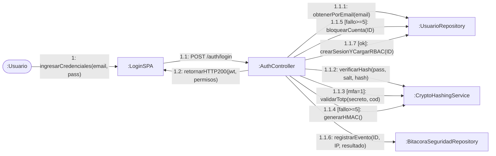
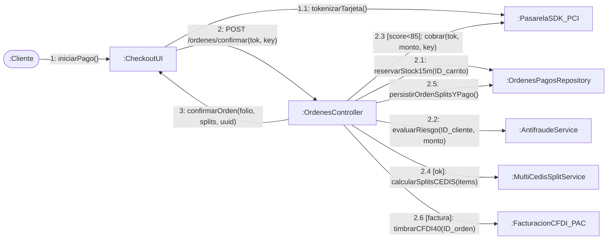
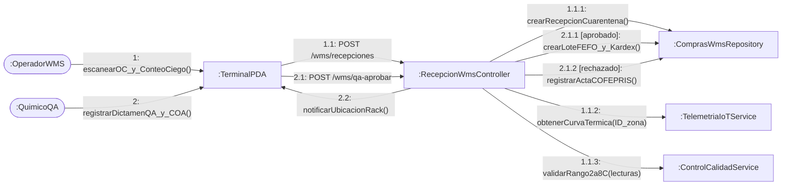

# MODELADO DE INTERACCIÓN: DIAGRAMAS DE COMUNICACIÓN (UML 2.5)
## PROYECTO INTEGRADOR V — TECNM / INSTITUTO TECNOLÓGICO SUPERIOR DE MONCLOVA
### ASIGNATURA: ANÁLISIS Y MODELADO DE SISTEMAS DE INFORMACIÓN (AMSI — IFE-1005)
**Sistema:** DERMA-ECOM (E-Commerce de Salud Cutánea, Belleza y Maquillaje con Trazabilidad FEFO y Cadena de Frío)  
**Autores y Distribución Equitativa:**
- **Submódulo 1 (`DC-01` · Tablas `001–050`):** José Luis Luna García
- **Submódulo 2 (`DC-02` · Tablas `051–100`):** Sheyla Estefanía Moncada Guel
- **Submódulo 3 (`DC-03` · Tablas `101–150`):** Eduardo Salazar Martínez

> [!IMPORTANT]
> **Diagramas de Comunicación UML 2.5 Visuales Editables (Instancias de objetos subrayadas `<u>:Clase</u>`, enlaces estructurales y numeración jerárquica decimal `1:`, `1.1:`, `1.2:`, `2:`):**
> - Editable `.drawio` (3 pestañas: Login Criptográfico, Checkout/CFDI y Recepción QA/FEFO): [`10a_diagrama_comunicacion_UML.drawio`](./10a_diagrama_comunicacion_UML.drawio)
> - Visor Interactivo HTML/SVG (con pestañas, zoom y exportación SVG): [`10b_visor_interactivo_comunicacion_UML.html`](./10b_visor_interactivo_comunicacion_UML.html)

---

## 1. PROPÓSITO DE LOS DIAGRAMAS DE COMUNICACIÓN UML

A diferencia del Diagrama de Secuencia (que enfatiza el orden cronológico vertical mediante líneas de vida), el **Diagrama de Comunicación** (antes llamado *Diagrama de Colaboración*) enfatiza la **organización estructural de los objetos que colaboran** (`:Vista`, `:Controlador`, `:Servicio`, `:Repositorio`) y expresa el orden de ejecución mediante **numeración decimal jerárquica** (`1:`, `1.1:`, `1.2:`, `1.2.1:`, `2:`).

---

## 2. DC-01: COMUNICACIÓN DE AUTENTICACIÓN SEGURA (LOGIN CRIPTOGRÁFICO, MFA Y BLOQUEO HMAC) — CU-01
**Autor Responsable:** José Luis Luna García (Submódulo 1)  
**Tablas BD:** `seguridad.usuarios`, `seguridad.usuarios_roles`, `seguridad.roles_permisos`, `seguridad.sesiones_activas`, `seguridad.intentos_login`, `auditoria.bitacora_seguridad_global`.

---

## 3. DC-02: COMUNICACIÓN DE CHECKOUT, ANTIFRAUDE, PAGO PCI-DSS, SPLIT Y CFDI 4.0 — CU-03 / CU-05
**Autor Responsable:** Sheyla Estefanía Moncada Guel (Submódulo 2)  
**Tablas BD:** `ventas.reservas_temporales_stock`, `ventas.ordenes`, `ventas.ordenes_splits_almacen`, `pagos.evaluaciones_antifraude`, `pagos.transacciones`, `fiscal.facturas_cfdi`.

---

## 4. DC-03: COMUNICACIÓN DE RECEPCIÓN CEDIS, IOT CADENA DE FRÍO, QA Y ALTA FEFO — CU-06
**Autor Responsable:** Eduardo Salazar Martínez (Submódulo 3)  
**Tablas BD:** `compras.recepciones_mercancia`, `compras.inspecciones_sanitarias_qa`, `wms.monitoreo_temperatura_humedad`, `wms.lotes_fabricacion_sanitaria`, `wms.kardex_movimientos`, `wms.mermas_destruccion_sanitaria`.

---

## 5. EQUIVALENCIA SEMÁNTICA COMUNICACIÓN ↔ SECUENCIA

| Diagrama de Comunicación | Equivalente en Secuencia | Enfoque Estructural Destacado | Autor Responsable |
| :---: | :---: | :--- | :--- |
| **DC-01** | **DS-01** (CU-01) | Colaboración centralizada en `:AuthController` hacia `:CryptoHashingService` y repositorios de seguridad | José Luis Luna García |
| **DC-02** | **DS-03 / DS-05** (CU-03 / CU-05) | Orquestación de `:OrdenesController` con `:AntifraudeService`, `:MultiCedisSplitService`, `:PasarelaSDK_PCI` y `:FacturacionCFDI_PAC` | Sheyla Estefanía Moncada Guel |
| **DC-03** | **DS-06** (CU-06) | Coordinación dual entre `:OperadorWMS` y `:QuimicoQA` mediante `:RecepcionWmsController`, `:TelemetriaIoTService` y `:ComprasWmsRepository` | Eduardo Salazar Martínez |
